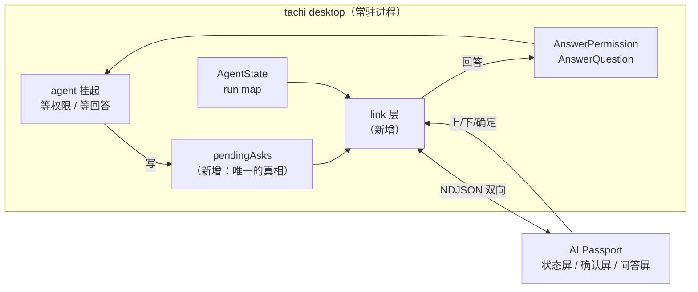

# Agent Badge：把 Tachi 的对话框搬到一块 240×320 的小屏上

> 版本: 0.5（设备侧落地） | 日期: 2026-09-28 | 状态: P0–P3 已落地，真机闭环已验证；BLE（P4）未开始
> 关联: [desktop/permission.go](../desktop/permission.go)、[desktop/askuser.go](../desktop/askuser.go)、
>       [desktop/agent.go](../desktop/agent.go)、[desktop/link](../desktop/link/)、[desktop/asks.go](../desktop/asks.go)、
>       [agent/agent_permission.go](../agent/agent_permission.go)、[agent/hooks/events.go](../agent/hooks/events.go)
> 设备侧仓库: `FoloToy/ai-passport`（ESP32-C3，8 MB Flash，无 PSRAM）

## 本版修订（0.3 → 0.4：BLE 岔路口探明）

§3.3 留下的三个候选，实测之后定了第一个：**desktop 自己用 Go 做 BLE central**
（`tinygo.org/x/bluetooth`），不引入 Python/`bleak` 中转进程，也不绕道 Wi-Fi。

探到四件事，都是真跑出来的（一个 30 行的探针：`Enable()` + `Scan()`）：

1. **编译只要 CommandLineTools**。darwin 后端是 cgo + CoreBluetooth（`tinygo-org/cbgo`），
   本机只有 `/Library/Developer/CommandLineTools`、没有完整 Xcode，照样编出了可执行文件。
   官方 README 说的「需要 Xcode」比实际严格。
2. **扫描真的能用**：扫到 19 个 BLE 设备。控制台角色正是我们需要的那个方向
   （README：macOS 目前只支持 Central）。
3. **缺 `NSBluetoothAlwaysUsageDescription` 会直接 SIGABRT**，不是返回错误。macOS 上访问
   隐私数据而 Info.plist 没声明时，进程是被 abort 掉的——所以 desktop 的 Info.plist
   （`desktop/build/darwin/Info.plist`）必须加这个键，否则一碰 BLE 就闪退，而且从外面看
   只是「app 没了」。
4. **授权归因给 responsible process，并且绑定 bundle identity**：这跟屏幕录制是同一个机制
   （`docs/agents/desktop.md` 的签名一节），所以「重建后要重新授权」在这里同样成立，
   ad-hoc 签名会让已授的蓝牙权限对不上。第一次使用会弹窗，且**由 responsible process 承担**
   ——从终端里跑 desktop，弹窗问的是终端；从 Finder 启动，问的才是 Tachi。

**没验证**：GATT 连接与特征读写（手上没有已知的 peripheral 可连——旁边那块板此刻跑的固件
不确定在广播什么），以及**在 Wails 进程内**跑 BLE（CoreBluetooth 的 dispatch queue 与 Wails
的主线程/run loop 的关系）。P4 开工的第一步应该是这两个，而不是直接写产品代码。

一个必须记住的 API 事实：库自己写着 **"The API is not stable!"**，所以版本要 pin 住
（探针用的是 v0.16.0），升级前先看它动了什么。

设计上因此定下来的两件事：

- link 层多一个 BLE transport，实现同一个 `link.Transport`（字节流）。GATT 是「特征读写」
  而不是流，所以适配层要做分包与组包——而 `Server.readLoop` 本来就是累积 buffer 再按行切，
  两边对得上，协议本身一行不用改。
- **安全必须在应用层再加一道**：BLE 的配对可以是不做认证的 Just Works，而这条链路上的一个
  回答就是在批准一条要执行的命令。所以协议里要带共享密钥（或首次配对时交换一个），
  不能只靠链路层的配对。

## 本版修订（0.2 → 0.3：开关进配置）

链路的目标从「只有环境变量」变成 **config 的 `badge` 块 + 环境变量覆盖**：

- `badge.transport`（`off` / `serial` / `tcp`，默认 off）与 `badge.address` 是持久设置，在设置页里能看见、
  能改——改完立刻生效（`applyPush`：停掉旧 listener 再按新配置起一条，旧连接断开，设备表现为重连）。
- `TACHI_BADGE` **覆盖**它，不是回退。环境变量是调试通道（临时把 app 指到一台假设备上），
  它不该被文件里的持久设置挡住。

所以链路有了一个「不是 config」的旁路，和一个「不是环境变量」的正门，两者都汇进同一个 `startBadge`
——它做的第一件事是撤掉上一条，因为一个进程里两条链路就是两个 Server 抢同一个串口。

## 本版修订（0.1 → 0.2：P0 实现回填）

P0——tachi 侧的 link 层加一台假设备——已经落地。实现过程里有三处偏离设计：

1. **多了一条 TCP 传输**（设计里只规划了串口）。它本来是给假设备留的开发通道，结果成了 P0
   唯一真跑起来的东西：脚本冒充设备连上来，串口那条留给固件就绪之后。传输层因此是 `Listener`
   一个接口两个实现（`link/tcp.go`、`link/serial.go`），协议对两者完全无感知。
2. **开关是环境变量 `TACHI_BADGE`**（0.3 起它同时是 config 的 `badge` 块，环境变量覆盖，见上一节）。
   取值 `serial[:port]` / `tcp:addr`，**不设置即关闭**——串口是共享资源，默认抢占它会让
   `idf.py monitor` 之类的工具莫名连不上设备。
3. **`ref` 在 sync 时保持稳定**（设计里没写死，是测试逼出来的）：重同步必须把每一条重发一遍，
   但设备上已经画出来的项要**原地更新**。重新分配 ref 等于让它换个身份重新排队，而旧的那条
   在 ref 表里再也等不到自己的 `ask_gone`。

另外两件是写代码时才看清的事：

- **一张表承载两类等待，是因为唤醒方式本来就不同**：权限的那条挂在自己新建的 channel 上，等待方
  用 `defer` 收拾；AskUser 的那条挂在 agent 自己的 `Channels.AskUserResp` 上，这一侧没有 defer 可
  搭——所以后者的清理只能由 `endTurn` 按类型兜底，否则一个被 Stop 的 turn 会在设备上留下一个
  谁也答不了的问题。
- **`Snapshot` 只发非空闲的会话**：设备要回答的是「谁在等我」，一个桌面上躺着的几十个空闲会话
  只是噪声，而每次去抖比较都要把它们序列化一遍。

验证过的东西：`desktop/link` 的单测（全量推送、回答送达、过期 ref 被拒、`ask_gone`、控制台噪声
被忽略、协议版本不符、sync 重发且 ref 稳定）、desktop 侧的单测（快照翻译、回答分发、订阅通知）、
以及真实链路（TCP 假设备连上来跑通；串口按 USB VID 自动发现并打开 `/dev/cu.usbmodem2101`）。

**没验证过**：一次真实 turn 里的端到端表现（需要一个真花钱的会话），以及设备上的固件。
P1 及以后未开始。

---
## 1. 要做什么

让 **AI Passport**（一块 60×95 mm 的可穿戴小屏，三枚按键：上 / 下 / 确定）成为 tachi desktop 的
**远程交互前端**：

1. **状态**：屏幕上显示当前会话在干什么（空闲 / 思考 / 执行工具 / 等你确认），带会话名。
2. **权限确认**：命中 `ask` 规则的 Bash 命令推到设备，三键回答「允许一次 / 本会话允许 / 拒绝」。
3. **AskUserQuestion**：模型提的问题和选项推到设备，上下键滚动、确定键提交（含多选）。
4. **提示音**：出现待答项时响一声。这是「人不在工位」这个场景的全部意义——屏幕你未必在看。

### 明确不做（本阶段）

- **不做设备端自由文本输入**。三键打不了字，模型提的「无选项填空题」在设备上显示
  「需要到电脑上回答」。这是取舍，不是疏忽。
- 不做多设备、手机端、远程（跨网络）访问。
- 不挂载 `tui` / `acp` / `channel` / `-p`，只做 desktop。理由见 §3.2。

## 2. 现状：什么白送，什么要挖

### 2.1 已经有的（代码里确认过）

| 能力 | 位置 |
| --- | --- |
| 事件出方向：`turn_start` / `stream_start` / `tool_call` / `tool_result` / `turn_complete` / `permission_request` / `permission_result` / `ask_user_question` / `ask_user_response` / `error` | `agent/hooks/events.go`，`Dispatcher.Dispatch` |
| 会话状态 `AgentState{SessionID, Status, Label, Detail}`，状态机已有 `idle/thinking/tool_running/busy/error` | `desktop/agent.go` |
| 权限挂起：`PermissionModeExternal` + `PermissionHandler` | `agent/agent_permission.go` |
| 权限回答：`AgentService.AnswerPermission(sessionID, toolID, decision)` | `desktop/permission.go` |
| AskUser 挂起：`Channels.AskUserResp`；回答入口 `AIAgent.RespondToAskUser(answers, annotations)` | `agent/agent.go` |
| AskUser 回答（desktop）：`AgentService.AnswerQuestion` | `desktop/askuser.go` |

### 2.2 缺口（工作量全在这里）

1. **没有入方向**。当前没有任何机制能让进程外的程序把答案送进一个正在跑的 tachi。
   前端（TUI / desktop 前端 / ACP client）各自通过进程内调用回答，这是唯一的路。
2. **待答的东西没有被记下来**。`desktop/pendingPermission` 只有一个 `answer chan`——它的注释
   写得很直白：`the row exists for the wait, nothing else needs to be read back out of it`。
   连「等的是什么命令」都没存。AskUser 更彻底：后端没有记录，只有一条发给前端的事件。
3. **没有序号**，设备无从判断「我看到的这坨东西是不是新的」。

## 3. 架构



### 3.1 为什么不写一个独立的 bridge 进程

那样等于在 tachi 外面重新发明一本「现在谁在等什么」的账：它得从 hook 事件里拼状态，还得想办法把
答案塞回一个它控制不了的进程——而这件事现在根本没有通道（缺口 1）。反过来，如果让**扛着 agent 的
进程自己开这个口**，`AnswerPermission` / `AnswerQuestion` 是两个现成的函数调用，缺的只是一张
「在等什么」的表（缺口 2），而那张表本来也该由挂起方持有。

### 3.2 为什么挂 desktop

它是五个入口里唯一一个「有真人在，但人可能不在看屏幕」的前端——正好是设备的用武之地。而且
`AgentState`、两张 pending 表、两个回答入口全都在它手里，改动集中在一个新包里。

`tui` 的用户人就坐在键盘前，设备是多余的；`acp` / `channel` / `-p` 没有「看得见的人」这个前提。
真要扩展到那些入口，正确做法是把 pending 表下沉到 `agent` 层（谁挂起谁登记），本项目不做。

### 3.3 传输层

协议与传输解耦：一个 `Link` 接口，两个实现。

- **Phase 1 走串口**（USB-Serial-JTAG）。现在设备就插在电脑上，不需要配网、不需要共享密钥、
  不用算电池。代价是拖着线。
- **BLE 留给后续**，方案已定（见 0.4 修订）：设备做 GATT peripheral（`demo_ble.c` 已是广播方，
  仓库也有双机 NimBLE 实战经验），desktop 直接用 `tinygo-org/bluetooth` 做 central。另外两个
  候选（Python + `bleak` 中转、BLE 只做唤醒而数据走 Wi-Fi）都不必了。

## 4. 协议

行分隔 JSON（NDJSON）。**每行以 `@@` 前缀标记**，因为这块板子的控制台日志和设备协议共用同一条
USB-Serial-JTAG：不标记的话日志字节会混进解析器，而设备侧在二进制/协议窗口内静默日志这件事，
归档里已经有人踩过（`docs/reference/y2lin/serial-screenshot-protocol`）。前缀之外的行一律当日志丢弃。

主机 → 设备：

```json
{"t":"state","seq":42,"sessions":[{"id":"ab12","title":"修 lint","status":"tool_running",
  "label":"执行","detail":"调用 Bash"}]}
{"t":"ask","seq":43,"kind":"permission","session":"ab12","toolId":"call_1",
  "body":"rm -rf build/","hint":"匹配规则 ask:rm-*",
  "options":[{"label":"允许一次","value":"allow_once"},
             {"label":"本会话全部允许","value":"allow_session"},
             {"label":"拒绝","value":"deny"}]}
{"t":"ask","seq":44,"kind":"ask_user","session":"ab12","toolId":"call_2",
  "questions":[{"header":"方向","question":"……","multiSelect":false,
                "options":[{"label":"A","description":"……"}]}]}
{"t":"ask_gone","seq":45,"ref":43}
```

设备 → 主机：

```json
{"t":"hello","proto":1,"fw":"0.1.0"}
{"t":"answer","ref":43,"decision":"allow_once"}
{"t":"answer","ref":44,"answers":{"<问题全文>":"A"},"annotations":{}}
{"t":"sync","since":41}
```

约定：

- `seq` 单调递增，覆盖 state 与 ask 两类。设备断线重连后发 `sync`，主机把 `since` 之后的补上；
  补不齐（进程重启过）就由主机回一个全量 `state` + 当前 pending。
- `ask` 的 `ref` 就是 `seq`。回答必须带回 `ref`，主机据此校验「你答的是不是当前这条」——
  和 `AgentService.AnswerPermission` 现在拒绝过期卡片是同一个理由。
- `answers` 的 key 是**问题全文**、value 是选中项标签，与 TUI/desktop 现有约定一致
  （见 `desktop/askuser.go` 注释），模型看到的是同一个形状。
- **电脑上先答掉的情况**：desktop 回答后必须推 `ask_gone`，否则设备还举着一条已经作废的问题。
  反向也一样，设备答完由主机推新的 `state`。

## 5. tachi 侧改动清单

1. **`desktop/asks.go`（新）**——`pendingAsks` 表：`kind`（permission / ask_user）、`sessionID`、
   `toolID`、渲染所需内容（权限的 `preview`、AskUser 的 `[]tools.Question`）、`seq`。
   - 写入点：`askPermission`（已有挂起处）、AskUser 事件发出处。
   - 清除点：`AnswerPermission` / `AnswerQuestion` 成功、ctx 取消（`Stop`）。
   - 键沿用 `desktop/permission.go` 的 `permKey(sessionID, toolID)`（工具调用 id 是模型生成的，
     单用它会串会话）。
2. **`desktop/permission.go`（改）**——`pendingPermission` 补上展示字段，或直接并入 `pendingAsks`
   （倾向后者：一张表比两张好，设备要的正是「跨两类待答项的统一视图」）。
3. **`desktop/link/link.go`（新）**——`Link` 接口 + 主机侧会话循环：把 `pendingAsks` 与 `AgentState`
   的每次变化编成行推出去，收回答时转发到两个现成入口。
4. **`desktop/link/serial.go`（新）**——串口实现（`go.bug.st/serial`，desktop 是独立 module，
   依赖加在 `desktop/go.mod`）。
5. **`desktop/main.go`（改）**——启动时按配置打开 link；失败（端口被 `idf.py monitor` 之类占用）
   只在界面提示，不能让 desktop 起不来。

副作用提醒：desktop 独占串口后，`idf.py monitor` 就不能同时开了。开发设备固件时要么关掉 desktop
的 link，要么给设备侧加「日志只在没有主机连接时输出」。

## 6. 设备侧改动清单（`FoloToy/ai-passport`）

- **新应用，UI 必须重新设计**（仓库硬性规范：不得沿用 demo 菜单/页面外壳），复用 BSP。
- 三块屏：状态屏、确认屏、问答屏。上下键移动，确定键选择/提交，长按返回。
- **串口管线照着归档抄**：显式安装 USB-Serial-JTAG 驱动（不装会反复崩溃重启，表面症状是「屏幕
  一直在闪」）、读任务禁止忙等（否则饿死空闲任务触发看门狗）、按子串而非换行匹配、写入按 512 字节
  分块（`usb_serial_jtag_write_bytes` 落在环形缓冲上，整块提交必然失败）。
- **中文字库**：这是本方案最硬的一处。AskUser 的题面与选项是**模型当场生成**的，没法像视觉小说
  那样预先做字形子集；而默认 Montserrat 不含中文字形（UTF-8 正确、编译通过都不代表能显示）。
  方案：塞一个覆盖 GB2312 一级字库（3755 常用字）的 **16px 点阵**字体，约 300 KB。8 MB Flash 放得下，
  但必须开工前就定，否则做完发现中文全是空白。
- 提示音走 ES8311；空闲息屏 + 唤醒。

## 7. 分阶段

| 阶段 | 内容 | 能否独立验证 |
| --- | --- | --- |
| P0 | tachi 侧 link 层 + 串口；**用脚本冒充设备**跑通协议 | 能，且完全不碰设备、不用烧录 |
| P1 | 设备侧串口 + 状态屏 | 能，插上就跑 |
| P2 | 确认屏（权限三键） | 能 |
| P3 | 问答屏 + 中文字库 + 提示音 | 能 |
| P4 | BLE（传输层换实现，协议不动） | 能 |

P0 是关键设计选择：先在一台假设备上把协议和 tachi 侧逻辑验证完，设备侧固件只在协议稳定后才动手。
这样 tachi 侧的改动可以在不碰 ESP-IDF、不烧录的前提下审查。

## 8. 风险与未决

1. ~~**BLE 在 macOS + Go 上怎么做**（§3.3 三选一）~~——已定（0.4 修订）：Go 直达，实测能编、能扫。
   剩下的未知是 GATT 读写，以及 Wails 进程内的集成。
2. **安全边界**：串口是物理连接，天然可信。一旦走 BLE 或 Wi-Fi，谁能回答「允许执行这条 Bash」
   就必须有配对/密钥约束，否则同一空间的任何人都能批准你的命令。
3. **功耗**：520 mAh + 无线常连撑不住整天。佩戴场景需要「主机侧才是长连方」或低频策略，
   P4 一起解决。串口阶段不涉及。
4. **多会话**：桌面上同时跑多个会话时设备显示哪个？倾向「有待答项者优先，否则最近活跃者」，
   需要确认。
5. **`tui` / `acp` 是否也要挂**：本设计把 pending 表放在 desktop，那些入口要用就得下沉到 `agent`
   层，是一次可观的改动，暂不做。

## 本版修订（0.4 → 0.5：设备侧落地）

设备侧的固件写完了，在真机上跑通了完整闭环（发 ask → 屏幕显示中文选项 → 按键 → 主机收到
正确答案）。过程中踩到的坑里，有四个是**只有真机才会暴露**的，记在这里因为它们都会重现：

1. **连接后的第一条消息会被吞**（如果只标记「连上了」就 return）。重连后的第一条可能正是
   一条 ask，于是屏幕停在「等电脑」，而主机看起来一切正常——它确实发出去了。
2. **`now - s_last_message_ms` 的 uint32 下溢**：`now` 在循环开头取，而消息处理刚把时间戳
   更新到「更晚」，相减得到负数、下溢成 40 亿，于是每收到一条消息的同一轮就判成超时，
   连接状态永远是断的。
3. **`lv_font_conv` 默认给位图做 RLE 压缩**并写 `bitmap_format = 1`，而那个格式是 LVGL 8
   时代的，LVGL 9.5 解不出来。症状极具欺骗性：**字形查得到、边界框尺寸也对，但一个像素都
   不画**；而换成 LVGL 内置字体又完全正常。要加 `--no-compress` 才是 PLAIN 位图。
4. **`sdkconfig.defaults` 只在生成配置时生效**：改完不删掉已有的 `sdkconfig`，开关不会
   应用（表现是「我明明开了却没用」）。

另外一个跨端的约定值得点名：**`@@` 前缀不是洁癖**。设备启动时，IDF 的启动日志和协议行
真的会交错在同一条 USB 流上——截图里就是 `I (156) esp_image: segment 4: ...@@{"t":"hello"}`，
前缀是唯一能把两者分开的东西。

设备侧的详细说明（三块屏、按键、字体生成、构建命令）在 ai-passport 那个仓库的根 README。

## 附录 A：BLE 探针（0.4 修订的实证，P4 开工时的起点）

一个独立的小 module，`go.mod` 里 `require tinygo.org/x/bluetooth`（pin 住版本；0.4 探针用的是
v0.16.0）。**必须包成 .app 并 `open` 启动**，两个理由都在 0.4 修订里：直接从终端跑会让归属落在
responsible process 上（于是 TCC 去查终端的 Info.plist），而缺了 `NSBluetoothAlwaysUsageDescription`
是 SIGABRT 而不是一个错误返回。

```go
package main

import (
	"fmt"
	"os"
	"time"

	"tinygo.org/x/bluetooth"
)

var adapter = bluetooth.DefaultAdapter

func main() {
	// open 启动的程序看不到 stdout，写文件。
	out, _ := os.Create("/tmp/bleprobe.out")
	defer out.Close()
	logf := func(f string, a ...any) { fmt.Fprintf(out, f+"\n", a...); out.Sync() }

	if err := adapter.Enable(); err != nil {
		logf("enable failed: %v", err)
		return
	}
	logf("adapter enabled, scanning 8s…")

	seen := map[string]bool{}
	done := make(chan struct{})
	go func() {
		err := adapter.Scan(func(a *bluetooth.Adapter, r bluetooth.ScanResult) {
			if seen[r.Address.String()] {
				return
			}
			seen[r.Address.String()] = true
			logf("  %s  rssi=%d  name=%q", r.Address.String(), r.RSSI, r.LocalName())
		})
		if err != nil {
			logf("scan failed: %v", err)
		}
		close(done)
	}()
	select {
	case <-done:
	case <-time.After(8 * time.Second):
	}
	logf("done, %d device(s)", len(seen))
}
```

```sh
mkdir -p Probe.app/Contents/MacOS
go build -o Probe.app/Contents/MacOS/Probe .
cat > Probe.app/Contents/Info.plist <<'PLIST'
<?xml version="1.0" encoding="UTF-8"?>
<!DOCTYPE plist PUBLIC "-//Apple//DTD PLIST 1.0//EN" "http://www.apple.com/DTDs/PropertyList-1.0.dtd">
<plist version="1.0"><dict>
  <key>CFBundleExecutable</key><string>Probe</string>
  <key>CFBundleIdentifier</key><string>local.badge.probe</string>
  <key>NSBluetoothAlwaysUsageDescription</key><string>Scan for the badge.</string>
</dict></plist>
PLIST
codesign --force --deep --sign - Probe.app
open -a Probe.app          # 会弹一次蓝牙授权，问的是这个 probe
```

P4 要往前走时，把同一个骨架搬进 desktop（`NSBluetoothAlwaysUsageDescription` 加进
`desktop/build/darwin/Info.plist`），先只验证「Wails 进程里 Enable + Scan 能跑」，
再谈 GATT 连接与读写。
