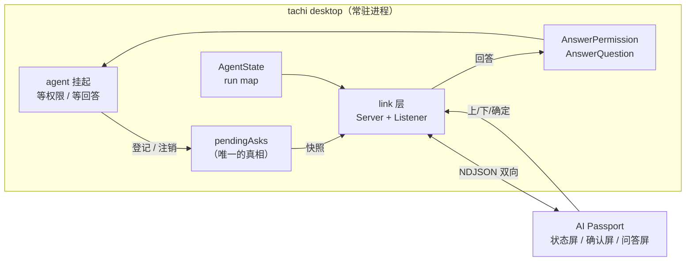

# Agent Badge：把 Tachi 的对话框搬到一块 240×320 的小屏上

> 状态: P0–P2 与问答屏、空闲息屏已落地，真机闭环已验证（发 ask → 屏上中文 → 按键 → 主机收到正确答案）。
>       **未实现**：提示音、BLE（P4）。逐条见 §8。
> 关联: [desktop/link](../desktop/link/)、[desktop/badge.go](../desktop/badge.go)、
>       [desktop/asks.go](../desktop/asks.go)、[desktop/ask_answered.go](../desktop/ask_answered.go)、
>       [desktop/permission.go](../desktop/permission.go)、[desktop/askuser.go](../desktop/askuser.go)、
>       [desktop/settings.go](../desktop/settings.go)、[config/config.go](../config/config.go)、
>       [agent/agent_permission.go](../agent/agent_permission.go)、[agent/hooks/events.go](../agent/hooks/events.go)
> 设备侧仓库: `FoloToy/ai-passport`（ESP32-C3，8 MB Flash，无 PSRAM）；固件细节见那个仓库的根 README

## 1. 要做什么

让 **AI Passport**（一块 60×95 mm 的可穿戴小屏，三枚按键：上 / 下 / 确定）成为 tachi desktop 的
**远程交互前端**：

1. **状态**：屏幕上显示当前会话在干什么（空闲 / 思考 / 执行工具 / 等你确认），带会话名。
2. **权限确认**：命中 `ask` 规则的 Bash 命令推到设备，三键回答「允许一次 / 本会话允许 / 拒绝」。
3. **AskUserQuestion**：模型提的问题和选项推到设备，上下键滚动、确定键提交（含多选）。
4. **提示音**：出现待答项时响一声。这是「人不在工位」这个场景的全部意义——屏幕你未必在看。
   **未实现**（见 §8）。

### 明确不做

- **不做设备端自由文本输入**。三键打不了字，模型提的「无选项填空题」在设备上显示
  「需要在电脑上回答」。这是取舍，不是疏忽。
- 不做多设备、手机端、远程（跨网络）访问。
- 不挂载 `tui` / `acp` / `channel` / `-p`，只做 desktop。理由见 §3.2。

## 2. 可以复用的东西

| 能力 | 位置 |
| --- | --- |
| 事件出方向：`turn_start` / `stream_start` / `tool_call` / `tool_result` / `turn_complete` / `permission_request` / `permission_result` / `ask_user_question` / `ask_user_response` / `error` | `agent/hooks/events.go`，`Dispatcher.Dispatch` |
| 会话状态 `AgentState{SessionID, Status, Label, Detail}`，状态机已有 `idle/thinking/tool_running/busy/error` | `desktop/agent.go` |
| 权限挂起：`PermissionModeExternal` + `PermissionHandler` | `agent/agent_permission.go` |
| 权限回答：`AgentService.AnswerPermission(sessionID, toolID, decision)` | `desktop/permission.go` |
| AskUser 挂起：`Channels.AskUserResp`；回答入口 `AIAgent.RespondToAskUser(answers, annotations)` | `agent/agent.go` |
| AskUser 回答（desktop）：`AgentService.AnswerQuestion` | `desktop/askuser.go` |

## 3. 架构



### 3.1 为什么不开一个独立的 bridge 进程

那样等于在 tachi 外面重新发明一本「现在谁在等什么」的账：它得从 hook 事件里拼状态，还得把答案塞回
一个它控制不了的进程。而让**扛着 agent 的进程自己开这个口**，`AnswerPermission` / `AnswerQuestion`
是两个现成的函数调用，缺的只是一张「在等什么」的表——而那张表本来就该由挂起方持有。

### 3.2 为什么只挂 desktop

它是五个入口里唯一一个「有真人在，但人可能不在看屏幕」的前端——正好是设备的用武之地。而且
`AgentState`、待答表、两个回答入口全都在它手里，改动集中在一个新包里。

`tui` 的用户人就坐在键盘前，设备是多余的；`acp` / `channel` / `-p` 没有「看得见的人」这个前提。
真要扩展到那些入口，正确做法是把待答表下沉到 `agent` 层（谁挂起谁登记），本项目不做。

### 3.3 传输层

协议与传输解耦：一个 `link.Listener` 接口，三个实现，协议对传输完全无感知。

- **`serial`（真机走这条）**：设备的 USB-Serial-JTAG。插上就有，不需要配网、不需要共享密钥、
  不用算电池。代价是拖着线。
- **`tcp`（开发用）**：tachi 监听一个地址，一个脚本冒充设备连上来。它是不动 ESP-IDF、不烧固件
  就能把协议跑通的那条路，也是设备将来走 Wi-Fi 时的形状。**默认绑回环**：这条链路上的一个回答
  就是在批准一条要执行的命令，代码不强制回环，所以地址不要写 `0.0.0.0`。
- **`off`（默认）**：不比串口更该默认打开。串口是共享资源，app 一启动就抢占它，会让
  `idf.py monitor` 之类莫名连不上设备。

`badge.transport` / `badge.address` 是持久设置，在设置页里能看见、能改，改完立刻生效
（`applyPush`：停掉旧 listener 再按新配置起一条，旧连接断开，设备表现为重连）。`TACHI_BADGE`
**覆盖**它而不是回退——环境变量是「临时把 app 指到一台假设备上」的调试通道，不该被文件里的
持久设置挡住。

**BLE 留给 P4**（方案见 §8 与附录 A）：设备做 GATT peripheral（`demo_ble.c` 已是广播方），
desktop 直接用 `tinygo.org/x/bluetooth` 做 central。

## 4. 协议

行分隔 JSON（NDJSON），**每行以 `@@` 前缀标记**。这不是洁癖：这块板子的控制台日志和设备协议共用
同一条 USB-Serial-JTAG，不标记的话日志字节会混进解析器——设备启动时真的会交错成
`I (156) esp_image: segment 4: ...@@{"t":"hello"}`。两侧都只认行首带前缀的行，其余当日志读掉并丢弃
（必须读掉：不读，缓冲区迟早堵死在这条链路上）。

主机 → 设备：

```json
{"t":"state","seq":42,"sessions":[{"id":"ab12","title":"修 lint","status":"tool_running",
  "label":"执行","detail":"调用 Bash"}]}
{"t":"ask","seq":43,"ref":43,"kind":"permission","session":"ab12","toolId":"call_1",
  "title":"Bash 确认","body":"$ rm -rf build/\n\n命中 ask 规则: \"rm-*\"",
  "options":[{"label":"允许一次","value":"allow_once"},
             {"label":"本会话允许","value":"allow_session"},
             {"label":"拒绝","value":"deny"}]}
{"t":"ask","seq":44,"ref":44,"kind":"ask_user","session":"ab12","toolId":"call_2","title":"方向",
  "questions":[{"header":"方向","question":"先用哪条路验证？","multi_select":false,
                "options":[{"label":"先做设备","description":"需要板子"}]}]}
{"t":"ask_gone","seq":45,"ref":43}
{"t":"reset","seq":46}
{"t":"error","seq":47,"ref":43,"message":"……"}
```

设备 → 主机：

```json
{"t":"hello","proto":1,"fw":"0.1.0"}
{"t":"sync","since":0}
{"t":"answer","ref":43,"decision":"allow_once"}
{"t":"answer","ref":44,"answers":{"<问题全文>":"选项标签"},"annotations":{}}
```

约定：

- **`ref` 由主机分配，且就是那次分配的 `seq`**（`link.Server.nextSeq()`），主机拿它查出这条回答
  属于谁——和 `AgentService.AnswerPermission` 拒绝过期卡片是同一个判断：一条过期的回答必须被拒，
  而不是批准了此刻正等着的另一件事。
- **每条连接都是一个全新的 ref 空间**（`Server` 是每条连接一个，`nextSeq` 从 0 开始），所以设备
  连上来时主机**先发 `reset`**、再发下面那份全量：设备收到 `reset` 就把手里的等待项全部丢掉。
  不清的话，同一条等待会以新 ref 再入队一次——屏幕上两条，而旧的那条按下去没有任何反应（它在
  主机的 ref 表里已经不存在了）。这条也让「设备漏了某条 `ask_gone`」这类漂移在每次重连时自愈。
- **同一条待答项内容变了就用同一个 `ref` 重发**（模型的提问在流式阶段可能被改写）：设备上那一项
  原地更新，游标不跳。重新分配 ref 等于让它换个身份重新排队，而旧的那条在 ref 表里再也等不到
  自己的 `ask_gone`。
- `answers` 的 key 是**问题全文**、value 是选中项标签（多选按 `, ` 拼），与 TUI/desktop 现有约定
  一致，模型看到的是同一个形状。题面被截断的题设备直接不上屏：键错了模型会收到一个它不认识的答案。
- `decision` 的三个机器值 `allow_once` / `allow_session` / `deny` 是两侧共同的常量
  （`desktop/link`、`main/badge_proto.h`）。设备不知道它们是什么意思，只负责送回来。
- **`label` 是协议级常量，不只是文案**：设备用它挑颜色（`提问`=琥珀、`执行`=绿、`空闲`=灰），
  所以 `desktop/agent.go` 里那几个中文字符串改动会同时改变设备上的观感。
- **去抖**：`Snapshot` 的每一次变化都编成行发出去，但先与上次发送的内容逐字节比较；「思考中」的
  每个 delta 都会推一次状态而内容常常一个字没变。`Snapshot` 因此被要求返回**内容和顺序都稳定**
  的结果（会话按 id 排、显示中的会话排最前）。
- **只发非空闲会话**：设备要回答的是「谁在等我」，桌面上躺着的几十个空闲会话只是噪声，而每次去抖
  比较都要把它们序列化一遍。
- **电脑上先答掉**：desktop 回答后必须推 `ask_gone`，否则设备还举着一条已经作废的问题。反向也一样，
  设备答完由主机推新的 `state`（因为重新同步时那条 ask 已经不在快照里）。
- 主机看不懂的协议行忽略掉、不断连接；回答送不出去（过期 ref）**静默丢弃**；`Answer` 返回错误时
  回一条 `error`——设备上按下的那一下不能没有回音。
- `hello` 的 `proto` 不匹配则断开，而不是猜。**新增一种消息类型不必动 `proto`**：不认识的设备会
  忽略它（旧固件只是在日志里多一行 `unparsed line`），这样固件与主机可以各自升级。

### 4.1 两侧的上限

设备是这块屏的瓶颈，它的上限写在 `main/badge_proto.h`：

| 项 | 主机 | 设备上限 |
| --- | --- | --- |
| 一行消息 | 256 KB（超出丢整行） | 4096 B（超出丢整行） |
| 会话 | 不设限 | 4 |
| 一个问题 | 1–4 题（工具 schema） | 3 题 |
| 一个问题的选项 | 不设限 | 5 项 |
| 题面 / 会话标题 | — | 64 B |
| 状态副标题 / 报错文本 | — | 96 B |
| 权限预览 `body` | — | 256 B |

设备侧是**静默截断**（超出的会话、第 4 题、第 6 个选项都不会上屏，也不报错），主机侧不做校验。
见 §9。

### 4.2 建了但没用起来的字段

- **`sync.since`**：设备恒定发 `0`（它不维护 seq），主机收到 `sync` 直接全量重推、**根本不读 `since`**。
  所以设计里的「补 since 之后的、补不齐才全量」实际退化成「永远全量」。字段留着是为了协议形状完整。
- **`ask.hint`**：link 层会在非空时发出去，但 desktop 从不给它赋值，设备也不解析它。真实信息在
  `body` 里——`bashAskPreview` 生成的 `$ <命令>` 加一行 `命中 ask 规则: "<rule>"` 原样透传，
  不在设备上二次解析（那份格式的第二个解析器早晚会和写它的那个漂移）。

## 5. tachi 侧实现

| 文件 | 职责 |
| --- | --- |
| `desktop/asks.go` | `pendingAsk` 表：`kind`（permission / ask_user）、`sessionID`、`toolID`、渲染所需的 `preview` 或 `questions`、权限等待的唤醒 `answer` channel。键是 `session + tool call id`——工具调用 id 由模型生成，两个会话完全可能生成同一个 |
| `desktop/badge.go` | 实现 `link.Source`：`Snapshot()` 把 run map 与待答表翻成协议结构，`Answer()` 分发到两个现成入口；按配置开关链路 |
| `desktop/link/link.go` | `Listener` / `Transport` 接口、`Server` 会话循环、去抖、ref 分配、`hello`/`sync`/`answer` 处理 |
| `desktop/link/serial.go` | 串口实现；端口为空时按 Espressif USB VID 每次 Accept 重新查找（端口名随插拔漂移） |
| `desktop/link/tcp.go` | 监听式实现（开发用，见 §3.3） |
| `desktop/ask_answered.go` | 把「这次回答来自设备」广播给前端（`agent:ask_answered`） |
| `desktop/settings.go`、`config/config.go` | `badge.transport` / `badge.address` 设置项与持久配置 |
| `scripts/badge_sim.py` | 冒充设备的假设备：把收到的东西画成那块屏的窄幅样子，把按键当数字收 |

一张表管两类等待，是因为**唤醒方式本来就不同**：权限的那条挂在自己新建的 channel 上，等待方用
`defer` 收拾；AskUser 的那条挂在 agent 自己的 `Channels.AskUserResp` 上，这一侧没有 defer 可搭——
所以后者的清理只能由 `endTurn` 按类型兜底，否则一个被 Stop 的 turn 会在设备上留下一个谁也答不了
的问题。

**一条回答在设备上产生时，前端也得知道**：前端自己回答时卡片是它自己清的，但设备走的是后端那条路
直接调回答函数，窗口这边毫不知情——卡片会一直挂着，而且还能再点。所以回答成功后端广播一次
`agent:ask_answered`，前端按 `kind` 撤掉对应那张。任何两个前端共享的状态都要这样处理。

**链路起不来不该让 desktop 起不来**：配置拼错、地址为空、端口被占，都只记一行日志并返回。
（**界面提示未做**，见 §8。）

## 6. 设备侧实现（`FoloToy/ai-passport`）

- **新应用，UI 自己重画**（仓库硬性规范：不得沿用 demo 菜单/页面外壳），复用 BSP。三块屏：
  状态屏（头像 + 会话名 + 状态 + 副标题 + 电量）、确认屏（命令预览 + 三个选项）、问答屏
  （题面 + 选项列表 + `第 n/m 题`）。
- **按键**：上/下短按在选项间移动；上/下长按换题（第一题上「上一题」、末题上「下一题」都不动）；
  确定短按在确认屏提交决定、在问答题上勾选（多选）或选中并前进（单选，末题即提交）；
  确定长按提交整组答案。多选没有「下一题」的话整条 ask 都答不完——`main/badge_state.c` 里
  `question_index += 1` 只存在于单选分支，所以换题必须由上下键的长按承担。
  （板子层对三个键都报了长按，是 app 层原来把它丢了。）
- **串口管线**：显式安装 USB-Serial-JTAG 驱动（不装会反复崩溃重启，表面症状是「屏幕一直在闪」）；
  读任务禁止忙等（否则饿死空闲任务触发看门狗）；写按 512 字节分块（`usb_serial_jtag_write_bytes`
  落在环形缓冲上，整块提交必然失败）；1 KB 收发缓冲、128 B 读块、4096 B 行上限。
- **中文字库**：AskUser 的题面与选项是**模型当场生成**的，没法预先做字形子集，缺一个字就是一个方框
  （LVGL 的缺字形占位框，`LV_USE_FONT_PLACEHOLDER` 默认开着）。做法是**从本机字体按 Unicode 区间
  生成**：ASCII + 拉丁补充（`·`）+ 通用标点（`…` `—`）+ CJK 标点 + 全部 CJK 统一表意文字
  （U+4E00–U+9FA5）+ 全角形式，16px / 4bpp 抗锯齿。字体**不入仓库**（每人用本机字体生成，且产物
  17 MB），生成脚本是 `tools/gen_badge_font.sh`，对外发布时把字体源指向 OFL 字体即可。
  实测占用：`glyph_bitmap` 2.4 MB + `glyph_dsc` 333 KB ≈ 2.7 MB，app 总计 3.47 MB / 8 MB。
- **空闲息屏是关背光，不是睡眠**。判据在 `main/badge_power.c`（纯逻辑，主机测试覆盖）：没有待答项
  且 60 秒无按键、无链路状态变化，就把背光降到 0。三条约束：
  - **有待答项时永不熄屏**，而且出现新的 ask 会立刻点亮——屏幕灭着藏一条「有人在等你」是本设备
    唯一不可接受的行为；
  - **只有按键和链路状态变化算活动**。主机的 `sync` 心跳每 10 秒换来一条 `state`，把「收到消息」
    当活动的话空闲计时永远归零，屏幕根本不会灭；
  - 灭屏时**第一次按键只负责点亮、不进状态机**（黑屏上你看不见光标在哪一项，而确定键一按就是
    一个决定）。
  不睡芯片的理由见下：睡下去就听不到主机递过来的 ask，而 USB-Serial-JTAG 在 IDF 5.5.3 里没有
  唤醒源（`esp_sleep_enable_usb_*` 不存在）。
- **开机自检字形**（`main/main.c`）：查 `'A'` 与 `中` 能不能解析出字形描述符——字体表「在 Flash 里
  但不认识这个字」从外面看和「屏幕坏了」一模一样。它只探测这两个字符，所以**接不住别的缺字**。
- **状态机的纯逻辑（`badge_state.c` / `badge_proto.c`）与 ESP-IDF/LVGL 无关**，由主机测试覆盖：
  这块板上最贵的两类 bug 是「按键按下去没反应」和「答回去的答案对不上题」，两者都能在主机上试出来。
- **未做**：提示音（走 ES8311），见 §8。

## 7. 真机上会被咬的地方

1. **重连后的第一条消息必须触发一次重绘**：它可能就是那条 ask，而如果处理函数只在「状态真的变了」
   时才返回 true，屏幕会停在「等电脑」上，主机那边看起来一切正常——它确实发出去了。
   `handle_line` 的返回值里带着 `|| !was_connected` 正是为了这个。
2. **比较时间戳前必须重新读一次时钟**：`now` 在循环开头取，而消息处理刚把 `s_last_message_ms`
   更新成「比它更晚」的时刻；直接相减得负数，uint32 下溢成 40 亿，于是每收到一条消息的同一轮就
   被判成超时，连接状态永远是断的。
3. **`lv_font_conv` 默认给位图做 RLE 压缩**并写 `bitmap_format = 1`，那是 LVGL 8 时代的格式，LVGL 9.5
   解不出来。症状极具欺骗性：**字形查得到、边界框尺寸也对，但一个像素都不画**，而换成内置字体又
   完全正常。要 `--no-compress` 才是 PLAIN 位图。
4. **`sdkconfig.defaults` 只在生成配置时生效**：改完不删掉已有的 `sdkconfig`，开关不会应用
   （表现是「我明明开了却没用」）。
5. **`@@` 前缀是唯一的分界**：IDF 的启动日志与协议行真的会交错在同一条 USB 流上（见 §4）。

## 8. 分阶段与未完成

| 阶段 | 内容 | 状态 |
| --- | --- | --- |
| P0 | tachi 侧 link 层 + 假设备（tcp / 脚本）跑通协议 | 已落地 |
| P1 | 设备侧串口 + 状态屏 | 已落地，真机验证 |
| P2 | 确认屏（权限三键） | 已落地，真机验证 |
| P3 | 问答屏 + 中文字库 | 已落地，真机验证 |
| P3' | **提示音**（出现待答项时响一声） | **未实现** |
| — | **空闲息屏**（只关背光；判据与约束见 §6） | 已落地 |
| P4 | BLE（传输层换实现，协议不动） | 未开始 |

P0 先做的理由仍然成立：协议和 tachi 侧逻辑在一台假设备上先验证完，设备侧固件只在协议稳定后才动手。

其它已知但未做的事：

- **`since` 增量补发**：见 §4.2，实际永远是全量。
- **`hint` 字段**：见 §4.2，两端都没用。
- **链路状态没有界面出口**：失败只写日志（§5)，设置页能改 transport/address 但看不到链路现在如何。

## 9. 风险与未决

1. **安全边界**：串口是物理连接，天然可信。一旦走 BLE 或 Wi-Fi，谁能回答「允许执行这条 Bash」就必须
   有配对/密钥约束——BLE 的配对可以是不做认证的 Just Works，而这条链路上的一个回答就是在批准一条
   要执行的命令，所以要在**应用层**再加一道（协议里带共享密钥），不能只靠链路层配对。P4 一起解决。
2. **BLE 在 macOS + Go 上的已知事实**（探针实测见附录 A）：编译只需要 CommandLineTools；
   缺 `NSBluetoothAlwaysUsageDescription` 是 **SIGABRT 而不是错误返回**；授权归因给 responsible
   process 并绑定 bundle identity（和屏幕录制同一个机制），所以「重建后要重新授权」在这里同样成立。
   **未知**：GATT 连接与特征读写（手上没有已知的 peripheral），以及**在 Wails 进程内**跑 BLE
   （CoreBluetooth 的 dispatch queue 与 Wails 主线程/run loop 的关系）。P4 的第一步应该是这两件事，
   而不是直接写产品代码。
3. **功耗**：520 mAh + 无线常连撑不住整天。佩戴场景需要「主机侧才是长连方」或低频策略，P4 一起解决。
   串口阶段不涉及。
4. **多会话显示哪个**：已定——**有待答项者优先，否则显示中的那个（`activeID`），再否则按 id 稳定排序**。
   设备的状态屏拿「第一个」当「现在这个」，所以顺序必须确定且稳定。
5. **重连之后的等待项**：`ref` 表与 `nextSeq` 都是内存的、每条连接重新分配，所以设备手里那些
   旧 ref 再也等不到答案。这条已经由 `reset` 处理（见 §4）：主机在每条连接开始时先清空设备的
   队列，再重发当前的等待项。**未实测**的部分只有一件——设备漏收 `reset` 之后的漂移（要真会话
   才能撞上），而它在下一次重连时自愈。
6. **设备侧上限是静默截断**（§4.1）：工具的 schema 允许 4 个问题，设备只上屏 3 个；选项超过 5 个时
   第 6 个选不到。两端都不报错，用户只会觉得「少了一题」。要么主机侧按设备上限收紧，要么在设备上
   明确提示截断。
7. **`tui` / `acp` 是否也要挂**：本设计把待答表放在 desktop，那些入口要用就得下沉到 `agent` 层，
   是一次可观的改动，暂不做。

## 附录 A：BLE 探针（P4 开工时的起点）

一个独立的小 module，`go.mod` 里 `require tinygo.org/x/bluetooth`（**pin 住版本**：库自己写着
"The API is not stable!"；探针用的是 v0.16.0）。

必须包成 .app 并 `open` 启动，理由就是 §9.2 那两条：直接从终端跑会让授权归属落在 terminal
（于是 TCC 去查终端的 Info.plist），而缺了 `NSBluetoothAlwaysUsageDescription` 是 SIGABRT。

```go
package main

import (
	"fmt"
	"os"
	"time"

	"tinygo.org/x/bluetooth"
)

var adapter = bluetooth.DefaultAdapter

func main() {
	// open 启动的程序看不到 stdout，写文件。
	out, _ := os.Create("/tmp/bleprobe.out")
	defer out.Close()
	logf := func(f string, a ...any) { fmt.Fprintf(out, f+"\n", a...); out.Sync() }

	if err := adapter.Enable(); err != nil {
		logf("enable failed: %v", err)
		return
	}
	logf("adapter enabled, scanning 8s…")

	seen := map[string]bool{}
	done := make(chan struct{})
	go func() {
		err := adapter.Scan(func(a *bluetooth.Adapter, r bluetooth.ScanResult) {
			if seen[r.Address.String()] {
				return
			}
			seen[r.Address.String()] = true
			logf("  %s  rssi=%d  name=%q", r.Address.String(), r.RSSI, r.LocalName())
		})
		if err != nil {
			logf("scan failed: %v", err)
		}
		close(done)
	}()
	select {
	case <-done:
	case <-time.After(8 * time.Second):
	}
	logf("done, %d device(s)", len(seen))
}
```

```sh
mkdir -p Probe.app/Contents/MacOS
go build -o Probe.app/Contents/MacOS/Probe .
cat > Probe.app/Contents/Info.plist <<'PLIST'
<?xml version="1.0" encoding="UTF-8"?>
<!DOCTYPE plist PUBLIC "-//Apple//DTD PLIST 1.0//EN" "http://www.apple.com/DTDs/PropertyList-1.0.dtd">
<plist version="1.0"><dict>
  <key>CFBundleExecutable</key><string>Probe</string>
  <key>CFBundleIdentifier</key><string>local.badge.probe</string>
  <key>NSBluetoothAlwaysUsageDescription</key><string>Scan for the badge.</string>
</dict></plist>
PLIST
codesign --force --deep --sign - Probe.app
open -a Probe.app          # 会弹一次蓝牙授权，问的是这个 probe
```

P4 要往前走时，把同一个骨架搬进 desktop（`NSBluetoothAlwaysUsageDescription` 加进
`desktop/build/darwin/Info.plist`），先只验证「Wails 进程里 Enable + Scan 能跑」，再谈 GATT 连接与读写。

GATT 是特征读写而不是字节流，所以适配层要做分包与组包——而 `Server.readLoop` 本来就是累积 buffer
再按行切，两边对得上，协议本身一行不用改。
