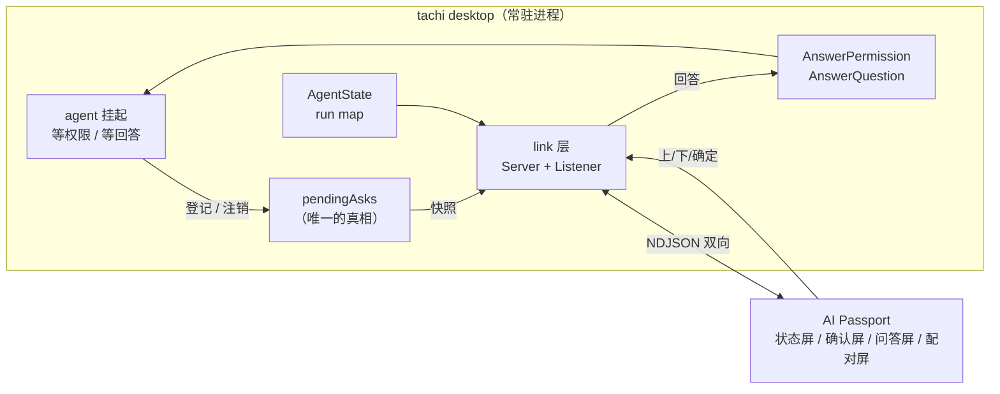

# Agent Badge：把 Tachi 的对话框搬到一块 240×320 的小屏上

> 状态: P0–P4 与提示音已落地，真机闭环已验证（发 ask → 屏上中文 → 按键 → 主机收到正确答案；BLE 链路上同样跑通）。
> 关联: [desktop/link](../desktop/link/)、[desktop/badge.go](../desktop/badge.go)、
>       [desktop/asks.go](../desktop/asks.go)、[desktop/ask_answered.go](../desktop/ask_answered.go)、
>       [desktop/permission.go](../desktop/permission.go)、[desktop/askuser.go](../desktop/askuser.go)、
>       [desktop/settings.go](../desktop/settings.go)、[config/config.go](../config/config.go)、
>       [agent/agent_permission.go](../agent/agent_permission.go)、[agent/hooks/events.go](../agent/hooks/events.go)
> 设备侧仓库: `FoloToy/ai-passport`（ESP32-C3，8 MB Flash，无 PSRAM）；固件细节见那个仓库的根 README

## 1. 要做什么

让 **AI Passport**（一块 60×95 mm 的可穿戴小屏，三枚按键：上 / 下 / 确定）成为 tachi desktop 的
**远程交互前端**：

1. **状态**：屏幕上显示当前会话在干什么（空闲 / 思考 / 执行工具 / 等你确认），带会话名。
2. **权限确认**：命中 `ask` 规则的 Bash 命令推到设备，三键回答「允许一次 / 本会话允许 / 拒绝」。
3. **AskUserQuestion**：模型提的问题和选项推到设备，上下键滚动、确定键提交（含多选）。
4. **提示音**：**出现待答项**时响一声，**一个回合跑完**时响另一声。这是「人不在工位」这个
   场景的全部意义——屏幕你未必在看，声音不用看。判据在**主机**侧（见 §5 的 `alertWanted`）：
   窗口不在前台、**或者**这件事不属于当前活跃会话。「你正看着那件事」就不出声——那样的一声
   只是噪音。判一次，在事件发生的那一刻：之后你走开了也不补响（补响要记住「已提醒过」并能在
   之后主动推一条信号，而那会把一件已经看过的事再说一遍）。**响的同时点亮屏幕**：听见了却
   看不见，用户还得再按一下才看得到状态，那一声就白响了。设置页有开关（`badge.alert`，默认开）。

### 明确不做

- **不做设备端自由文本输入**。三键打不了字，模型提的「无选项填空题」在设备上显示
  「需要在电脑上回答」。这是取舍，不是疏忽。
- 不做多设备、手机端、远程（跨网络）访问。
- 不挂载 `tui` / `acp` / `channel` / `-p`，只做 desktop。理由见 §3.2。

## 2. 可以复用的东西

| 能力 | 位置 |
| --- | --- |
| 事件出方向：`turn_start` / `stream_start` / `tool_call` / `tool_result` / `turn_complete` / `permission_request` / `permission_result` / `ask_user_question` / `ask_user_response` / `error` | `agent/hooks/events.go`，`Dispatcher.Dispatch` |
| 会话状态 `AgentState{SessionID, Status, Label, Detail}`，状态机已有 `idle/thinking/tool_running/busy/error` | `desktop/agent.go` |
| 权限挂起：`PermissionModeExternal` + `PermissionHandler` | `agent/agent_permission.go` |
| 权限回答：`AgentService.AnswerPermission(sessionID, toolID, decision)` | `desktop/permission.go` |
| AskUser 挂起：`Channels.AskUserResp`；回答入口 `AIAgent.RespondToAskUser(answers, annotations)` | `agent/agent.go` |
| AskUser 回答（desktop）：`AgentService.AnswerQuestion` | `desktop/askuser.go` |

## 3. 架构



### 3.1 为什么不开一个独立的 bridge 进程

那样等于在 tachi 外面重新发明一本「现在谁在等什么」的账：它得从 hook 事件里拼状态，还得把答案塞回
一个它控制不了的进程。而让**扛着 agent 的进程自己开这个口**，`AnswerPermission` / `AnswerQuestion`
是两个现成的函数调用，缺的只是一张「在等什么」的表——而那张表本来就该由挂起方持有。

### 3.2 为什么只挂 desktop

它是五个入口里唯一一个「有真人在，但人可能不在看屏幕」的前端——正好是设备的用武之地。而且
`AgentState`、待答表、两个回答入口全都在它手里，改动集中在一个新包里。

`tui` 的用户人就坐在键盘前，设备是多余的；`acp` / `channel` / `-p` 没有「看得见的人」这个前提。
真要扩展到那些入口，正确做法是把待答表下沉到 `agent` 层（谁挂起谁登记），本项目不做。

### 3.3 传输层

协议与传输解耦：一个 `link.Listener` 接口，三个实现（`serial` / `tcp` / `ble`），外加一个关闭档，
协议对传输完全无感知。

- **`serial`（有线那条）**：设备的 USB-Serial-JTAG。插上就有，不需要配网、不需要共享密钥、
  不用算电池。代价是拖着线。
- **`tcp`（开发用）**：tachi 监听一个地址，一个脚本冒充设备连上来。它是不动 ESP-IDF、不烧固件
  就能把协议跑通的那条路，也是设备将来走 Wi-Fi 时的形状。**默认绑回环**：这条链路上的一个回答
  就是在批准一条要执行的命令，代码不强制回环，所以地址不要写 `0.0.0.0`。
- **`ble`（P4，已落地）**：设备做 GATT peripheral，desktop 直接用 `tinygo.org/x/bluetooth`
  做 central，协议一行没改。GATT 上是服务 `FFF0` 带两个特征：`FFF1`（主机 → 设备，write）、
  `FFF2`（设备 → 主机，notify）；主机按 UUID 找它们而不是按顺序取——表里的顺序是实现细节，
  认错了就是把协议写进了通知口。代价从「拖着一根线」换成「第一次要在电脑上输一次屏上那 6 位
  配对码」，所以它不是「插上就能用」的那一档。
- **`off`（默认）**：不比串口更该默认打开。串口是共享资源，app 一启动就抢占它，会让
  `idf.py monitor` 之类莫名连不上设备。

`badge.transport` / `badge.address` 是持久设置，在设置页里能看见、能改，改完立刻生效
（`applyPush`：停掉旧 listener 再按新配置起一条，旧连接断开，设备表现为重连）。`ble` 那一档的
地址栏填的是**广播名字**（空则用默认名），不是蓝牙地址——CoreBluetooth 给的地址是它自己的标识，
每次重连不保证不变，而名字正是用户能在系统设置里看见的那个。`TACHI_BADGE`
**覆盖**它而不是回退——环境变量是「临时把 app 指到一台假设备上」的调试通道，不该被文件里的
持久设置挡住。

**同一时刻只有一条链路，而且这条不变量由我们自己守。** `startBadge` / `stopBadge` 用一把锁
（`linkGate`）串行化，换链路时先摘掉旧的、装上新的、再停旧的。以前它其实是被操作系统兜着的
——串口和 TCP 的第二次打开会失败；**BLE 不会**（两个 central 可以同时连上同一个 peripheral）。
而两条活链路就是**两本 ref 账**：同一条等待会被登记两次、各发一份，其中一份按下去没有任何反应
（它在另一条的 ref 表里）。设备侧不需要配合，它一次只接一条连接就够（BLE 侧
`MAX_CONNECTIONS=1`）。

**BLE 的两笔账都落在主机侧**（设备侧只做 GATT 的搬运工）。一是**分包**：CoreBluetooth 一次
`without-response` 写只有约 182 字节（`maximumWriteValueLength` 那个值库没有暴露出来），超了
整条**静默**丢掉，而小消息永远暴露不出这个问题——所以按 180 字节切片，片间还留一点间隔，因为
连着灌满发送队列在 `without-response` 下同样只表现为「丢」。二是**等安全**：由下面第 2 条
约束推出来——`Accept` 在把链路交出去之前，会用一次 with-response 的裸换行写去逼出加密
（设备把空行丢掉，不会凭空多出一条协议行），配对就发生在那次写里，而没到「已认证加密」它不返回。
库自己的写超时**短于**「读码 + 敲码」那段时间，所以这次探测写必须重试，一次失败不等于配对失败。

**配对已经实测定了**（附录 A.2），由此产生三条实现约束：

1. **认证在链路层，不是自研密钥**：设备侧 `sm_io_cap = DISPLAY_ONLY` + `sm_mitm = 1` +
   `sm_bonding = 1` + `sm_sc = 1`；badge 每次配对生成一个 6 位码显示在屏上，用户在电脑上输入
   （macOS 会弹框，实测可行）。配对成功后 `encrypted / authenticated / bonded` 都是 1，
   `key_size = 16`（LE Secure Connections）。
2. **「连上」不等于「安全」**：连接建立时链路是**明文**的，几百毫秒后才升级（实测 420 ms）。
   所以固件在说出任何一行协议之前必须先校验那三个位——**收到 `hello` 之前就要拒**，而不是先聊着。
3. **换电脑必须能 Forget**：电脑侧留着旧 bond、而 badge 忘了它时，重连会**连上即断**，
   macOS **不会**自动重新配对（实测）。所以 badge 上要有一个「忘记那台电脑」的入口（删 bond、
   重新广播），界面也要能引导用户去 macOS 系统设置里 Forget——这是唯一的补救路径（CoreBluetooth
   没有 unpair API）。

## 4. 协议

行分隔 JSON（NDJSON），**每行以 `@@` 前缀标记**。这不是洁癖：这块板子的控制台日志和设备协议共用
同一条 USB-Serial-JTAG，不标记的话日志字节会混进解析器——设备启动时真的会交错成
`I (156) esp_image: segment 4: ...@@{"t":"hello"}`。两侧都只认行首带前缀的行，其余当日志读掉并丢弃
（必须读掉：不读，缓冲区迟早堵死在这条链路上）。

主机 → 设备：

```json
{"t":"state","seq":42,"sessions":[{"id":"ab12","title":"修 lint","status":"tool_running",
  "label":"执行","detail":"调用 Bash"}]}
{"t":"ask","seq":43,"ref":43,"kind":"permission","session":"ab12","toolId":"call_1",
  "title":"Bash 确认","body":"$ rm -rf build/\n\n命中 ask 规则: \"rm-*\"",
  "options":[{"label":"允许一次","value":"allow_once"},
             {"label":"本会话允许","value":"allow_session"},
             {"label":"拒绝","value":"deny"}]}
{"t":"ask","seq":44,"ref":44,"kind":"ask_user","session":"ab12","toolId":"call_2","title":"方向",
  "questions":[{"header":"方向","question":"先用哪条路验证？","multi_select":false,
                "options":[{"label":"先做设备","description":"需要板子"}]}]}
{"t":"alert","seq":45,"kind":"ask"}
{"t":"alert","seq":46,"kind":"done"}
{"t":"ask_gone","seq":47,"ref":43}
{"t":"reset","seq":48}
{"t":"error","seq":49,"ref":43,"message":"……"}
```

设备 → 主机：

```json
{"t":"hello","proto":1,"fw":"0.1.0"}
{"t":"sync","since":0}
{"t":"answer","ref":43,"decision":"allow_once"}
{"t":"answer","ref":44,"answers":{"<问题全文>":"选项标签"},"annotations":{}}
```

约定：

- **`ref` 由主机分配，且就是那次分配的 `seq`**（`link.Server.nextSeq()`），主机拿它查出这条回答
  属于谁——和 `AgentService.AnswerPermission` 拒绝过期卡片是同一个判断：一条过期的回答必须被拒，
  而不是批准了此刻正等着的另一件事。
- **每条连接都是一个全新的 ref 空间**（`Server` 是每条连接一个，`nextSeq` 从 0 开始），所以设备
  连上来时主机**先发 `reset`**、再发下面那份全量：设备收到 `reset` 就把手里的等待项全部丢掉。
  不清的话，同一条等待会以新 ref 再入队一次——屏幕上两条，而旧的那条按下去没有任何反应（它在
  主机的 ref 表里已经不存在了）。这条也让「设备漏了某条 `ask_gone`」这类漂移在每次重连时自愈。
- **同一条待答项内容变了就用同一个 `ref` 重发**（模型的提问在流式阶段可能被改写）：设备上那一项
  原地更新，游标不跳。重新分配 ref 等于让它换个身份重新排队，而旧的那条在 ref 表里再也等不到
- **`alert` 是一条独立的、一次性的消息**（`kind` = `ask` / `done`），而不是挂在 ask 上的字段：
  「有事等你」与「回合完成」是两件事，而后者根本不属于任何一条 ask。它也因此不能被去抖吞掉——
  一次回合完成与下一次之间可能什么都没变，而「什么都没变」正是它要说的那件事。设备每收到一条就
  放对应的一段音频（两种含义、两段声音）。
  自己的 `ask_gone`。
- `answers` 的 key 是**问题全文**、value 是选中项标签（多选按 `, ` 拼），与 TUI/desktop 现有约定
  一致，模型看到的是同一个形状。题面被截断的题设备直接不上屏：键错了模型会收到一个它不认识的答案。
- `decision` 的三个机器值 `allow_once` / `allow_session` / `deny` 是两侧共同的常量
  （`desktop/link`、`main/badge_proto.h`）。设备不知道它们是什么意思，只负责送回来。
- **`label` 是协议级常量，不只是文案**：设备用它挑颜色（`提问`=琥珀、`执行`=绿、`空闲`=灰），
  所以 `desktop/agent.go` 里那几个中文字符串改动会同时改变设备上的观感。
- **去抖**：`Snapshot` 的每一次变化都编成行发出去，但先与上次发送的内容逐字节比较；「思考中」的
  每个 delta 都会推一次状态而内容常常一个字没变。`Snapshot` 因此被要求返回**内容和顺序都稳定**
  的结果（会话按 id 排、显示中的会话排最前）。
- **只发非空闲会话**：设备要回答的是「谁在等我」，桌面上躺着的几十个空闲会话只是噪声，而每次去抖
  比较都要把它们序列化一遍。
- **电脑上先答掉**：desktop 回答后必须推 `ask_gone`，否则设备还举着一条已经作废的问题。反向也一样，
  设备答完由主机推新的 `state`（因为重新同步时那条 ask 已经不在快照里）。
- 主机看不懂的协议行忽略掉、不断连接；回答送不出去（过期 ref）**静默丢弃**；`Answer` 返回错误时
  回一条 `error`——设备上按下的那一下不能没有回音。
- `hello` 的 `proto` 不匹配则断开，而不是猜。**新增一种消息类型不必动 `proto`**：不认识的设备会
  忽略它（旧固件只是在日志里多一行 `unparsed line`），这样固件与主机可以各自升级。

### 4.1 两侧的上限

设备是这块屏的瓶颈，它的上限写在 `main/badge_proto.h`：

| 项 | 主机 | 设备上限 |
| --- | --- | --- |
| 一行消息 | 256 KB（超出丢整行） | 4096 B（超出丢整行） |
| 会话 | 不设限 | 4（超出不列，但底栏按主机报的总数说「另有 N 个」，不再少报）|
| 一个问题 | 1–4 题（工具 schema，只是描述、没有强制） | 4 题 |
| 一个问题的选项 | 不设限 | 5 行 |
| 题面 / 会话标题 | — | 64 B |
| 状态副标题 / 报错文本 | — | 96 B |
| 权限预览 `body` | — | 256 B |

**放不下的东西必须在屏幕上说出来**——看不见的选项等于不存在，而用户无从知道少了什么：

- **选项**：有溢出时只显示 4 项，最后一行说「…还有 N 项在电脑上」（解析层就留出这一行，
  所以状态机里的选项数永远是可选项数，光标落不到提示上）。
- **题数**：超出上限、或者某道题的题面长到装不下（题面是回传答案的键，截断了模型会收到一个它不
  认识的答案，所以那种题整道不上屏）时，设备弹一次「还有 N 题没上屏，到电脑上答」。
- **答案缓冲**：`BADGE_ANSWER_MAX`。答案的键是**题面全文**，所以 4 道稍长的题就超过旧的
  512 字节缓冲，而那时设备会**静默地什么都不发**（屏幕上是「按了没反应」）。现在装不下会说
  「答案装不下，到电脑上答」。

主机侧仍然不做校验（schema 里没有任何 `maxItems`），所以越界随时可能发生，靠设备这句提示兜住。
见 §9。

### 4.2 建了但没用起来的字段

- **`sync.since`**：设备恒定发 `0`（它不维护 seq），主机收到 `sync` 直接全量重推、**根本不读 `since`**。
  所以设计里的「补 since 之后的、补不齐才全量」实际退化成「永远全量」。字段留着是为了协议形状完整。
- **`ask.hint`**：link 层会在非空时发出去，但 desktop 从不给它赋值，设备也不解析它。真实信息在
  `body` 里——`bashAskPreview` 生成的 `$ <命令>` 加一行 `命中 ask 规则: "<rule>"` 原样透传，
  不在设备上二次解析（那份格式的第二个解析器早晚会和写它的那个漂移）。

## 5. tachi 侧实现

| 文件 | 职责 |
| --- | --- |
| `desktop/asks.go` | `pendingAsk` 表：`kind`（permission / ask_user）、`sessionID`、`toolID`、渲染所需的 `preview` 或 `questions`、权限等待的唤醒 `answer` channel。键是 `session + tool call id`——工具调用 id 由模型生成，两个会话完全可能生成同一个。另有两条与提示音有关的：`alertWanted`（要不要响的那条纯判据）与 `alertIfUnwatched`（把它接到「一条等待」与「一个回合完成」两处，见 agent_turn.go） |
| `desktop/badge.go` | 实现 `link.Source`：`Snapshot()` 把 run map 与待答表翻成协议结构（状态副标题在这里裁到设备收得下的**字节数**——设备那个字段是按字节截断的），`Answer()` 分发到两个现成入口，`TakeAlerts()` 交出攒下的提示音（事件不能被去抖吞掉）；按配置开关链路 |
| `desktop/link/link.go` | `Listener` / `Transport` 接口、`Server` 会话循环、去抖、ref 分配、`hello`/`sync`/`answer` 处理 |
| `desktop/link/serial.go` | 串口实现；端口为空时按 Espressif USB VID 每次 Accept 重新查找（端口名随插拔漂移） |
| `desktop/link/tcp.go` | 监听式实现（开发用，见 §3.3） |
| `desktop/link/ble.go` | BLE 实现（central 侧）：按广播名字扫描、把 GATT 连接包装成字节流、切片写、**等到链路已认证加密才交出去**（见 §3.3） |
| `desktop/ask_answered.go` | 把「这次回答来自设备」广播给前端（`agent:ask_answered`） |
| `desktop/settings.go`、`config/config.go` | `badge.transport` / `badge.address` / `badge.alert`（提示音开关，默认开）设置项与持久配置 |
| `scripts/badge_sim.py` | 冒充设备的假设备：把收到的东西画成那块屏的窄幅样子，把按键当数字收 |

一张表管两类等待，是因为**唤醒方式本来就不同**：权限的那条挂在自己新建的 channel 上，等待方用
`defer` 收拾；AskUser 的那条挂在 agent 自己的 `Channels.AskUserResp` 上，这一侧没有 defer 可搭——
所以后者的清理只能由 `endTurn` 按类型兜底，否则一个被 Stop 的 turn 会在设备上留下一个谁也答不了
的问题。

**一条回答在设备上产生时，前端也得知道**：前端自己回答时卡片是它自己清的，但设备走的是后端那条路
直接调回答函数，窗口这边毫不知情——卡片会一直挂着，而且还能再点。所以回答成功后端广播一次
`agent:ask_answered`，前端按 `kind` 撤掉对应那张。任何两个前端共享的状态都要这样处理。

**链路起不来不该让 desktop 起不来**：配置拼错、地址为空、端口被占，都只记一行日志并返回。
（**界面提示未做**，见 §8。）

## 6. 设备侧实现（`FoloToy/ai-passport`）

- **新应用，UI 自己重画**（仓库硬性规范：不得沿用 demo 菜单/页面外壳），复用 BSP。四块屏：
  状态屏（头像 + 会话名 + 状态 + 副标题 + 电量；副标题在工具执行中是**工具名 + 参数摘要**，
  复用前端的 `tools.ToolArgsSummary`，所以「在拿它干什么」一眼可见——长的那行自己跑马灯）、确认屏（命令预览 + 三个选项）、问答屏
  （题面 + 选项列表 + `第 n/m 题`）、配对屏（那 6 位码，48px 拆成 3+3 —— 用户要把它念到、抄进
  另一台设备，是这块屏上唯一需要「隔着一米也看得清」的东西）。**配对屏压过其它三块**：码在屏上
  的时候，用户唯一的任务就是把它敲进电脑，会话列表和电量都是干扰。
- **按键**：上/下短按在选项间移动；上/下长按换题（第一题上「上一题」、末题上「下一题」都不动），
  而**正文装不下时长按先翻屏**（一次一屏 = 3 行）、翻到那一端才换题（判据在界面里：
  `badge_ui_scroll` 返回「真的翻了没有」，按键路径据此决定这次按键归谁——放得下时行为一个字不变）；
  确定短按在确认屏提交决定、在问答题上勾选（多选）或选中并前进（单选，末题即提交）；
  确定长按提交整组答案。多选没有「下一题」的话整条 ask 都答不完——`main/badge_state.c` 里
  `question_index += 1` 只存在于单选分支，所以换题必须由上下键的长按承担。
  （板子层对三个键都报了长按，是 app 层原来把它丢了。）状态屏上确定长按本来没有含义，现在用来
  **忘记那台电脑**：第一次只是上膛（屏上说一句，6 秒后自动退膛），第二次才真的删 bond——
  这个动作只做了一半（电脑那份 bond 得用户自己去系统设置删），一步到位会让用户在毫无提示的情况下
  撞上「连上即断」那个死锁。
- **串口管线**：显式安装 USB-Serial-JTAG 驱动（不装会反复崩溃重启，表面症状是「屏幕一直在闪」）；
  读任务禁止忙等（否则饿死空闲任务触发看门狗）；写按 512 字节分块（`usb_serial_jtag_write_bytes`
  落在环形缓冲上，整块提交必然失败）；1 KB 收发缓冲、128 B 读块、4096 B 行上限。
  ⚠ **接收环只有 1 KB，而一条三题的 ask 实测 1133 字节**：发送方必须写满为止（一条消息可能横跨
  多次写），**非阻塞写不能假定「一次写完一行」**——半行到不了设备，它只会一直等换行，而且一声
  不吭（屏幕停在上一屏，谁都看不出发生了什么）。这条对 BLE 尤其要紧：GATT 一次只能写几十到
  两百多字节，分包是这个传输自己的责任。
- **提示音（`main/badge_sound.c`）**：主机说响一声，这里按它的 `kind` 放对应的那一段——**两种
  含义两段音频**（「有事等你」上行短铃 / 「回合完成」下行两声），人不用看屏幕就能分开。PCM 是
  生成物（`tools/gen_badge_sound.py` → `main/badge_sound_ask_16k.c` 与 `badge_sound_done_16k.c`，
  16 kHz 单声道，随仓库分发），播放走 BSP 的 `bsp_audio_*`：codec 平时睡着，唤醒 → 分块写完 →
  再睡回去——这块板上「平时不占电流」比「响得快一点」要紧。播放在自己的任务里，不阻塞按键与
  LVGL；而收到提示音时主循环顺手算一次「有活动」，于是屏幕也跟着亮（见 §6 的息屏那三条）。
- **BLE 链路（`main/badge_ble.c`，P4）**：与串口并列的第二条传输，NimBLE 做 GATT peripheral。
  **状态机不知道自己在跟谁说话**：两条路各自把「一行」交给同一个回调、各自接受同一个「发一行」，
  出方向由 `main.c` 按「链路是否已认证加密」路由——加密了走 BLE，否则走串口。链路状态分四态
  各占一行界面（未配对 / 配对中 / 已配对但没连上 / 已加密），因为它们对应四件完全不同的事：
  去配对 / 把屏上的码敲进电脑 / 打开 tachi / 什么都不用做；配对期间还要**保持亮屏**（熄灭就等于
  把那串码藏起来）。两个只有真机才会暴露的坑：
  - **链路层不知道对面已经没了**：主机崩溃或被 kill 时这里收不到断开事件，而设备卡在「已连接」
    就**永远不会重新广播**——主机侧的症状是「设备不见了」，屏幕上却一切正常。所以要按「多久没
    收到数据」主动断开；判据刻意不看协议层的 `connected`，因为「连上、订阅了、然后一个字节都
    没发」恰恰是最容易卡住的处境，那时它还是 false。
  - **界面不会自己知道链路变了**：配对码到了、加密完成了，这些发生在 NimBLE 的任务上。主循环
    得盯着状态并**在变化时强制重画**，否则症状看起来只是「配对了但屏幕没反应」。
- **中文字库**：AskUser 的题面与选项是**模型当场生成**的，没法预先做字形子集，缺一个字就是一个方框
  （LVGL 的缺字形占位框，`LV_USE_FONT_PLACEHOLDER` 默认开着）。做法是**从本机字体按 Unicode 区间
  生成**：ASCII + 拉丁补充（`·`）+ 通用标点（`…` `—`）+ **符号区（箭头 / 数学 / 技术符号 / 圈号 /
  几何 / 杂项 / 装饰：`⌘` `⇧` `→` `≤` `✓` `■` `★` `①`）** + CJK 标点 + 全部 CJK 统一表意文字
  （U+4E00–U+9FA5）+ 全角形式，16px / 4bpp 抗锯齿。符号区是必须的：那些字符同样是模型写的
  （真实例子：「⌘=/⌘- 的冲突怎么解？」），而每次漏一个就是一个方框。emoji（U+1F300 以上）
  按 MB 计，明确不做。字体**随仓库分发**（约 18 MB 源码文本），生成脚本是
  `tools/gen_badge_font.sh`——产物既然要提交，源就必须是**可再分发**的：脚本默认用依赖里
  自带的那份思源黑体（Source Han Sans SC，OFL 1.1），而系统自带的中文字体（Arial Unicode、
  Hiragino）授权不允许，用它们切出来的产物不能提交。
  实测占用：`glyph_bitmap` 2.4 MB + `glyph_dsc` 339 KB ≈ 2.8 MB（顶栏那两枚图标另加 ~11 KB），
  app 总计 3.85 MB / 8 MB。
- **长文本的处置按区域分**：只有题目正文/命令预览允许换行，而它的视口就是面板留给它的那块
  高度（3 行）；装不下时**靠长按上/下翻屏看全文**（不带动画，一次一屏 = 3 行，翻到边界才换题
  ——见按键那条）。其余固定位置的文本一律「一行 + 打点」，因为这块屏上相邻元素只隔 24px，两行必然重叠
  （LVGL 的 `DOTS` 模式
  是「先按对象尺寸换行，再在最后一行打点」，只设宽度不定高度就会撑成两行）。**选中的那一行**
  例外：它横向循环滚动显示全文（`SCROLL_CIRCULAR`，60 px/s）——五个选项同时滚谁也看不清，而
  琥珀色高亮本来就是「你在看这一行」。**熄屏时动画必须停**（见下条）：黑屏背后滚动的文字只在
  烧电，还会让 LVGL 任务一直重绘，所以快照里带一个 `screen_on`，屏幕状态翻转时强制重画一帧。
  同理，重画时**别无条件再设一次 long mode**：`lv_label_set_long_mode` 每次都把动画删掉并归零，
  而状态屏每 10 秒因心跳重画一次——不挡这一下，长文案永远滚不到后半句（症状是「它在滚，但每
  10 秒从头发起」）。
- **空闲息屏是关背光，不是睡眠**。判据在 `main/badge_power.c`（纯逻辑，主机测试覆盖）：没有待答项
  且 60 秒无按键、无链路状态变化，就把背光降到 0。四条约束：
  - **有待答项时永不熄屏**，而且出现新的 ask 会立刻点亮——屏幕灭着藏一条「有人在等你」是本设备
    唯一不可接受的行为；
  - **配对进行中同样不熄屏**：屏上是那 6 位码，而用户正站在另一台设备前敲它，这时候熄屏等于
    把任务藏起来；
  - **只有按键和链路状态变化算活动**。主机的 `sync` 心跳每 10 秒换来一条 `state`，把「收到消息」
    当活动的话空闲计时永远归零，屏幕根本不会灭；
  - 灭屏时**第一次按键只负责点亮、不进状态机**（黑屏上你看不见光标在哪一项，而确定键一按就是
    一个决定）。
  不睡芯片的理由见下：睡下去就听不到主机递过来的 ask，而 USB-Serial-JTAG 在 IDF 5.5.3 里没有
  唤醒源（`esp_sleep_enable_usb_*` 不存在）。
- **开机自检字形**（`main/main.c`）：查 `'A'` 与 `中` 能不能解析出字形描述符——字体表「在 Flash 里
  但不认识这个字」从外面看和「屏幕坏了」一模一样。它只探测这两个字符，所以**接不住别的缺字**。
- **状态机的纯逻辑（`badge_state.c` / `badge_proto.c`）与 ESP-IDF/LVGL 无关**，由主机测试覆盖：
  这块板上最贵的两类 bug 是「按键按下去没反应」和「答回去的答案对不上题」，两者都能在主机上试出来。
- **未做**：无（提示音已落地，见 §1 与 §6）。

## 7. 真机上会被咬的地方

1. **重连后的第一条消息必须触发一次重绘**：它可能就是那条 ask，而如果处理函数只在「状态真的变了」
   时才返回 true，屏幕会停在「等电脑」上，主机那边看起来一切正常——它确实发出去了。
   `handle_line` 的返回值里带着 `|| !was_connected` 正是为了这个。
2. **比较时间戳前必须重新读一次时钟**：`now` 在循环开头取，而消息处理刚把 `s_last_message_ms`
   更新成「比它更晚」的时刻；直接相减得负数，uint32 下溢成 40 亿，于是每收到一条消息的同一轮就
   被判成超时，连接状态永远是断的。
3. **`lv_font_conv` 默认给位图做 RLE 压缩**并写 `bitmap_format = 1`，那是 LVGL 8 时代的格式，LVGL 9.5
   解不出来。症状极具欺骗性：**字形查得到、边界框尺寸也对，但一个像素都不画**，而换成内置字体又
   完全正常。要 `--no-compress` 才是 PLAIN 位图。
4. **`sdkconfig.defaults` 只在生成配置时生效**：改完不删掉已有的 `sdkconfig`，开关不会应用
   （表现是「我明明开了却没用」）。
5. **`@@` 前缀是唯一的分界**：IDF 的启动日志与协议行真的会交错在同一条 USB 流上（见 §4）。

## 8. 分阶段与未完成

| 阶段 | 内容 | 状态 |
| --- | --- | --- |
| P0 | tachi 侧 link 层 + 假设备（tcp / 脚本）跑通协议 | 已落地 |
| P1 | 设备侧串口 + 状态屏 | 已落地，真机验证 |
| P2 | 确认屏（权限三键） | 已落地，真机验证 |
| P3 | 问答屏 + 中文字库 | 已落地，真机验证 |
| P3' | **提示音**（出现待答项时响一声；判据在主机：失焦或非活跃会话） | 已落地，真机验证 |
| — | **空闲息屏**（只关背光；判据与约束见 §6） | 已落地 |
| P4 | BLE（传输层换实现，协议不动） | 已落地，真机验证 |

P0 先做的理由仍然成立：协议和 tachi 侧逻辑在一台假设备上先验证完，设备侧固件只在协议稳定后才动手。

其它已知但未做的事：

- **`since` 增量补发**：见 §4.2，实际永远是全量。
- **`hint` 字段**：见 §4.2，两端都没用。
- **链路状态只有设备侧有出口**：状态屏把四态说出来（未配对 / 配对中 / 已配对 / 已加密），
  而 desktop 侧看不到——失败只写日志（§5），设置页能改 transport/address 但不知道链路现在如何。

## 9. 风险与未决

1. **安全边界**：串口是物理连接，天然可信。BLE 这条则必须有约束——这条链路上的一个回答就是在批准
   一条要执行的命令。P4 的做法是**把它压在链路层**，而不是协议里带共享密钥：设备
   `DISPLAY_ONLY` + MITM + LE Secure Connections，配对要用户核对屏上那 6 位码并敲进电脑，所以
   「不做认证的 Just Works」那条路走不通；设备在说出任何一行协议之前先要那三个安全位，主机也等到
   `authenticated` 才把链路交出去。**Wi-Fi 不适用这一套**（没有链路层配对可借），那条路将来仍然
   需要应用层密钥。
2. **BLE 在 macOS + Go 上的已知事实**（探针实测见附录 A）：编译只需要 CommandLineTools；
   缺 `NSBluetoothAlwaysUsageDescription` 是 **SIGABRT 而不是错误返回**；授权归因给 responsible
   process 并绑定 bundle identity（和屏幕录制同一个机制），所以「重建后要重新授权」在这里同样成立。
   配对与安全的那几条已实测（附录 A.2）：Passkey Entry 可行、三个安全位都为 1、重连免配对、陈旧
   bond 必须 Forget；GATT 连接与特征读写也在真机上连过、读过。**「在 Wails 进程内跑 BLE」同样
   不再是未知**——P4 用的就是 §3.3 那个骨架（`desktop/link/ble.go`），真机跑通。随之而来的三条
   陷阱（Info.plist 缺键即 SIGABRT、超过 ~182 字节的写静默丢、`WriteWithoutResponse` 在需要认证
   的特征上什么也不说）记在 `docs/agents/desktop.md` 的「Badge Link over BLE」一节，不在这里重复。
3. **功耗**：520 mAh + 无线常连撑不住整天。佩戴场景需要「主机侧才是长连方」或低频策略——
   P4 落地时没动它，仍然待办。串口阶段不涉及。
4. **多会话显示哪个**：已定——**有待答项者优先，否则显示中的那个（`activeID`），再否则按 id 稳定排序**。
   设备的状态屏拿「第一个」当「现在这个」，所以顺序必须确定且稳定。
5. **重连之后的等待项**：`ref` 表与 `nextSeq` 都是内存的、每条连接重新分配，所以设备手里那些
   旧 ref 再也等不到答案。这条已经由 `reset` 处理（见 §4）：主机在每条连接开始时先清空设备的
   队列，再重发当前的等待项。**未实测**的部分只有一件——设备漏收 `reset` 之后的漂移（要真会话
   才能撞上），而它在下一次重连时自愈。
6. **设备侧的上限现在会自己说出来**（§4.1），但两件事仍然没做：
   - **主机侧不收紧**：工具 schema 里没有 `maxItems`，「1-4 questions」只是写给模型的描述，
     模型超出没有任何后果（设备只是把那几题的存在说出来）。要真收紧得给 schema 加约束，或者在
     link 层按设备上限夹取。
   - **上限还是两处硬编码**（`main/badge_proto.h` 与 `agent/tools/askuser.go` 的描述各写各的）。
     更干净的做法是设备在 `hello` 里报自己的能力、主机据此夹取——那是一次协议扩，没做。
7. **`tui` / `acp` 是否也要挂**：本设计把待答表放在 desktop，那些入口要用就得下沉到 `agent` 层，
   是一次可观的改动，暂不做。

## 附录 A：BLE 探针（P4 开工时的起点）

### A.1 能力探针：能不能扫到、要不要包 .app

一个独立的小 module，`go.mod` 里 `require tinygo.org/x/bluetooth`（**pin 住版本**：库自己写着
"The API is not stable!"；探针用的是 v0.16.0）。

必须包成 .app 并 `open` 启动，理由就是 §9.2 那两条：直接从终端跑会让授权归属落在 terminal
（于是 TCC 去查终端的 Info.plist），而缺了 `NSBluetoothAlwaysUsageDescription` 是 SIGABRT。

```go
package main

import (
	"fmt"
	"os"
	"time"

	"tinygo.org/x/bluetooth"
)

var adapter = bluetooth.DefaultAdapter

func main() {
	// open 启动的程序看不到 stdout，写文件。
	out, _ := os.Create("/tmp/bleprobe.out")
	defer out.Close()
	logf := func(f string, a ...any) { fmt.Fprintf(out, f+"\n", a...); out.Sync() }

	if err := adapter.Enable(); err != nil {
		logf("enable failed: %v", err)
		return
	}
	logf("adapter enabled, scanning 8s…")

	seen := map[string]bool{}
	done := make(chan struct{})
	go func() {
		err := adapter.Scan(func(a *bluetooth.Adapter, r bluetooth.ScanResult) {
			if seen[r.Address.String()] {
				return
			}
			seen[r.Address.String()] = true
			logf("  %s  rssi=%d  name=%q", r.Address.String(), r.RSSI, r.LocalName())
		})
		if err != nil {
			logf("scan failed: %v", err)
		}
		close(done)
	}()
	select {
	case <-done:
	case <-time.After(8 * time.Second):
	}
	logf("done, %d device(s)", len(seen))
}
```

```sh
mkdir -p Probe.app/Contents/MacOS
go build -o Probe.app/Contents/MacOS/Probe .
cat > Probe.app/Contents/Info.plist <<'PLIST'
<?xml version="1.0" encoding="UTF-8"?>
<!DOCTYPE plist PUBLIC "-//Apple//DTD PLIST 1.0//EN" "http://www.apple.com/DTDs/PropertyList-1.0.dtd">
<plist version="1.0"><dict>
  <key>CFBundleExecutable</key><string>Probe</string>
  <key>CFBundleIdentifier</key><string>local.badge.probe</string>
  <key>NSBluetoothAlwaysUsageDescription</key><string>Scan for the badge.</string>
</dict></plist>
PLIST
codesign --force --deep --sign - Probe.app
open -a Probe.app          # 会弹一次蓝牙授权，问的是这个 probe
```

**P4 落地时就是这么搬的**：同一个骨架进了 `desktop/link/ble.go`，
`NSBluetoothAlwaysUsageDescription` 同时加进 `desktop/build/darwin/Info.plist` 与 `Info.dev.plist`
——缺了那个键，任何**链接了**这个库的进程一碰 CoreBluetooth 就是 SIGABRT（库的 darwin 适配器在
**包级变量**里就建好了 `CBCentralManager`，import 即触碰），而且它崩在 CoreBluetooth 自己的回调
线程上，看起来像「第一次跑没事、第二次莫名退出」。

GATT 是特征读写而不是字节流，所以适配层要做分包与组包——而 `Server.readLoop` 本来就是累积 buffer
再按行切，两边对得上，协议本身一行不用改。

### A.2 配对探针：macOS 到底怎么配（已实测）

P4 的最大不确定性是「**macOS 会不会配合一个 DISPLAY_ONLY + MITM 的 peripheral 做 Passkey Entry**」——
如果不配合，就得退回自研应用层密钥。用一个一次性的探针把它变成了事实：

- 设备侧：`tools/ble-probe/`（ai-passport 仓库里一个独立的小 app，链 `bt` + `nvs_flash`，**不接屏幕**：
  passkey 固定成 `123456` 打在串口日志里；一个要求 `BLE_GATT_CHR_F_READ_AUTHEN` 的特征用来触发配对）。
  它同时把 `CONFIG_BT_NIMBLE_NVS_PERSIST=y`、`MAX_BONDS=1`、
  `HANDLE_REPEAT_PAIRING_DELETION=y` 一起验了。
- 主机侧：一个 30 行的 Go 程序（`tinygo.org/x/bluetooth@v0.16.0`）：扫描 → 连接 → 读那个特征。

实测四条（真机 + 真电脑）：

| # | 问题 | 结果 |
| --- | --- | --- |
| 1 | macOS 会做 Passkey Entry 吗 | **会**：它弹框要 6 位码，输入后 `enc_change status=0` |
| 2 | 配对后的安全位 | **`encrypted=1 authenticated=1 bonded=1 key_size=16`**，受 `READ_AUTHEN` 保护的特征读通 |
| 3 | 重连要不要重新配对 | **不要**：第二次连接 420 ms 内升级到加密，**全程没有 passkey 交互**，且 `authenticated` 仍为 1 |
| 4 | 电脑留着 bond、badge 忘了它会怎样 | **连上即断（reason=531，HCI 0x13 对端主动断开）**，badge 侧**收不到任何配对请求**；在 macOS 里 Forget 之后重新配对**正常**（再弹一次输码框）|

另外两条只有真机才会遇到的：

- **连接建立时链路是明文的**，约 400 ms 后才升级。固件不能把「已连接」当成「安全」——必须等
  `enc_change` 之后再校验那三个位，否则协议会先在明文上开口说话。
- **Go 库的坑**：`adapter.Connect()` 在失败时返回**零值 `Device` 加 `nil` error**，随后
  `DiscoverServices` 直接 nil 解引用 panic（实测崩了两次）。tachi 侧真实现时必须防这个——
  用户要看到的是「连接失败」，不是一个崩溃的 app。
