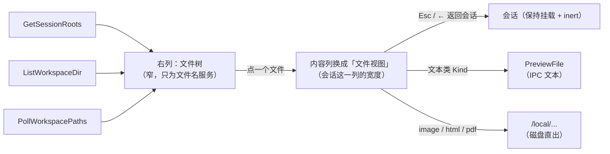

# Desktop 文件树与预览面板设计

> 版本: 0.1 | 日期: 2026-10-13 | 状态: 设计待确认（未实现）
> 原型: [2026-10-13-desktop-file-tree-prototype.html](./2026-10-13-desktop-file-tree-prototype.html)（单文件假数据，可点）
> 关联: [preview.go](../desktop/preview.go)、[roots.go](../desktop/roots.go)、[fileservice.go](../desktop/fileservice.go)、
>       [gitdiff.go](../desktop/gitdiff.go)、[oneoff.go](../desktop/oneoff.go)（`uiState`/`UIStateVO`）、
>       [main.go](../desktop/main.go)（`/local` 资产路由）、[pkg/fileindex](../pkg/fileindex/fileindex.go)、
>       [filepreview.tsx](../desktop/frontend/src/filepreview.tsx)、[viewer.tsx](../desktop/frontend/src/viewer.tsx)、
>       [markdown.tsx](../desktop/frontend/src/markdown.tsx)、[App.tsx](../desktop/frontend/src/App.tsx)、
>       [layout.css](../desktop/frontend/public/layout.css)、[2026-09-12-desktop-oneoff-panel-design.md](./2026-09-12-desktop-oneoff-panel-design.md)、
>       [2026-09-11-desktop-multi-workspace-design.md](./2026-09-11-desktop-multi-workspace-design.md)

---

## 目录

1. [背景与目标](#1-背景与目标)
2. [关键事实：原料盘点是齐的](#2-关键事实原料盘点是齐的)
3. [语义定义](#3-语义定义)
4. [交互设计](#4-交互设计)
5. [数据模型与绑定](#5-数据模型与绑定)
6. [后端实现](#6-后端实现)
7. [前端实现](#7-前端实现)
8. [自动刷新](#8-自动刷新)
9. [与既有决策的关系](#9-与既有决策的关系)
10. [风险与边界（以及第一版不做什么）](#10-风险与边界以及第一版不做什么)
11. [测试计划](#11-测试计划)
12. [分阶段实施](#12-分阶段实施)
13. [待决问题](#13-待决问题)

---

## 1. 背景与目标

读者现在只能从**会话流里**看文件：agent 交出的附件卡片（`FileCard`）、回复里点到磁盘文件的链接
（`FilePreviewOverlay`）。想主动看某个文件——"这个仓库长什么样"、"`docs/` 里都有什么"——没有任何入口，只能
让 agent 去读。而这件事恰好是 agent 干的活里最不需要 agent 的那部分。

目标：桌面上有一个**会话工作区的文件树**，点目录展开、点文件就地预览——代码高亮、markdown（含 mermaid）、
图片、网页、PDF、CSV 表格——并在 agent 改动文件后自己更新。

三个非目标（第一版明确不做）：**不改文件**（无编辑/保存/新建/删除/重命名/拖拽）、**不是终端**、
**不引入文件监听依赖**（见 §8）。

一句话形态：**右列只有树（导航），文件在会话那一列打开（阅读）。**



**为什么预览不待在右列里**：右列是一份**导航**，它的宽度只为文件名服务；而读一份 markdown、一段代码需要的是
会话这一列那么宽。把两件事塞进同一个面板（上树下预览）会得到一个两半都不够用的盒子，而且每看一个文件都要
重新展开一次树——树留在旁边，连着点几个文件才是浏览的样子。

---

## 2. 关键事实：原料盘点是齐的

这个功能之所以小，是因为两侧的原材料都已经在仓库里，而且是被别处打磨过的：

| 需要的东西 | 已经在哪儿 | 用法上的注意 |
| --- | --- | --- |
| 一个文件是什么、能不能预览 | `preview.go` 的 `previewKind` + 10 个 `kind*` 常量 | `kind` 字符串是前端 switch 的契约，**沿用同一批**，不新开一套 |
| 文本类内容（含 1MiB 上限、截断、残缺 rune） | `PreviewFile(path, withContent)` | 只有 md/text/csv 走它；其余走 `/local` |
| 图片 / HTML / PDF 出盘 | `main.go` 的 `/local?p=…` 与 `/local/…` | `toLocalAsset` / `toLocalPath` 已经在前端 |
| markdown（mermaid、代码高亮、复制按钮） | `MarkdownBlock`（`markdown.tsx`） | 代码走 `fenced()` 包一道 fence，复用同一条流水线 |
| CSV 表格、图片灯箱、浮层壳、⌘F 查找 | `CSVTable`、`ImageViewer`、`ViewerOverlay`、`findable` | `findable` 只在文本类上开（iframe 里的文档搜不了） |
| 一个目录"列一层" | `fileindex.Immediate(dir, limit)` | 排序是**目录优先 + 名字大小写不敏感**，树要与它一致 |
| 哪些文件被 gitignore | `gitdiff.go` 的 `ignoredPaths(root, paths)` | 输出 `<source>:<line>:<pattern>\t<path>`，正好够做灰显 + tooltip |
| 会话的工作区根（含附加根、项目、git 分支） | `GetSessionRoots` → `SessionRootsVO` | 树不自己解析根 |
| 右列的形态、宽度持久化、标题栏开关 | `OneOffPanel`（`oneoff.tsx`）+ `uiState`/`UIStateVO` | 宽度的三条规则（`panelRoom` / `clampPanelWidth` / Go 侧的 `validOneOffPanelWidth`）要**共用**，不是抄一份 |
| 打开 / 在文件夹中显示 / 复制 | `OpenPath` / `RevealPath` / `copyText` | 前两个先 stat 再返回原因；复制**绝不**裸用 `navigator.clipboard` |

唯一真正的空白是：**一层目录的清单**（`Immediate` 是给 @ 补全用的，会跳过 `.git` 但也只服务补全的形态）
与**变更感知**。这两件都在本设计里新写，见 §6、§8。

---

## 3. 语义定义

### 3.1 树 = 会话的工作区

树的顶层节点**就是** `GetSessionRoots` 给的那几个根：主目录在前，附加根在后（带 `rootLabels` 的标签，
两个同名根退化成全路径——与 @ 选择器、diff 面板同一条规则），每个根带它的 git 分支。一个由项目驱动的会话，
根来自项目（`sessionRootsFrom` 已经这么解析），树不需要知道有"项目"这回事。

**绝不读进程 cwd。** GUI 进程的 cwd 是 `/`，这条规则在 `docs/agents/desktop.md` 的「桌面会话树」那节已经写过
一遍，这里是它的第 N 个消费者。

### 3.2 树的边界是**字面包含**

一个请求的路径必须落在会话的某个根之内（`filepath.Clean` 之后按前缀判包含，`roots.go` 的 `dirContains`
就是这个语义）。判定**不解析符号链接**：

- 拒绝 `../../../etc`、`/etc`、另一个根之外的绝对路径——即使这些东西是 webview 发来的伪造请求，也走不到；
- 允许根内部的符号链接指向外面（那是用户自己的目录布置，不是本应用要管的事），它只是被标成 `link`。

拒绝是一条**可见的句子**（`DirListingVO.Error`），不是静默的空目录：静默正是这类解析 bug 唯一的表现形式。

### 3.3 三种预览来源

| Kind | 内容从哪来 | 渲染 |
| --- | --- | --- |
| `markdown` `text` `csv` | `PreviewFile(path, true)` → IPC 文本 | `MarkdownBlock` / `CSVTable`，上限 1 MiB、截断有说明 |
| `image` `html` `pdf` | `/local`（webview 直接取盘） | `` / 沙箱 iframe（`allow-scripts`，**无** `allow-same-origin`）/ 无沙箱 iframe（WebKit 自己的 PDF 阅读器） |
| `binary` `dir` `missing` | 没有内容 | 一句说明 + 「打开」「在文件夹中显示」；`dir` 是"目录本身不是一个可预览的文件" |

### 3.4 忽略 ≠ 隐藏

树**显示**被 `.gitignore` / `.ignore` / `.rgignore` 忽略的文件，只是**灰显**，tooltip 说出是哪条规则命中的
（`<source>:<line>:<pattern>` 里那个 source 是读者能去打开的文件，pattern 才是可行动的部分）。

这与 `@` 补全、检查点快照的口径**故意不同**：那两处是"索引/快照的可见性"，忽略就是不可见；这里回答的是
"磁盘上有什么"。用户在树里最常见的一个动作就是去看 build 产物或日志——那正是被忽略的那一类。

### 3.5 只读

树里的每个出手都是"看"：打开、在文件夹中显示、复制路径、（P4）把 `@` 引用插进输入框。
没有任何一条路径写盘。

---

## 4. 交互设计

### 4.1 位置：右列只有树，预览在内容列

`.app-body` 是 `[侧栏][主列][右列]`。右列的两个占用者是**文件树**和**旁路面板**：同一时间只开一个。

理由不是审美，是宽度：对话有 `CHAT_MIN_WIDTH` + `CHAT_MIN_SHARE` 的下限（住在 `oneoff.tsx` 的 `panelRoom()`，
`sidebar.tsx` 有一份自己的拷贝），两个 300px+ 的
右列会直接把对话压到下限上、把一次会话挤成一条。互斥让"右列给谁"变成一次二选一，也让标题栏那两个开关
的状态是自明的（点亮一个，另一个灭）。

代价说明白：`/review` 跑着的时候想看文件树，得先收掉旁路面板。可以接受——旁路面板的活是"看着它跑"，
文件树是"它跑完了我去看看"，两者很少同时要。

### 4.2 三个状态，两个开关

这里有**两件事**要分开说，它们不是一件事：

| 状态 | 谁拥有 | 怎么进 | 怎么出 |
| --- | --- | --- | --- |
| **树面板开合** | 标题栏（一个按钮）+ **⌘E** | 点按钮 / ⌘E | 同一个按钮 / ⌘E / 面板自己的 ✕ |
| **文件视图**（内容列显示的是文件） | 内容列，与设置页同一个位置 | **点树里的一个文件**（唯一入口） | **Esc** 或头部的「← 返回会话」 |

两者**互相独立**：关掉树，文件照旧停在那儿读（像编辑器把侧栏收起来）。这样"我看一眼树"和"我换个文件"
不会互相打断。

- **⌘E 必须先确认它不在 Wails 默认菜单的加速键里**（待决 1）：菜单加速键在 webview 看到事件之前处理，
  撞键就是一个前端测不出来的死键。
- **Esc 归文件视图。** 树面板不认领 Esc（它是一个持续存在的布局选择，像侧栏）；查找条打开时 Esc 归查找条。
- **⌘F 归文件视图**（它立着的时候）：那里的文本是文件内容，不是会话。会话自己的查找条这时是关着的——
  与设置页那条「一个视图盖住了聊天，查找就属于上面那个」同一条规则。

### 4.3 右列内部：只有树

```
┌─ 文件                       ↻  × ─┐   ← 头：刷新、收起
│ ▾ tachi                  main     │   ← 根（含 git 分支）
│   ▾ docs                           │
│     ▾ agents                       │
│       desktop.md                   │   ← 选中 = 内容列正在显示它
│     desktop.md                     │
│   ▸ desktop                        │
│   ▸ dist                忽略        │   ← 被 git 忽略：仍然显示，只是灰
│   … 另有 12 项未显示                │
└────────────────────────────────────┘
```

- 默认宽度 **340**，min 240、max 560，键盘 ±24。**不自造一套钳制算法**：`oneoff.tsx` 的 `panelRoom()` /
  `clampPanelWidth()` 提出来共用（两个面板占的是同一块空间，算法只该有一份），只是这对面板传入自己的
  min/max。读者挑的宽度会被**原样存下**，能不能显示由 `panelRoom()` 当场算（窄窗口限制显示，不覆盖选择）。
- 树的一行：展开箭头（只有目录有）、图标、名字，根行额外带标签与 git 分支，被忽略的行带灰（§3.4），
  有变化的目录带一个短促的标记（§8.3）。
- **只有一个滚动器**：这个盒子自己滚，别的东西不嵌套一个 `overflow`（浮层/查找会去搜错误的盒子）。

### 4.4 多个根：几个顶层节点，不是一棵合并的树

一个会话的工作区常常不止一个目录：主目录 + 若干附加目录（项目驱动的会话，根整个来自项目）。它们在磁盘上
是互不相干的几棵树，没有共同的父目录，所以**不合并、也不造一个虚拟根节点**——**每个根就是一个顶层节点**。

```
▾ tachi                 main      ← 主目录（标签为空，就是它的名字）
    ▾ docs
  lib             /Volumes/data   ← 附加根，带标签
  shared-lib              ↑ 两个同名根时，标签退化成全路径
```

- **顺序**：`sessionRootsFrom` 给的顺序（主目录在前，附加根按声明顺序）。稳定，不重排。
- **一行上显示什么**：名字（basename）、根标签（`rootLabels`：主目录是空、附加根是 basename，两个同名根退化
  成全路径——与 @ 选择器、diff 面板同一套，不是树自己的一套）、以及那一行的 **git 分支**。分支必须显示：
  同一个仓库的两份检出在树里长得一模一样，而这件事 diff 面板已经为同样的理由处理过一次。
- **默认展开状态**：主目录展开（列它顶层），附加根**收起**。附加根常在外接盘或网络挂载上，一次开面板就
  全列一遍等于把等待摊在每一次开面板上；点一下才列，成本与读者的动作成正比。
- **不存在/已卸载的根**：灰掉 + 原因，不可展开，但**行还在**（`SessionRootVO.Exists=false` 就是为它存在的）。
  一次目录消失是一个要被报告的事实，不是要被删掉的噪音——与 diff 面板对消失的附加根是同一条规则。
- **嵌套的根**（附加根落在主目录里面）：**两处都显示**。去重是 `@` 选择器的规则（那里重复的行是纯噪音）；
  树里嵌套本来就是树的样子，还省一次下钻。两处指向同一个绝对路径（§3.2 的边界判定按字面路径，不受影响）。
- **根集合变了**（加/删根、项目编辑）：`agent:workspace_changed` → 重读 `GetSessionRoots`，丢掉已消失的根的
  listing，**保留仍然存在的根的展开状态**（否则一次重命名把读者展开的三层全收了）。
- 有附加根就一定有主目录（`AddSessionRoots` 在没有主目录时直接拒绝），所以顶层不会出现"一堆并列的根、
  没有主"这种形态。

**文件视图头里的路径要带根。** 树里的位置已经说明了归属，但那一行是一条脱离树的路径文本，而"同一个仓库的
两份检出"正是会撞名字的情形：附加根下的文件显示成 `shared-lib/src/x.go`（标签 + 相对路径），主目录下的显示
相对路径，绝对路径作为 tooltip——与 diff 那条「只要其中一个必须带标签，每一行就都要带」是同一个理由。

### 4.5 树上的手势

| 手势 | 结果 |
| --- | --- |
| 点目录行 / 箭头 | 展开或收起；**展开时才向后端要这一层** |
| 点文件行 | 在**内容列**打开它（进文件视图，§4.7）；再点一次不"取消选中"（读着的文件不该因为一次误点消失） |
| 右键一行 | 菜单：打开、在文件夹中显示、复制路径、（P4）插入 `@` 引用到输入框 |
| ↑ ↓ | 在**可见行**之间移动（跨层，收起的分支不展开就不算） |
| ← → | 收起 / 展开当前行（文件行上 ← 跳到父目录） |
| Enter | 目录 = 展开收起，文件 = 打开（并滚进视野） |
| 双击 | 与单击一致（**不做**"双击打开系统应用"——那会让两种打开方式分不出谁是谁） |

键盘导航放到 P4，但状态从一开始就按"有一个选中行"来设计（`aria-selected`）。

### 4.6 空态与坏态（都要说人话）

| 情形 | 屏上 |
| --- | --- |
| 会话还没有工作目录 | 「这个会话还没有工作目录」+ 一个按钮打开工作区面板（复用既有的 chip 那一套） |
| 根目录不存在（卸载/删除） | 那一行灰掉 + 原因（`SessionRootVO.Exists=false` 就是为这个存在的） |
| 目录读不出来（权限） | 行内一句原因，行**还在**（不静默消失） |
| 目录为空 | 「（空目录）」 |
| 一层超过上限 | 「另有 N 项未显示」——与侧栏的 `MoreRows` 同一种说法 |

### 4.7 文件视图：内容列换一个视图

它就是 `.main` 里会话那一片的**另一个视图**，与设置页占的是同一个位置、用的是同一条规则：**会话保持挂载，
只是 `inert`**（滚动位置、输入框草稿、正在流的回复都还活着，回来时原位）。

```
┌ ← 返回会话 Esc   desktop.md  41.2 KB        打开  Finder  复制路径 ┐
│ docs/agents/desktop.md                                          │
├─────────────────────────────────────────────────────────────────┤
│ # Tachi —— 桌面手册                                              │
│ …                                                                │
└─────────────────────────────────────────────────────────────────┘
```

- **头**：「← 返回会话」（Esc 的可见形式）、文件名、大小、三个出手（打开 / 在文件夹中显示 / 复制路径），
  第二行是**带根标签的相对路径**（§4.4）。**没有"全屏"按钮了**——预览已经在会话这一列，它就是最宽的那个
  地方。
- **正文**：§3.3 那三种来源，按 kind 分流，且**分流只有一处**（§7.2）。
- **操作不在会话流里**：这条规则同「条带与页脚」——进文件视图不等于往会话里塞一条消息，会话不受影响。
- **点树里的另一个文件**：换掉正文，视图不重进（不闪、不重置滚动）。
- **⌘F 归它**（§4.2）。图片点击仍是既有的灯箱（`ImageViewer`），那是一次放大，不是第二个阅读界面。

---

## 5. 数据模型与绑定

### 5.1 新增两个绑定（`AgentService`）

```go
// desktop/filetree.go

// ListWorkspaceDir 列出会话工作区里的一个目录，一层。
// path 必须落在会话的某个根之内（§3.2）；path == 根本身就是列它的顶层。
func (s *AgentService) ListWorkspaceDir(sessionID, path string) DirListingVO

// PollWorkspacePaths 批量回报一组路径的现状，给自动刷新用（§8）。
func (s *AgentService) PollWorkspacePaths(sessionID string, paths []string) []PathStateVO
```

```go
type FileNodeVO struct {
	Name  string `json:"name"`
	Path  string `json:"path"`            // 绝对路径（/local、OpenPath、@ 引用都用它）
	IsDir bool   `json:"isDir"`           // Stat 的结论：符号链接指向目录也算目录
	Link  bool   `json:"link,omitempty"`  // 它本身是一个符号链接
	Size  int64  `json:"size,omitempty"`  // 字节；目录为 0
	// Kind 是给图标和"能不能预览"的提示，只由扩展名决定（§6.2）。未知扩展名是 "unknown"，
	// 它不代表不能预览 —— 那件事由点开后的 PreviewFile 回答（它按内容判）。
	Kind string `json:"kind"`
	// Ignored 非空表示这一项被 git 忽略，值是命中的规则（".gitignore:12: dist/"）——一个字段
	// 同时回答"要不要灰"和"被谁灰"。
	Ignored string `json:"ignored,omitempty"`
	// Error 是这一项自己的问题（stat 不到、链接断了）。行照样出现。
	Error string `json:"error,omitempty"`
}

type DirListingVO struct {
	Path    string       `json:"path"`
	Root    string       `json:"root"`    // 这一层属于哪个根（面包屑/标签用）
	Entries []FileNodeVO `json:"entries"`
	Total   int          `json:"total"`   // 这一层实际的条目数（截断前）
	Truncated bool       `json:"truncated,omitempty"`
	// Error 是"整个目录读不出来"（权限、刚被删）。它与 Entries 互斥，且必须显示给读者。
	Error string `json:"error,omitempty"`
}

type PathStateVO struct {
	Path    string `json:"path"`
	Exists  bool   `json:"exists"`
	IsDir   bool   `json:"isDir,omitempty"`
	Size    int64  `json:"size,omitempty"`
	MTimeMs int64  `json:"mtimeMs,omitempty"`
}
```

根集合不新开绑定：复用 `GetSessionRoots`（它有分支、有 `Exists`、有项目信息）。

### 5.2 为什么不是"一次把树取回来"

- 一棵真实的仓库树是几万到几十万条，**一次取回来就是一次全树 walk**——正是 `@` 补全的设计花力气避免的那笔
  成本（`docs/agents/desktop.md`：不宽的工作区根，就是为了不让索引盖住整台机器）。这里是同一个道理。
- 逐层惰性：一次 `os.ReadDir`（微秒级）换一屏行。展开一个 10 万文件的 `node_modules` 也只读它一层，
  再被上限截断。
- 代价：展开是"点一下等一次往返"。在本机进程内的绑定上这不是问题。

### 5.3 面板自己的状态持久化

`uiState`（`desktop_ui.json`）+ `UIStateVO` + setter，照旁路面板那几件的写法：

| 字段 | 含义 |
| --- | --- |
| `fileTreeOpen` | 树面板上次开着吗 |
| `fileTreeWidth` | 面板宽度（0 = 没拖过，用默认；setter 钳制边界——边界镜像 Go 里 `oneOffPanelMinWidth`/`MaxWidth` 那一对） |
| `fileTreeMemo` | 展开状态与当前文件，**按工作区**为键（见 §5.4） |

前端读一次 `GetUIState`（挂载时），之后本地 state 驱动帧——文件是持久那一半，不是屏幕上那一份的来源。

注意 **`view`（内容列显示什么）不进这个文件**：那是这次运行里的会话上下文，不是偏好。启动一律落在会话上
（一个为"我昨天在看的文件"自动切走的启动，读起来就是"我的会话去哪了"）。

### 5.4 展开状态的记忆（按工作区）

需求原话：「要记住文件夹和文件的展开状态」。落地是四件事：

**1. 键是工作区，不是会话。** 同一个项目里的会话共用一个展开态——树的身份是那几棵树，不是"这次对话"：

```
key = "p:" + 项目 id      当那个项目确实在驱动这个会话（与 projects.usable 同一个谓词）
    = "d:" + 主目录路径    否则（普通会话）
```

**键由后端推导**（`fileTreeKey(sessionID)`），绑定收的是 **sessionID**：前端不许自己拼键，否则"什么算同一个
工作区"就有了第二份定义。前缀让两种键不可能撞（项目 id 与路径是两种东西）。

**2. 存绝对路径，读的时候过滤。** 一条 memo 是一组**绝对**目录路径 + 一个选中的文件路径：

- 绝对（不是相对根）是因为有多个根：相对路径说不出"哪个根下面"，而且根会动。
- **写不管，读过滤**：`GetFileTreeMemo` 丢掉那些已经不在任何根之内、或者已经不是目录的路径（一次 `Stat`
  一条，上限 500 条就是 1 毫秒级）。被删掉的目录不会留下一行幽灵，被重指的根（项目换了检出目录）自然回到
  默认展开。过滤结果**不回写**——回写要每次开面板都写一次盘，而写下来的东西本来就只在写入时有效。
- 恢复时**连带补上祖先**：一条深层路径必须它的每一级祖先都展开才看得见，而记忆里可能缺（根被重指过一次）。
  补祖先是一次纯字符串前缀运算，不查盘。

**3. 记的还包括"在看的那个文件"**：面板打开时把上次选中的那个文件也选中，并把它的内容重新取一次
（**仍然不自动刷新**——§8.4 的规则一字不改）。它若已经不在了，预览显示的就是既有的 `missing` 那句话说
"文件已不存在"，不需要新的一态。

**4. 上限与淘汰**：一个工作区最多记 500 条路径（再多就不是"我展开过什么"，是"我没关过什么"），最多记
50 个工作区，按最后写入时间淘汰最旧的。写入**去抖**（一次展开/收起/选中之后 500ms，再加面板关闭时一次）：
一条树上的点击不值得一次整文件重写。`desktop_ui.json` 是手可编辑的，所以 setter 也要钳这两条上限——
读过滤 + 写钳制，两边都不依赖对方。

冒烟要一个 **`uiState` fixture**（把一段 `desktop_ui.json` 种进沙箱的 HOME）：它能断言的是"重启后回来"那种
形状——展开态与选中的文件都从盘上恢复，而不是从这一次运行的内存里。

---

## 6. 后端实现

新文件 `desktop/filetree.go`（列目录 + 边界 + 轮询），单测 `desktop/filetree_test.go`。

### 6.1 一层清单的规则（一处声明，两个消费者）

照 `fileindex.Immediate` 的**排序**（目录优先；组内按名字 `strings.ToLower` 比较），因为树里那一列和
@ 选择器里那一列是同一批文件，行序不一致读起来就是随机的：

1. `os.ReadDir(dir)`；跳过名字恰为 `.git` 的条目。**其余点文件一律显示**。
2. 每项 `os.Stat`（**跟随**符号链接）拿 `IsDir` / `Size`；`DirEntry.Type()&fs.ModeSymlink` 决定 `Link`。
   stat 失败 = 该项 `Error`，行还在。
3. 排序（上述）、截断到 `fileTreeMaxEntries`（初值 2000）→ `Truncated` + `Total`。
4. Kind 提示（§6.2）、Ignored（§6.3）。

一条边界：**`fileTreeMaxEntries` 是"交给 webview 的条目数"，不是"磁盘上有多少"**——`Total` 那个数字必须
分开报，否则"另有 N 项"会是一个假的数。

### 6.2 Kind 提示只看扩展名

`previewKind`（`preview.go`）对一个没有专门渲染器的文件会**读内容**去判（8KB 探测）——那是对单个文件的
正确做法，对一层几百个文件是不能接受的 I/O。所以树用一个纯扩展名的提示：

- 复用同一批表：`imageExts`、`binaryExts`、`langByExt` / `langByBase`，加上 `.md` `.html` `.pdf` `.csv`
  那几条特判——**同一批**，不是新写的第二份（第二份就会漂：树说"📄 文本"，点开却是二进制）。
- 没命中的扩展名 = `unknown`，图标用中性的那个。它**不**等于"不能预览"：`previewKind` 点开时会按内容
  再判一次（`NOTES` 这种没扩展名的 README 就是这样被认出来的）。

### 6.3 忽略标记

复用 `gitdiff.go` 的 `ignoredPaths(root, paths)`：一次 `git check-ignore -v -- <paths>`，`cwd` 用**包含这个
目录的那个根**（git 需要一个在仓库里的 cwd；根本身通常就是仓库根）。解析那些 `<source>:<line>:<pattern>\t<path>`
行，得到一个 `path → 规则` 的 map。`ignoredPaths` 现有的返回形态是给 diff 面板的，所以这里加一个小解析函数
（`ignoredSet`），并让 `ignoredPaths` 与它共用一个实现——两条路读同一份 `check-ignore` 输出，格式解读只能有
一处。

不在 git 仓库里（或者没装 git）= 全部不标记，不是错误。一次列一层付一次子进程，可接受；将来若成为热点，
可以把 `-v` 的输出按根缓存一小段时间（TTL 与 `fileindex.DefaultTTL` 同级）。

### 6.4 边界判定

```go
// mustBeInsideWorkspace：请求路径必须落在会话的某个根之内（字面包含，不解析符号链接）。
```

放 `filetree.go` 里，用 `roots.go` 已有的 `dirContains`。会话没有根 = 什么都不列（返回一个带说明的
`DirListingVO`，不是空树）。

### 6.5 轮询

`PollWorkspacePaths` 就是批量 `os.Stat`（跟 `Lstat` 不必区分：判存在和 mtime 用 `Stat` 就够），带一个
上限（初值 512，超了截断——但前端不该送这么多，见 §8）。它**不做任何判定**：变化的语义（目录 mtime 变了 =
条目增删；文件 mtime+size 变了 = 内容变了）由前端那一半说，因为那正是它要显示的那件事。

---

## 7. 前端实现

### 7.1 文件与归属

| 文件 | 装什么 |
| --- | --- |
| `frontend/src/filetree.tsx` | `FileTreePanel`（头 + 树）、`FileTree`（行，递归） |
| `frontend/src/fileview.tsx` | `FileView`（内容列那个视图：头 + 正文 + 返回） |
| `frontend/src/useFileTree.ts` | 按工作区的树状态：展开集合、每层 `listing` 缓存、选中路径、脏标记、轮询与记忆的读写 |
| `frontend/src/filepreview.tsx` | 抽出 `<FileBody kind meta path onExpand />`，被卡片、浮层、文件视图三处共用 |
| `App.tsx` | `view` 加上 `'file'`（与 `'settings'` 并列）、⌘E、与旁路面板互斥、`uiState` 读写 |
| `public/layout.css` | 树面板与文件视图的布局类（与 `.oneoff-panel`、`.app-body[inert]` 住同一处） |

**不新增 CSS 文件**：`index.html` 里那 6 个 `<link>` 是一份声明，加一个文件要动它，而这里没有需要新文件的
体量。

**`view` 是三态而不是两态**：`'chat' | 'settings' | 'file'`。这三者是同一个位置的竞争对手，用同一个机制
（`.main` 里的视图 + 会话 `inert`）——第二套"盖一层"的做法会开始问"设置页立着时文件视图能不能开"这类本来
不存在的问题。文件视图记住**看的是哪个文件**（`filePreview: {root, path, name}`），设置页不需要。

### 7.2 一条 kind 分流

现在 `filepreview.tsx` 里 kind 的分流写了两遍（`FilePreviewBody` 一份、`FileFullscreen` 一份），文件视图会是
第三份。先把 `<FileBody>` 抽出来：给 `kind + meta + path`，渲染那一段内容（`markdown`/`text` 走
`AttachmentText`，`csv` 走 `CSVTable`，`image`/`html`/`pdf` 走 `/local`，其余是说明句），`onExpand` 是任选的
外扩动作。

三处的差别留在这三处：卡片给"预览/收起"按钮、浮层给 `findable` 和阅读栏、文件视图给整列的宽度和头部。
**kind 的判断只有一处**——这是 §2 那张表能保持为真的前提。

### 7.3 按工作区的状态

`useFileTree(sessionId, open)` 内部：

- `expanded: Set<string>`、`listings: Map<string, DirListingVO>`、`selected: {root, path} | null`、
  `dirty: Set<string>`。
- **会话切换即全部重置**，然后从 §5.4 的 memo 恢复（键是工作区，所以同一项目的两个会话切来切去，看到的是
  同一棵展开着的树）。
- 根变了（`agent:workspace_changed`，或面板自己的根写入之后）→ 丢掉 `listings` 重新列，保留 `expanded` 里
  仍然存在的路径（否则一次重命名会把读者展开的三层全部收起来）。
- 取回的预览内容带它来自哪条路径 + 哪次 mtime：路径换了就不复用。

---

## 8. 自动刷新

需求是原话："改了文件自动刷新文件不行吗"。能，但**分两半**，因为"文件变了"对两个部分意味着不同的事：
树上"多了一行/少了一行"是无害的，预览里"正文换了一段"不是。

### 8.1 机制：前端轮询，不引入 fsnotify

- 树面板开着、且窗口可见时，前端每 **2s** 调一次 `PollWorkspacePaths`，送的路径 = 当前展开的目录 + 文件视图
  正在显示的那个文件。不打开面板 = 一次调用都不发；面板收起 = 立即停。
- **不引入 `fsnotify`**：那是一个新依赖（`desktop/` 是独立 module，要单独 tidy），且要管 fd 上限、子目录递归
  注册、大树的 watch 成本。这里的探测量是"几十个目录的 `os.Stat`"，比维护一套 watcher 便宜得多。
- 隐藏/被盖住的窗口会把定时器节流到 1Hz（`docs/agents/desktop.md` 那条）：轮询只是变慢，不会坏。
- 变化之后**只重列变了的那个目录**，不整树重来。

### 8.2 两个额外的触发时机

- **一轮结束时**（`agent:idle`）立即重列一次：agent 是你这台机器上最频繁的写文件者，它写完的那一刻正是
  你想看的时候。
- 面板头上的 **↻** 手动刷新（重列所有已展开目录 + 重取文件视图的内容）。自动刷新是提示，不是保证——
  mtime 加尺寸判不出来"同一秒内改回同样大小"这种情形，读者的兜底必须在那儿。

### 8.3 脏标记

变化的目录在它的行上加一个短促的标记（新条目高亮一下，或用 `.is-dirty`），**不自动展开**、**不移动滚动
位置**。读者没展开的分支里发生了什么都不打扰他。

### 8.4 文件视图里的内容不自动替换

树会自己更新（上面），**文件视图的正文不会**。文件变了时，头部下面出现一条 `.fileview-stale`：
「文件已更新（12:03）· 重新读取」，点它才重新取。

理由是一条已经写在手册里的规则：绝不把内容从读者手下挪走（会话列表、滚动位置、跟随底部都是这一条的
不同应用）。一个正在读的 markdown 在你眼皮底下重排，是自动更新里最坏的一种——而这次它连位置都是你挑的。

---

## 9. 与既有决策的关系

- **工作区根只来自会话**：树的根是 `sessionRootsFrom` 的产物（`GetSessionRoots`）。这条口径下，树不需要也不
  应该有自己的"当前目录"概念。
- **根不宽**：`wideRootReason` 已经拒了 `/`、`$HOME`、含 Tachi 状态目录的路径，所以树天生不会一开就是
  一台机器或一堆 dotfile。这不需要在这里再写一遍。
- **文件视图用的是设置页那条已经写过的规则**：内容列换一个视图，原来的那个**保持挂载、只是 `inert`**。
  那条规则背后是一个已经踩过的 bug（`visibility: hidden` 让 WebKit 永久丢掉省略号截断的文本，issue #27），
  以及"对话不能因为看一眼别的就丢滚动位置和草稿"。所以这里是**第三个 view，不是第二套机制**。
- **一个盒子一个滚动器**：树是一个盒子（它自己滚），文件视图的正文是另一个（它自己滚）。浮层的 ⌘F 只搜
  它自己那棵子树（`findable`）——那条规则在这里体现为"⌘F 归文件视图"（§4.2）。
- **忽略的两套口径是故意的**：树按 gitignore 只是灰（§3.4），而 `@` 补全与检查点照旧"忽略即不可见"。
  也就是说：**树里能看到一个 `@` 补全建议不出来的文件**——这是对的，它回答的是不同的问题。
- **`/local` 的信任面不变**：它照样服务任何可读路径（它只从本应用自己的 webview 可达）。树不会扩大这个面：
  它只把自己列出来的路径喂过去。
- **打开/显示/复制都走既有出口**：`OpenPath` / `RevealPath` / `copyText`。新写一套 `open` 调用会让"点了没反应"
  的失败模式多一份。
- **面板开关/宽度是持久偏好**：进 `desktop_ui.json`（与旁路面板同一套），手可编辑，所以 setter 要钳制；
  **`view` 不进**（§5.3）。
- **记忆的键由后端推导**（§5.4）：「什么算同一个工作区」只有一个定义，前端不许自己拼。
- **四个面一起动**：Go 方法、重新生成的 Wails 绑定（`cd desktop && GOWORK=off wails3 generate bindings -clean=true -ts -i`）、
  前端、冒烟驱动。绑定没重生成 = `tsc` 直接失败。
- **冒烟路由表要加一行**：这是"driver 看得见"的改动，见 §11。

---

## 10. 风险与边界（以及第一版不做什么）

| 风险 | 应对 |
| --- | --- |
| 巨大目录（`node_modules`、`dist`） | 惰性（只读一层）+ 每层 2000 条上限 + 报 `Total`。展开是读者自己的动作，成本与他的动作成正比 |
| 符号链接环（`a -> ..`） | 惰性天然不会递归爆炸（读一层就停）；`link` 标记让读者看得见自己在链上。**不做** visited 守卫：它会静默拒绝某个普通目录，而这里的风险只是"多点几下" |
| 轮询把每 2s 变成一批 syscall | 只 stat"已展开的目录 + 文件视图里那个文件"；树收起即停；窗口被盖住时天然节流 |
| 一层 2000 行的 DOM | 与侧栏的窗口化同一个问题域。第一版先靠上限；如果实测卡，再照 `SIDEBAR_WINDOW_ROWS` 那套做窗口化（同一个 `MoreRows` 交互） |
| 右列挤压对话 | 与旁路面板互斥（§4.1）；树面板自己的默认宽度只有 340，宽度钳制照对话下限剩多少来算 |
| 记忆文件无限长大 | 每个工作区 500 条路径、最多 50 个工作区（§5.4），写入去抖 |
| 预览一个 200MB 日志 | 已有的 1MiB 上限与截断说明（`readPreviewText`） |
| HTML 预览执行脚本 | 已有的沙箱：`allow-scripts`、**无** `allow-same-origin`——碰不到 Wails 桥，读不出 `/local` 之外的东西 |

**第一版不做**：编辑/保存；新建/删除/重命名/拖拽移动；内置终端；git 面板（分支已经在根那一行显示，够了）；
把会话目录本身（`~/.tachi/...`）展成树；`fsnotify`；树内的模糊搜索框（P4 可选，索引现成）。

---

## 11. 测试计划

### 11.1 Go 单测（`desktop/filetree_test.go`）

- 排序：目录优先 + 名字大小写不敏感（与 `fileindex.Immediate` 同一断言，两处行序必须一致）。
- `.git` 被跳过；`.env` / `.tachi/…` 这类点文件**在**。
- 越界拒绝：`../..`、`/etc`、另一个根之外的绝对路径；会话没有根时给说明句。
- 一层上限：`Total` 是真实数、`Truncated` 为真、条目数等于上限。
- 忽略标记：种 `.gitignore` + 一次 `check-ignore` 命中（git 不在 PATH 上就 skip，照 `gitdiff_test.go`
  的做法）。
- 符号链接：目录链可展开且 `Link=true`；断链的项有 `Error` 而**行还在**。
- 消失的目录 → `Error`，不是 panic（读者点开一个刚被 `rm -rf` 的目录是常态）。
- `PollWorkspacePaths`：目录里增删文件 → 目录 mtime 变；文件改写 → size/mtime 变；不存在 → `Exists=false`。
- 记忆的**键**：项目驱动的会话 → `p:<id>`；普通会话 → `d:<主目录>`；没有主目录 → 不记（没有东西可展开）；
  **同一项目的两个会话拿到同一个键，两个无关会话拿到两个键**（这条就是"按工作区共享"的全部含义）。
- 记忆的**读过滤**：memo 里一条已不在任何根之内、一条已不是目录的路径都被丢掉；写钳制 500 条 / 50 个工作区，
  且按最后写入时间淘汰最旧的。

### 11.2 冒烟场景 `file-tree`

fixture：工作目录种一棵小树（一个子目录、一个 `.go`、一个 `.md`、一张图片、一个二进制、一个被 `.gitignore`
忽略的文件），加 `extraRoots`（现成的 fixture）证明多根，加一个新的 **`uiState`**（种一段 `desktop_ui.json`）
证明记忆是从盘上恢复的。

driver 断言：两个根都出现且带分支 → 展开子目录 → 点代码文件，**内容列换成文件视图**并把代码显示出来 →
树**仍然可见**（这正是这次改形态的原因）→ 点 md，标题渲染 → 点图片，`img.src` 以 `/local` 开头 →
点二进制，「不支持预览」+ 打开按钮 → 被忽略的那一行带灰的类 → 点「← 返回会话」（以及一次 Esc），会话回来
且**草稿还在**（文件视图没有把会话卸载掉）→ **自动刷新**：Go 那一半在场景中途写一个新文件，driver 用
`waitFor` 等它出现在那一层 → 顺手重开一次面板，断言展开态与选中的文件都还在。

Go 那一半断言：`dirs listed`（先列了哪几个目录——证明展开是惰性的，不是一次全树）；以及记忆的键
（同一项目的两个会话拿到同一个键，两个无关会话拿到两个键）。路由表加一行：「文件树 / 文件视图」→ `file-tree`。

### 11.3 关卡

`make lint`、`cd desktop && GOWORK=off go test ./...`（根目录的 lint/test 覆盖不到 `desktop/`）、
`make desktop-smoke ARGS="-run file-tree -v"`。类型检查由 `npm run build`（`tsc && vite build`）覆盖，
所以改完前端要确认 `[ bin/tachi-desktop -nt <改过的源文件> ]`——一次没通过类型检查的编辑会跳过 Go 构建，
于是跑的是上一个二进制。

---

## 12. 分阶段实施

| 阶段 | 内容 | 可独立验收 |
| --- | --- | --- |
| **P0** | `filetree.go`：一层清单、边界、Kind 提示、忽略标记、`PollWorkspacePaths`、记忆的键与读写过滤 + 单测 | Go 单测全绿 |
| **P1** | 右列树面板：标题栏开关、⌘E、与旁路面板互斥、宽度持久化；树本身（展开/收起/选中、空态与坏态）；**展开状态的记忆**（读写 + 去抖） | 冒烟：根、展开、重开面板还在 |
| **P2** | 文件视图：`view` 三态、会话 `inert`、⌘F 归属、返回（Esc / 按钮）；抽 `<FileBody>`；三种来源的渲染 | 冒烟：代码/md/图片/二进制四态 + 返回后草稿还在 |
| **P3** | 自动刷新：轮询、脏标记、`agent:idle` 触发、↻ 手动刷新、`.fileview-stale` | 冒烟：写文件 → 出现在树里，正文等一次点击 |
| **P4** | 打磨：键盘导航、右键菜单（打开/在文件夹中显示/复制路径/**插入 `@` 引用**）、从会话反查定位（回复里的文件链接 / `SendFile` 卡片点开时在树里展开并选中） | 各自的冒烟断言 |

P4 里「插入 `@` 引用」是只有这个应用能做的那一件事：树里看到一个文件，直接把它变成输入框里的一个引用
（`atfile.RefForPath` 已经在后端），这是文件树与 `@` 机制之间的自然接缝。

---

## 13. 待决问题

1. **⌘E 会不会撞菜单**：Wails 默认菜单只被删掉了三个 zoom 项（`menu_darwin.go`），其余照留。要实测一次
   ——或者照 `menu_darwin_test.go` 的做法加一条断言。撞了就换 ⌘⇧E，或者只留标题栏按钮。
2. **与旁路面板互斥还是并排**：本设计取互斥（§4.1）。树面板只有 340，理论上并排也放得下，但那样"右列"
   就有两个可变的宽度，而对话的下限要在两条边上同时成立。
3. **文件视图与既有 `FilePreviewOverlay` 的分工**：本设计里会话流里的文件链接仍然开**浮层**（那是一次从对话
   出发的速览，浮层关掉就回到原位），树里的文件开**视图**（那是浏览）。两者共用 `<FileBody>`，不是一个渲染
   两份。替代方案是链接也走视图（附带把树展开定位过去）——那会让一次点击带走整个内容列，倾向不做，
   但 P4 的「从会话反查定位」会把它变成可选行为。
4. **轮询间隔**（暂定 2s）与"窗口被盖住时是否继续"（倾向继续，反正被节流到 1Hz）。
5. **上限的具体数字**：一层 2000 条、轮询 512 个路径、记忆 500 条 / 50 个工作区——都是估的，P0 之后拿真实
   仓库量一次再定。
6. **树的排序要不要有例外**：目前只有 `.git` 被跳过（这是你选的口径）。若某天想在树里也不显示
   `node_modules`，那会是一条**新规则**（不是"忽略即隐藏"，那会把 build 产物也藏了）。
7. **要不要"跟随 agent 的改动自动定位到新文件"**（它写了哪个文件就把树展开到那儿并选中）——很贴心，
   也很容易变成一个自己动起来的界面。倾向放进 P4 之后单独议。
