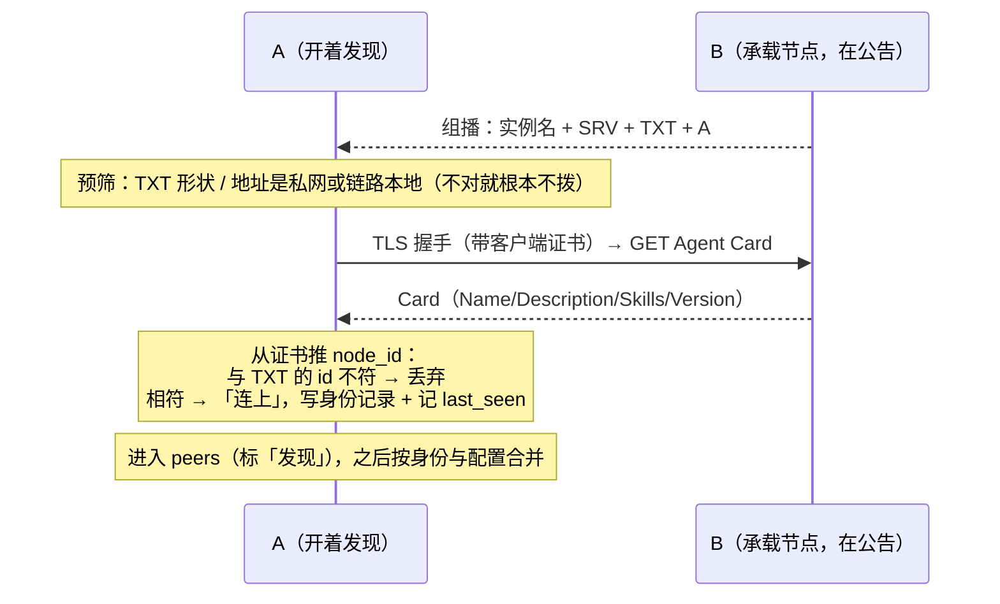

# Tachi 多节点协作：mDNS 发现与对端目录

状态：**设计；尚未实现。** 本文取代 `2026-10-13-a2a-discovery-design.md`（那份写的是「候选面 + 人接受」，与已拍定的「连上即认」流程不一致，已删）。

已落地的前提（本文依赖，不重复论证）：节点身份与双向 TLS、**身份记录（TOFU）以 `node_id` 为键而名字只是它的一个字段**、`NodeIDFor = hex(sha256(pub)[:16])`（32 位十六进制，不可冒充）、Card 走 `/.well-known/agent-card.json`、工具入参本来就接受「node_id 的唯一前缀」。日期：2026-10-14。

> 这是日期方案，不是行为手册；配置形状与接口是设计示意。落地后把稳定下来的部分回写 `docs/agents/node.md`。

## 一、已拍定的选择

1. **发现走 mDNS `_tachi._tcp`**；DNS-SD 子类型先不做（后果：同一张网里别人的 Tachi 也会出现在列表里）。
2. **发现本身是个开关，默认关**；公告只在**承载节点服务**的进程里做。
3. **「连上」= 成功读一次对端的 Agent Card**（走 mTLS、带客户端证书）。这一步同时就是 TOFU 发生的地方——不需要新的握手代码，今天读卡片这条路就是一次带身份的连接。
4. **连上即加入 peers**；本机**只展示 peers 里的**。
5. **合并按身份**：同一个 `node_id` 只留一条——**标签以配置为准，地址两边都留**。
6. **点名只认身份**（node_id 或它的唯一前缀）。名字只是展示：`card.name(node_id)`，即**对端自称的名字后面缀上不可伪造的身份**；人配过的标签优先于对端自称。
7. **过滤自己**（按本机 `node_id`）。
8. **按时间移除**：自动发现的条目默认 **1 小时**没再见到就移除；**配置来的条目不移除**。
9. **标来源**：配置 / 发现。
10. 一台机器有多个地址（局域网一个、网格一个）仍是**同一台机器**。
11. **配置里只填地址，不填身份**；身份在第一次连上之后自动记下来，不进用户的配置文件。
12. **读对端 Card 里公告的地址**，把它当作那个身份的一个地址——不是「只读我们自己配置的地址」。
13. **必须能公告一个可连地址**：离开 loopback 提供服务、又推不出可连地址（绑 `0.0.0.0` 且没配 `public_url`）是**启动时的错误**，不静默降级。
14. **地址过期不做补救**：发现会带来新地址，不去猜、不去兜。

态度上的一条：这是个完全自控的系统，规则要**明确**——用「必须写」和「照着读」这样的约定，替掉多余的分支与兜底。

不做：子类型、gossip、跨网段（组播本来就做不到）、隐私模式（公告里隐去机器名）、地址过期的补救。

## 二、一次发现的全过程

反向的那半（配置里写好的对端）不需要等人委派：**启动后/刷新时去读一次卡片**（今天的探测就在做这件事），成功即拿到身份，于是它能在同一轮就被点名。

三个状态必须分开说，不能合成两个：

| 状态 | 含义 |
| --- | --- |
| 还没问过 | 谁都没读过它的卡片 |
| 问过，连不上 | 有地址、有身份（或配置里只有地址），但此刻够不到 |
| 连上了 | 卡片读到了，身份记下了，进了 peers |

## 三、对端的存储与合并

**两个来源，一个键。** 配置是人写的意图，发现是网络上的事实；两者的公共键是身份。

一条对端记录里有什么：

| 字段 | 谁说的 | 说明 |
| --- | --- | --- |
| 身份（node_id） | 握手（证书推导） | 唯一的键；不可冒充 |
| 地址（一组） | 配置 / 发现（mDNS）/ 对端自述（Card） | 一个身份可以有一组地址；旧的不删，只是往后排 |
| 标签 | 人（可选） | 纯展示，配置里的 `name` 降级成这个 |
| 自称名 | 对端（Card） | 展示用，会变、可能重名、可能为空 |
| 来源 | 本机 | 配置 / 发现 |
| 上次见到 | 本机 | 每次成功读卡片刷新 |

合并规则：

- 同身份：**标签以配置为准**；地址来自两边，合成一组（顺序见下）。
- 配置里只写了地址、没写身份：**第一次连上就把身份补上**（记在身份记录里，不改用户的配置文件）。所以**老的 `peers` 配置不用改**——里面的名字从此只是标签。
- 同一个身份从两个来源拿到地址（配置 + 对端自述 / 发现）：合进同一条记录，**旧的地址不删**（顺序见下）。
- 同一台机器出现多个地址：**一条记录**，拨哪个都由身份验明。
- 发现集合变了才重建发送侧（可接受，变化稀疏：只在出现/过期时）；**不要因为「收到一条公告」就重建**。
- 发现来的条目有**数量上限**（谁都能发组播）。

**地址是一组，顺序是一条明确的规则：**

1. 对端最近一次**自述**的地址（Card 里那一组）；
2. 配置里的地址（首次接触的入口，永不删除）。

先试自述的，是因为它更新鲜；试不通就退回配置地址。**代价必须承认**：出门在外时，先试的那个是它家里公告的局域网地址，会白等一次连接失败——所以这一步的超时值要短，它直接决定这个代价有多大。

自述的地址**只在那个地址上验过身份才算数**（答话的不是那台机器会被拒），所以它只是候选，不是信任。

移除：

- 只移除「发现来的、1 小时没再见到」的条目。
- **身份记录不删**。删了下次接触要重新 pin，而那正是这份记录存在的理由。
- 配置来的条目**永不自动移除**：够不到也要列出来并说明（「没出现在列表里」会被读成「没配置」，这是既有的规矩）。手删是人的动作。

## 四、点名与展示

- **点名只有一条路**：身份，或它的唯一前缀。前缀命中不止一台就拒绝，不猜（猜错就是把活发给另一台机器）。
- **标签三段优先**：人配的标签 → 对端自称的 Card 名 → 身份短形式（8 位）。
- **每次展示都带上身份**：`home-nas (3f2a1b)`。理由不是好看，是必需：名字是对端自称的，**出厂默认全是 `Tachi`**，还随时能改；括号里那截才是不可伪造的。
- **记录里存身份，显示时才翻译成名字**：会话行、委派记录、引用都存身份。对端改了名，历史里的那条仍然指向同一台机器。
- **名字是对端可控的文本**，会进提醒、界面、会话历史。所以要限长、去掉控制字符、措辞上标明「自称」，并且**任何判定都不许用它**（包括「这是不是我家的 NAS」）。
- **够不到的对端照样列出来**，用人的标签或身份短形式，绝不隐去。

## 五、mDNS 这一层

- 服务类型 `_tachi._tcp.local`；实例名做成 `<机器名>-<身份短形式>`，**只给人看**，身份不由它承担。
- TXT：`id`（32 位十六进制 = 本机 node_id）、`v`（APIVersion，今天 `1`）、`scheme=https`。不放能力清单、不放凭据（设计稿 §4.3 那条：身份提示仍须连接后验证）。
- **连上之后用证书推出来的 id 与 TXT 的 `id` 对比**：不符就丢弃这个候选并记一行警告（有人在组播里撒谎）；相符也只说明「这个地址上确实是这个身份」，**不是**「这是我的机器」。
- **预筛（不拨号就做掉的）**：TXT 形状不对根本不打；SRV/A 解出来的地址应当是私网或链路本地，解出公网地址就标出来或丢掉。
- **过滤自己**。
- 用 SRV/A 给出来的地址拨号，**绝不 dial `<名字>.local` 主机名**（Go 的解析器不做 mDNS，主机名只当显示标签）。
- **公告与「读它」是一条规则的两半。** 既然我们会读对端的 Card 地址，就要求每个对外服务的节点都必须说得出自己在一个可连的地址上：
  - 离开 loopback 提供服务、又推不出可连地址（绑 `0.0.0.0` 且没配 `public_url`）→ **启动时报错**，并说清怎么修（写 `node.public_url`，或把 `listen` 绑到一个具体地址）。绑 loopback 时地址为空**不是**错误：那时这个节点本来就不该被别的机器连。
  - 绑一个具体私网地址、又在端口转发后面而忘了写 `public_url`，推导出来的地址对外是错的——这是运维者的责任，我们不加猜测（地址是一组、按顺序试，已经能承受它）。
- **读的一方**：从 Card 的接口列表里取地址（可能多个），绑到这个身份上；每次成功读完卡片就更新它的地址集合，**旧地址不删**。
- 公告**只在承载节点的进程里**做；次序：远端面起来之后才公告；撤销时**先撤广告、再关监听、最后放锁**。
- 默认关；开了要能选网卡（公共网络上不该把机器名公告出去）。
- **发现是单向的**：只当调用方、不承载节点的进程能发现别人，别人发现不了它。这一条要写清楚，否则会被当成 bug。
- 现实限制：一跳、不穿路由器/VLAN/访客隔离、WiFi 与容器里常常不通、5353 要与系统守护进程共享。**因此任何正确性判断都不许依赖组播**：它只产生「要不要去连一下」这个动作。

## 六、代码落点

| 位置 | 改什么 |
| --- | --- |
| 对端目录 | 「身份为键、地址为一组、名字可选」的条目；三个来源的地址合并；`last_seen`；数量上限 |
| 配置 | `peers[]` 只有「地址（必填）+ 可选的标签」；身份不进配置；老的 `name` 继续有效，只是降级成标签；`node.discovery.{mdns.{enabled, advertise, interfaces}}`；启动时校验「对外服务必须有可公告的地址」 |
| 发送侧 | 输入从「配置列表」变成「合并后的列表」；重建只在集合真的变了时发生 |
| 远端客户端 | pin 的查找键从名字改成身份；HTTP 客户端的缓存键跟着改；把 Card 里的地址并进该身份的地址组；试拨顺序见 §三，先试的那一次超时要短 |
| 浏览 / 公告（两个新文件） | 常驻浏览 → 对端目录；TXT 编解码；预筛；过滤自己；公告挂进承载的启动与关闭次序里 |
| 面板 / picker / 提醒 | 标来源；`自称名 (身份短形式)` 的展示；够不到的对端仍列出并说明 |
| 四个前端 | 同一句话的四处渲染（TUI、桌面、web 只读） |
| `docs/agents/node.md` | 稳定后回写：目录按身份、连上即认、1 小时移除、公告的次序与单向性 |

## 七、阶段

| 阶段 | 内容 | 能不碰网络就测 |
| --- | --- | --- |
| 0 | 对端目录按身份（合并 / 点名 / 展示），假源 | 能 |
| 1 | 浏览 → 预筛 → 连上 → 入 peers（含过滤自己、TXT 与证书的交叉校验） | 假源能 |
| 2 | 公告（承载进程里，次序与开关） | 冒烟 |
| 3 | 1 小时过期、来源标记、手删 | 能 |
| 4 | 多地址试拨顺序、gossip、子类型 | 能 / 冒烟 |

## 八、验收与测试

单测（假发现源，不开网络）：

- 合并：同身份一条、配置优先；配置只写地址时身份会被补上；发现项过期只移除自己、身份记录不动。
- 点名：身份前缀唯一才解析，歧义拒绝；配置来的对端在这轮探测成功之后可被点名。
- 预筛：TXT 形状不对不拨号；TXT 的 id 与证书不符 → 丢弃。
- 自己：本机公告不出现在列表里。
- 上限：公告洪泛不会把表撑爆。
- 展示：自称名缺失/超长/带控制字符时，标签退化成身份短形式。

组成测试（loopback，两个真进程）：发现 → 连上 → 入 peers → 委派 → 用身份继续那段对话（换地址、改名之后仍然落到同一台机器）。

冒烟（opt-in）：真组播下的公告与浏览；WiFi/容器里「什么都看不到」要能被分辨成「组播不通」而不是「没有节点」。

## 九、待固定

1. 试拨的超时值（它直接决定「出门在外先试一个局域网地址」要付多少代价）。
2. 读卡片失败后的重试节奏（别每轮一个超时）。
3. 「1 小时」的刷新点：每次成功读卡片、每次委派，是否都算「见到」（建议都算）。
4. mDNS 库的选型（顺手看一眼子类型的支持情况，虽然这一版不用）。
