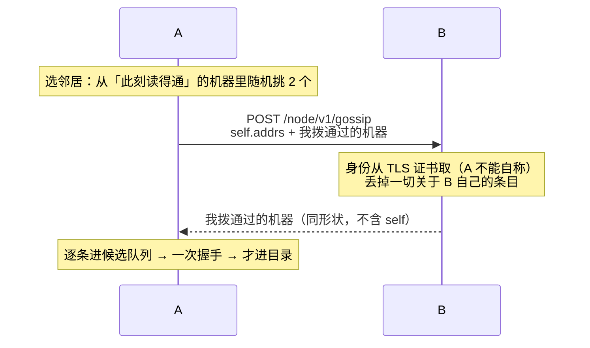

# Tachi 多节点协作：gossip 发现（转述）

状态：**设计；尚未实现。** 本文接在 `2026-10-14-a2a-discovery-design.md` 之后——那份定的是「候选面 + 连上即认」这条管道，本文给它加第三个供给者。已落地的前提不重复论证：身份从证书推出（`NodeIDFor`）、双向 TLS、pin 以 `node_id` 为键、一条公告必须先过一次握手才能变成目录里的一行。

> 这是日期方案，不是行为手册；配置形状与接口是设计示意。落地后把稳定下来的部分回写 `docs/agents/node.md`。

## 一、已拍定的选择

1. **gossip 是「候选来源」的第三个供给者，不是第三种机制。** mDNS 公告、gossip 转述、配置里的 `peers:` 三条路合流在同一处：一个**待验证候选**。转述不产生事实，它只产生「去拨一次」这个动作，入目录的规则一字不改。
2. **协议长在已有的远端 A2A 面上**（mTLS + 客户端证书），一条私有路由 `/node/v1/gossip`。不新开端口、不新造握手、不新造信任模型：调用方的身份由证书给出，它不能自称。
3. **只有私有路由，不是 A2A 协议。** 它挂在远端 mux 上，和 Card 那条路由是兄弟，**不进 A2A handler 链**（不碰受理、不建任务、不落记录），所以错误就是我们自己的 HTTP 状态码，`google.rpc.Status` 那套 domain 把戏在这里没有位置。
4. **转述的内容只有一句：我此刻亲手拨通过的机器。** 不是「我听说过」，不是「我配置里写过」，不是「我觉得它还活着」。链条因此自然终止在拨不通的地方——第二跳敢告诉你，是因为它自己真的连上了。
5. **不做 SWIM，不做失败检测，不做成员数。** 「它还活着吗」在这个系统里是**每轮、每条连接**回答的（读得通卡片 = Reachable），只对当下那一刻负责；没有任何东西需要法定人数。再加一套失败检测就是给同一个问题造第二个答案。
6. **不落盘。** gossip 状态全在内存里：没有新文件、没有新格式、没有要迁移的东西。durable 的那一半（pin、委派记录）一个字节都不动。
7. **转述不带名字、不带 Card、不带存活状态。** 名字是对端自称的、三台机器出厂全叫 `Tachi`；Card 在握手之后从本人那里读，比转述可信；「它五分钟前活着」是这条线上最没用的东西。
8. **两个开关，默认全关**：`enabled`（问邻居 + 收转述）、`relay`（回答别人的问）。和 mDNS 的 `enabled`/`advertise` 是同一对：学习与对外说话是两件事。
9. **发现是单向的，这一条不被打破**（理由见 §七）。

不做：跳数计数、失败检测 / incarnation、转述对端的自称名、持久化、一有新条目就立刻广播（那是自己给自己造放大器）、gossip 子类型 / 分域。

## 二、一次交换的全过程



一次往返双向都学到了东西（push-pull）：请求那一半是我的所知，应答那一半是它的。

## 三、一个条目是什么

```json
{ "self":  { "addrs": ["https://100.90.0.3:7080"] },
  "peers": [ { "id": "<32 位十六进制>", "addr": "https://192.168.71.167:7080", "age": 42 } ] }
```

- **`id`** 是那个身份，形状判据就是 `IsNodeID`（和 TXT 的 `id` 同一道检查）。
- **`addr` 是转述者拨通的那一个地址**，不是它配置里写的那个。理由是它能给出的最好的东西就是「我刚刚从这个地址连上了它」——卡片缓存里记着哪一条地址应答了（`fetchCard` 返回 served）。
- **`age` 是秒数，不是时间戳**：机器之间的钟不可信，而接收方本来就要用自己的钟再判一次。它直接来自卡片缓存的时间。
- **`self.addrs`** 是问的人说自己在哪里（config 的 `node.public_url`——「调用方能拨到的地址」本来就是它的定义）。它唯一的用处是让**收到问的那台机器**知道问它的人在哪：一台既承载又出站的机器，会在被它调用的那台机器的表里出现。它同样只是一句自称，照样走候选队列。
- 应答**没有 `self`**：问的人刚刚拨通了应答者，不需要被告知应答者在哪里。

**语义一句话：这是一次介绍，不是一条事实。**

收到 `{id, addr}` 时做的唯一动作，和收到一条组播公告时一模一样：排进候选队列，去拨一次。拨通了 → 证书推出身份 → 写 pin → 进目录；拨不通 → 退避重试，超时丢掉。它永远不会因为「别人说了」变成一行。

这条不是新规则，是现成的：`mdnsBrowser.Sightings()` 返回的只有 `b.seen`，`b.seen` 只由 `confirm()` 写，而 `confirm()` 只在验证成功之后被调。gossip 就是往同一张 `pending` 里也放东西。

顺着这条，三件好事自动成立：

1. **一个转述者撒谎，只会让本机多拨一次号。** 若它声称 `id=X` 而那个地址上答话的是 `Y`，`verifierOf` 返回的就是 `Y`（它从应答地址的 pin 里读回来，不假设），于是本机认识的是真的那台机器——和「相符也只说明这个地址上确实是这个身份」完全同构。
2. **半径由真实可达性决定，不需要跳数。** 我转述的每一条都是我自己验证过的，所以每多一跳都要多一次成功的握手；够不到的地方链条就没了。
3. **谎言的传播链被我自己切断**：一个我从没验证过的条目，绝不会出现在我发出去的负载里。

### 地址排序

`prependAddrs` 那一家（一处改），新加一档：**对端自述的 → 我亲手拨通过的那个 → 转述来的 → 配置里的**。配置地址永远在最后、永不删除（首次接触的入口）。前三档都是「有过证据的」，第四档是「人写下的意图」。

## 四、邻居与种子

- **邻居 = 目录里此刻读得通的机器**（卡片读得通 ⇔ 有身份 ⇔ 我验证过它）。绝不跟一台没验证过的机器 gossip：介绍必须来自一个我证明过的人。
- **种子集 = 配置 + mDNS。** 所以 gossip 不替代它们，它把「我能看见的」变成「它们能看见的」：局域网一跳之外、别人配置里写过、而**我这儿一行配置都没有**的机器——这是它唯一真正扩出来的那圈。
- 节奏：一个周期（约 45s ± 抖动）挑 2 个邻居换一次；启动 / 附着之后再补一次，用来入网。**不做「一有新条目就广播」**。
- 位置和浏览器一样：挂在 `DelegatorCache` 上（发送侧第一次被要的时候起来，`Close()` 一起停），所以**只当调用方的进程照样能 gossip**（这是出站动作），而 `-p` 照旧整个关掉发现。

## 五、协议这一层

- 路由：`POST /node/v1/gossip`（远端 mux 上的私有路由，命名跟 `/local/v1/handshake` 一个路子）。
- **loopback 明文面直接拒绝**：那个面上没有证书 = 没有身份 = 不谈。和 A2A 面「离开 loopback 才加密并要求客户端证书」是同一个开关读出来的两半。
- 身份取法就是 `callerNodeID(r)`：读连接的 `r.TLS.PeerCertificates[0]`，从 ed25519 公钥推 `NodeIDFor`。**请求里没有任何东西能到达身份**。
- **丢掉一切关于收件人自己的条目**（别告诉一台机器它自己在哪里）。
- `relay` 关：**回空视图，不回 404**。「我不说」和「这里没这个东西」是两件事，前者才是真的。
- 应答是一次纯内存读 + 序列化，受 `limitBody` 与 `maxRequestBodyBytes` 兜底。
- 版本写在路径里（`/v1`）。**没有独立的协议版本头**：这个路由不是 A2A，`A2A-Version` 在这里没有意义。

### 转述集合从哪来

「此刻读得通」这件事只有**发送侧**知道（卡片缓存 + pin），而发送侧住在入口点的 `DelegatorCache` 里；节点服务是从配置造出来的（`StartOrAttachNode(ctx, cfg)`），两者之间今天没有接线。所以这里要一个**显式的注册点**：

```go
// node/gossip.go
// 本进程的本地发送侧，若它有：由持有 DelegatorCache 的入口点在构造时登记、Close 时撤销。
// 读它的只有 gossip 的应答侧——「我此刻能证明什么」是发送侧才知道的事。
func SetReachableSource(fn func() []gossipEntry)
```

没登记（或这台机器根本没有发送侧）→ 应答为空。这是诚实的答案：**我此刻没有任何东西可以为它背书**。注入式函数在这个代码库里是现成的形状（`browser.setVerifier`、`PeerList` 的探测函数都是从外面注入的），所以这不是新的模式。

被否掉的替代：**只转述 pin 记录里的身份**。它不需要接线（pin 就在节点自己的数据目录里），但 pin 没有 `last_seen` 字段——只有 `first_seen`——所以它会把几个月前见过、后来搬走了的地址一直转述出去。多一次白拨是一回事，把「我见过」当成「我保证」是另一回事。

## 六、边界（谁都能发的东西，得有上限）

| 边界 | 怎么落 |
| --- | --- |
| 只拨私网 / 链路本地 | 复用 `isLocalAddr`。它已经认 CGNAT `100.64/10`，所以网格地址天生合法，公网地址天生被丢 |
| 验证速率 | **和 mDNS 共用同一个候选队列、同一个 `verifyLoop`**：一个 tick 一条连接，无论网上有多少包。两套循环各拨各的 = 拨号速率翻倍，所以这里必须是同一个 |
| 队列不被挤爆 | 候选队列与请求体各自设上限，**复用现成的 `maxDiscoveredPeers`（64）**，不新增魔法数 |
| 先手压流言 | 同一 tick 有多个到期时，**本地看到的那条优先于转述来的**。排序规则是同一个道理的两次应用 |
| 应答不做工作 | 纯内存读，见 §五 |
| 年龄上限 | 超过 `discoveryTTL`（1 小时）的不转述——我自己都不再算「见到」它了。**一个时钟，不是第二个** |

## 七、单向性没有被打破

`node.md` 里写着「发现是单向的：只当调用方的进程能发现别人，别人发现不了它」。加入 gossip 之后这句仍然成立，理由值得写下来：

请求里带的 `self.addrs` 是一句自称，所以它在接收方那边同样只能进候选队列——去拨一台不承载服务的机器必然失败，于是它永远进不了对方的目录。一台「只发不收」的机器，在别人的表里还是不存在。

唯一的副产品是它请求过的那台机器在**那一次**知道它的身份与地址，而「知道它的身份」今天就已经如此（`source_node_id` 就是这么来的）。差别只是那台机器可以顺手把身份 pin 下来——这一条**不做**，它和 gossip 无关（见 §十一）。

## 八、代码落点

| 位置 | 改什么 |
| --- | --- |
| `node/gossip.go`（新） | 客户端循环（选邻居、交换、退避、开关、`Close`）、服务端 handler、负载编解码、`SetReachableSource` |
| `node/a2a.go` | 远端 mux 上加一条 `/node/v1/gossip`（`a2asrv.WellKnownAgentCardPath` 的兄弟）；loopback 面拒绝；`relay` 关回空视图 |
| `node/sightings.go`（新，从 `node/discovery.go` 抽出） | 「已证实集合 + 候选队列」收敛成一处：browser 与 gossip 都往里写。候选加来源，同 tick 的优先序靠它。**`peerDirectory.discover` 一行不用改** |
| `node/delegatorcache.go` | `startBrowser` → `startDiscovery`（起两条腿）；`Close` 一起停；登记 / 撤销 `SetReachableSource`；`Discovery` 加 `SelfAddrs`（从 `cfg.Node.PublicURL` 来，`DiscoveryOf` 是唯一那份映射）；缓存记住「最后一次被问到的 peers」给循环用（发送侧会随对端列表重建，循环需要一个稳定的访问点） |
| `config/config.go` | `GossipDiscoveryConfig{ enabled, relay }`，挂在 `node.discovery` 下，默认全关 |
| `node/peerdir.go` | `prependAddrs` 一家加一档（§三）；面板要显示来源的话 `peerEntry` 加一个字段 |
| `node/peerboard.go` + Wails bindings | 面板详情标一句「从 tachi@home-nas 处听来」。提醒那行**不加**——每轮都在付这笔 token |
| `docs/agents/node.md` | 落地时同轮改：「发现（mDNS）」一节改成两条腿；写清转述只说自己证明过的、以及单向性为什么没被打破 |

## 九、阶段

| 阶段 | 内容 | 不开网就能测 |
| --- | --- | --- |
| 0 | 抽出共享的已证实集合 + 候选队列（mDNS 行为不变） | 能（现有 `discovery_test.go` 就是回归网） |
| 1 | 服务端：路由、编解码、注册点、开关与拒绝 | 能（假调用方） |
| 2 | 客户端循环：选邻居、交换、退避、`Close` | 能（假 sender） |
| 3 | 三进程组成：A 只配了 B，B 配了 C，A 不认识 C —— A 必须经由 B 发现 C 并委派成功 | 冒烟 |

阶段 0 单独成阶段是有原因的：它是**唯一一处有回归风险的重构**，而它的正确性判据是「现有测试一条不改还是绿的」。先做它，后面全是加法。

## 十、验收与测试

单测（假邻居，不开网）：

- 转述来的条目**验证通过前不进目录**；验证失败的进不了（和公告同一条规则）。
- 谎报身份：声称 X 的地址上答话的是 Y → 目录记的是 Y，并记一行警告。
- 转述集合里**只出现我拨通过的**：从别人那儿听来、我自己还没验证的，绝不进我发出的负载。
- 过滤自己；过滤收件人自己；超龄（> `discoveryTTL`）的不转述。
- 公网地址被丢；队列上限；同一 tick 里本地来源优先于转述来源。
- 开关：`enabled` 关 → 一个包都不发；`relay` 关 → 回空视图，条目一条都不外泄；loopback 明文面拒绝；没登记发送侧 → 空视图。
- 身份：请求里放什么都不能改变 `callerNodeID` 的结果。

组成（真 config、真二进制，照 `itest/run/delegation_tls_test.go` 的架子）：

- A→B→C 那条链（阶段 3）。
- 三台机器里有一台换了地址，另外两台在 TTL 内自己收敛。

## 十一、待固定

1. **周期与扇出**的取值（45s ± 抖动 / 2 个邻居）——它们直接决定一条新机器多久传遍全网，也决定稳态开销。
2. 面板要不要显示来源（要动 Wails bindings）。不要的话 `peerboard.go` 那一行整块可以不做。
3. 服务端要不要按调用方限流。倾向先不加：应答是纯内存读，而「谁能到这个端口」的立场已经定了（网络的事）。
4. 接收方要不要顺手 pin 下调用方的身份（今天只在 `source_node_id` 里留个 id）。这**与 gossip 无关**，但它是「接收方谁都没 pin → 每个 id 都解析成未知」那个已知缺口的正解，值得单独一次决定。
5. `self.addrs` 要不要留在 v1。它换来的是「一台既承载又出站的机器能在被它调用的那台机器的表里出现」，代价是负载上多一个自称字段。
