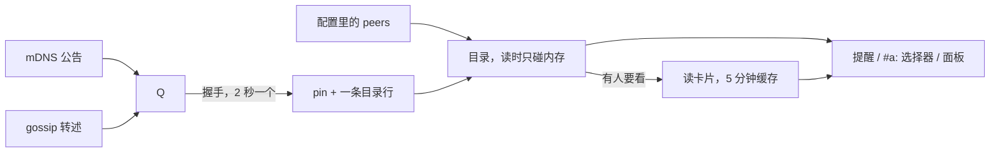
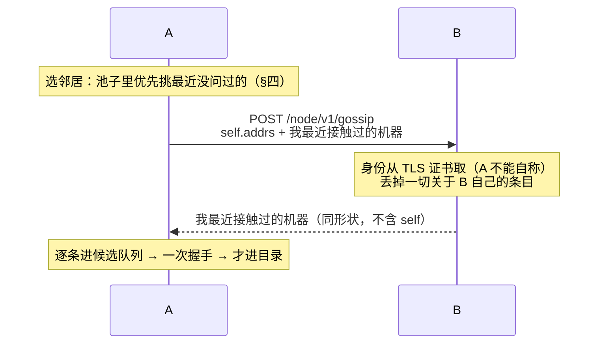
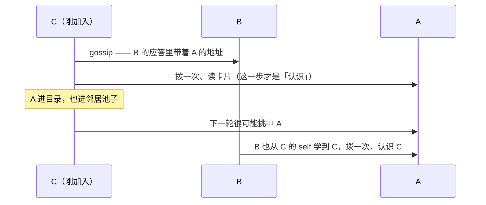

# Tachi 多节点协作：gossip 发现（转述）

状态：**设计；尚未实现。** 本文接在 `2026-10-14-a2a-discovery-design.md` 之后——那份定的是「候选面 + 连上即认」这条管道，本文给它加第三个供给者。已落地的前提不重复论证：身份从证书推出（`NodeIDFor`）、双向 TLS、pin 以 `node_id` 为键、一条公告必须先过一次握手才能变成目录里的一行。

> 这是日期方案，不是行为手册；配置形状与接口是设计示意。落地后把稳定下来的部分回写 `docs/agents/node.md`。

## 一、已拍定的选择

1. **gossip 是「候选来源」的第三个供给者，不是第三种机制。** mDNS 公告、gossip 转述、配置里的 `peers:` 三条路合流在同一处：一个**待验证候选**。转述不产生事实，它只产生「去拨一次」这个动作，入目录的规则一字不改。
2. **协议长在已有的远端 A2A 面上**（mTLS + 客户端证书），一条私有路由 `/node/v1/gossip`。不新开端口、不新造握手、不新造信任模型：调用方的身份由证书给出，它不能自称。
3. **只有私有路由，不是 A2A 协议。** 它挂在远端 mux 上，和 Card 那条路由是兄弟，**不进 A2A handler 链**（不碰受理、不建任务、不落记录），所以错误就是我们自己的 HTTP 状态码，`google.rpc.Status` 那套 domain 把戏在这里没有位置。
4. **转述的内容只有一句：我最近亲手接触过的机器**（读通一次卡片，或者完成过一次交换）。不是「我听说过」，不是「我配置里写过」，不是「我觉得它还活着」。链条因此自然终止在连不上的地方——第二跳敢告诉你，是因为它自己真的连上了。
5. **不做 SWIM，不做失败检测，不做成员数。** 「它还活着吗」在这个系统里是**每轮、每条连接**回答的（读得通卡片 = Reachable），只对当下那一刻负责；没有任何东西需要法定人数。再加一套失败检测就是给同一个问题造第二个答案。
6. **不落盘。** gossip 状态全在内存里：没有新文件、没有新格式、没有要迁移的东西。durable 的那一半（pin、委派记录）一个字节都不动。
7. **转述不带名字、不带 Card、不带存活状态。** 名字是对端自称的、三台机器出厂全叫 `Tachi`；Card 在握手之后从本人那里读，比转述可信；「它五分钟前活着」是这条线上最没用的东西。
8. **一个开关，默认关**：`enabled`。开了就同时学习和对外说话——mDNS 的 `advertise` 去掉，gossip 不再有 `relay`。不做「只听不说」这一档，因为那是让人去配一件大多数人都会配错的事，而成本那一侧的真相是：**谁能到这个端口，谁就能问你的邻居表**（§五），所以这一个开关同时也是一句关于暴露面的声明。
   - **这是一次静默的行为变化**（非严格解析，`yaml.Unmarshal` 忽略未知字段，所以不会报错）：原来写 `enabled: true, advertise: false` 的机器，升级后会开始公告自己；`advertise: true, enabled: false`（只公告不浏览）这一档不再可表达。
9. **发现是单向的，这一条不被打破**（理由见 §七）。
10. **`self.addrs` 留在 v1**（取值与理由见 §三）。它是可选字段——不加它协议照样自洽，只是「你调用过的那台机器不会因此认识你」。留它的意义是让方向对称：一台既承载又出站的机器，也能出现在它调用过的那台机器的表里。

不做：跳数计数、失败检测 / incarnation、转述对端的自称名、持久化、一有新条目就广播给所有人（那是自己给自己造放大器）、gossip 子类型 / 分域、**现成的 gossip 库**（理由见下）。

**为什么不用 memberlist / SWIM 那一类库。** 它们的价值集中在「成员与存活」：节点身份是一个**自己起的名字**（`Node.Name`）+ 一把**集群共享密钥**，自己的 TCP/UDP 监听，可疑与 incarnation 的状态机（Alive/Suspect/Dead/Left），以及为「广播任意应用数据」设计的重传（`RetransmitMult * log(N+1)`）。而这几样恰好都是我们明确不要的（§一.5、§一.6），并且第一样直接和本系统的根规则冲突：这里「这是哪台机器」只有一个答案——证书里的公钥推出来的身份——引入一个共享密钥 + 自起名字的成员视图，就是给同一个问题加第二个、而且更弱的答案。我们需要的形态只有一句：**在已有的 mTLS 面上做一次幂等的地址集合交换**；库能替我们省下的（重传调度、大集群扇出）在几十台以内几乎不值钱，而它要求我们额外付出的（新端口、新密钥、新成员视图）是实打实要维护的东西。

## 二、一次交换，以及它不在读取路径上

### 三条来源的差别只在「谁把它写进内存」

| 来源 | 谁写进内存 | 读目录时会等网络吗 |
| --- | --- | --- |
| 配置 `peers:` | 每轮读 config（改了下一轮生效） | 不 |
| mDNS 公告 | 浏览器在后台验证成功后写 | 不 |
| gossip 转述 | 循环在后台验证成功后写 | 不 |

所以 gossip 的异步性是**填表**的异步性，不是**读表**的异步性：`peerDirectory.build()` 永远只读内存。一个读者（委派提醒、`#a:` 选择器、面板、一次委派）永远不会因为「正在 gossip」而等——它读到的是此刻表里有什么，而 gossip 只是在后台改这张表。这正是「最终一致」在这里的全部含义：没有阻塞，也没有承诺时限。

### 整条链的形状



三层，各回答一个问题：

1. **来源层**（配置 / mDNS / gossip）→「你可能在哪」。配置是人写的**意图**（不过期、永远在列），另外两个是网络上的**事实**（会过期）。
2. **证实层**（一次握手）→「你到底是谁」。**这是唯一能把「声称」变成「知道」的地方**，产物是 pin。
3. **读取层**（目录 + 卡片快照）→「现在有哪些 peer」。只读内存、永不等网络，所以每个 turn、每次按键都可以调它。

两个容易搞错的细节：

- **「读卡片」出现两次**，产物与路径都不同：候选验证（在发现**之内**，产物是 **pin**，不共享缓存、每次都真拨）与卡片快照（在发现**之后**，产物是名字/技能/可达性，5 分钟缓存，见 §三）。别把它当成「发现之后统一做一次」。
- 试地址是**一台机器一条候选、一组地址按顺序试到通为止**，不是「每个地址各问一次」：候选以**身份**为键（早先按地址排队时，一台有十几个 IPv6 地址的机器要半分钟才被发现），地址先过滤（只 https、IPv6 链路本地一律不拨、IPv4 排前面），顺序与超时见 §三「地址排序」。

### 一次往返



一次往返双向都学到了东西（push-pull）：请求那一半是我的所知，应答那一半是它的。

## 三、一个条目是什么

```json
{ "self":  { "addrs": ["https://100.90.0.3:7080"] },
  "peers": [ { "id": "<32 位十六进制>", "addr": "https://192.168.71.167:7080", "age": 42 } ] }
```

- **`id`** 是那个身份，形状判据就是 `IsNodeID`（和 TXT 的 `id` 同一道检查）。
- **`addr` 是转述者拨通的那一个地址**，不是它配置里写的那个。理由是它能给出的最好的东西就是「我刚刚从这个地址连上了它」——卡片缓存里记着哪一条地址应答了（`fetchCard` 返回 served）。
- **`age` 是「转述者上次亲手接触它，距今多少秒」**——用的就是它卡片缓存里那个时间戳（`peerCard.at`）。取秒数不取时间戳，是因为机器之间的钟不可信，而接收方本来就要用自己的钟再判一次。它有明确的去处，三条：①**转述方**拿它过滤（超过 `contactTTL` 的不转述，见下）；②**接收方**拿它定这条候选的重试预算（越旧越少拨，越接近窗口上限就只拨一次）；③日志与面板里能说清「这个地址是别人 42 秒前刚用过的」。
- **`self.addrs`：问的人自己说「我在这些地址上」（取值来自 config 的 `node.public_url`）。** 形状是**一组**而不是一个，为的是不引入第二种形状：地址在别处一律是一组（`peerEntry.Addrs`、Card 的接口列表、mDNS 解出来的地址组），而接收方本来就是把收到的东西并进一个地址组。今天的取值确实只有一个。为什么需要它：A 去问 B 的时候，B 只看得到 A 的 **TCP 源地址**，而那个地址不能拿来回拨——它可能是 NAT 或网格的出口，也可能只是一个临时端口，都不是 A 的 A2A 监听地址。什么都不说，B 学到的就只是「有个身份叫 X 的来问过我」——**一行没有地址的记录**，B 永远没法把活派给它。带上之后 B 就有了一个候选地址：拨通一次，它就真认识 A 了。**它同样只是一句自称**（B 照旧要走那次握手），而且对一台不承载 A2A 服务的机器没用——那种机器拨不通，也就进不了 B 的表（§七）。
- 应答**没有 `self`**：问的人刚刚拨通了应答者，不需要被告知应答者在哪里。

**语义一句话：这是一次介绍，不是一条事实。**

收到 `{id, addr}` 时做的唯一动作，和收到一条组播公告时一模一样：排进候选队列，去拨一次。拨通了 → 证书推出身份 → 写 pin → 进目录；拨不通 → 退避重试，超时丢掉。它永远不会因为「别人说了」变成一行。

这条不是新规则，是现成的：`mdnsBrowser.Sightings()` 返回的只有 `b.seen`，`b.seen` 只由 `confirm()` 写，而 `confirm()` 只在验证成功之后被调。gossip 就是往同一张 `pending` 里也放东西。

顺着这条，三件好事自动成立：

1. **一个转述者撒谎，只会让本机多拨一次号。** 若它声称 `id=X` 而那个地址上答话的是 `Y`，`verifierOf` 返回的就是 `Y`（它从应答地址的 pin 里读回来，不假设），于是本机认识的是真的那台机器——和「相符也只说明这个地址上确实是这个身份」完全同构。
2. **半径由真实可达性决定，不需要跳数。** 我转述的每一条都是我自己验证过的，所以每多一跳都要多一次成功的握手；够不到的地方链条就没了。
3. **谎言的传播链被我自己切断**：一个我从没验证过的条目，绝不会出现在我发出去的负载里。

### 地址排序

`prependAddrs` 那一家（一处改），新加一档：**对端自述的 → 我亲手拨通过的那个 → 转述来的 → 配置里的**。配置地址永远在最后、永不删除（首次接触的入口）。前三档都是「有过证据的」，第四档是「人写下的意图」。

### 一个条目活多久，以及一台机器永远消失之后

两种窗口，回答两个不同的问题。这**不是**被禁的那种「同一个问题两个答案」——那条禁令针对的是两套规则在决定同一件事（比如「这东西什么时候被删」）；这里是两件不同的事：

| 窗口 | 多长 | 回答什么 | 谁刷新它 |
| --- | --- | --- | --- |
| `contactTTL` | 10 分钟 | 我愿不愿意替它背书（转述集合） | 读通一次卡片，或者完成一次交换 |
| `discoveryTTL` | 1 小时（既有） | 那一行还在不在目录里 | 一次握手验证、**一次成功的交换**，或者它是一条配置行（人写的意图，不需要证据） |

同一份证据（「我最近真的碰到过它」），两个松紧不同的用途：**对外说话要更紧**——说错话比少说一句糟。

**「接触」什么时候发生**（上面两个窗口能不能被刷新，全看这个）：读卡片不是定时的，它由六件事驱动——每一轮的委派提醒（`PeersReminder` → `Sender.Peers` → `Snapshot`）、打开 `#a:` / `@` 选择器、节点面板（刷新按钮会把整份缓存作废并重读）、进程启动的预热、**候选验证**（mDNS 公告 / gossip 转述）、以及点名一个还没有身份的条目（`Lookup` → `probeStrangers`）。三条要知道的：

- **缓存是唯一的节流**：`cardTTL` = 5 分钟，成功与失败一起缓存。所以 `Snapshot` 才敢在每个 turn 里被调用——否则一台下线的对端会让每一轮都白等一次超时。
- **候选验证不共享这个缓存**，它自己就是一次「拨号 + 读卡片」，产物是 **pin** 而不是缓存里那条；验证节奏是 `discoveryTick` = 2 秒一条，失败退避 `discoveryRetry` = 30 秒。同网段的一行之所以一直活着，靠的正是它——mDNS 每 1~2 分钟重新公告一次，每次都重新验一次，不是靠缓存。
- 因此「读通卡片」在两个地方留痕，别混：**pin**（只在第一次接触时写）与**卡片缓存里的 `at`**（最多 5 分钟刷新一次，进程内内存）。

**为什么 `contactTTL` 是必须的，不是锦上添花**：一次成功的交换必须算作一次接触。否则**跨网段的表会在一小时后自己忘光**——那些机器没有组播替它们刷新（同网段的条目是 mDNS 每两分钟公告一次在刷的），而目录里的一行只在「最近被验证过」时存在。少了这一条，一个纯 gossip 的网格会在第一小时内慢慢忘掉所有人，然后只剩下配置行。

**一台机器永远消失之后**（比如虚拟机被销毁）：

1. 谁也碰不到它了 → 不再有人刷新它 → 各节点的 `contactTTL` 窗口过后，它从所有人的**转述集合**里消失（最多 10 分钟）。
2. 它的那一行从各自的目录里掉出去（1 小时）。**各自计时，不是逐跳累加**——每个节点用的是自己的窗口。
3. **pin 永久留着**（`peer-identities.json` 不删）。所以它用**同一个身份**回来（同一把钥匙，从备份恢复）时立刻是老相识，不需要重新「第一次接触」；而一次全新安装（新钥匙）在别人眼里是**新身份**，会大声记一次 UNVERIFIED。换钥匙就是换机器，这是对的。
4. **没有撤销消息，也不需要**：沉默就是撤销。没有任何节点有资格替别人说「它走了」，所以这里不做 goodbye。（mDNS 那边有乖离通知，因为那是机器自己说的。）
5. 如果它的地址被一台新机器拿走，会撞上「一个地址不能属于两个身份」→ `ErrIdentityMismatch`，点名两个 id 和那个文件，告诉你删哪一行。
6. 指向它的**旧委派记录**还在本机，续跑会被拒并说清「那台机器已不在目录里」——不猜，也不退回名字。

**和配置来的对端比一下**：配置行**永不自动移除**，够不到也一直列着并说明（那是人写的意图）；gossip 学来的会自己消失。这条分界线就是两者的全部区别。

## 四、邻居与种子

- **邻居池 = 目录里「有地址」的行**：配置行（哪怕还没被接触过——它本来就是首次接触的入口，跟它换一次手就是它的第一次接触，pin 是那次握手的副产物，和提醒的探测同一条路），以及过了握手的 sighting。**准入只有这两种：人写下的，或者我自己握过手的**——一个从别人那儿听来的条目，在它自己被验证之前永远进不了池子。
- **「最近接触过」只用来排优先级，绝不当门槛。** 当门槛会死锁：一台配置里的机器只要这轮轮转没轮到它，`contactTTL` 一过就被踢出池子，而它掉出池子就再也没人问它了。
- **挑法**：优先挑最近没问过的（轮转），同一轮里不重复，池子小于扇出就都问；**跳过刚失败过的**（`gossipMute` = 5 分钟的小表，和 `cardTTL` 同一个量级），否则每次轮到一台下线的配置机器都要白等一次超时。**抖动只是防同步与兜底**——让两个节点不会永远在同一轮互相问——它不是主要策略。
- **偏向视野不同的那个**：同网段的邻居和你看到的是同一批机器，问它基本只是刷新；跨网段（或跨网格）的那台才是唯一能给你新东西的——它是你的桥。判断「谁视野不同」**不要用先验**（技能是自称的，地址在哪个网段也不是视野的证据），**用结果**：记下每个邻居上一轮贡献了几条新东西，给过的下次优先。这是 novelty 加权，而「上一轮有没有带来变化」本来就要算，所以不新增机制。**不要把桥写死成 hub**：让贡献多的自然拿到更多轮次，写死的拓扑在 hub 挂掉时就断成两半。
- **一个必须成立的算术**：`周期 × 池子大小 / 扇出 < contactTTL`，否则总有邻居长期轮不到、吃不到刷新。今天 3 台 × 3 分钟 / 2 ≈ 4.5 分钟 < 10 分钟，安全；池子变大要么加扇出、要么拉长 `contactTTL`——这两个数从此不能各自独立改。池子 ≲ 10 时轮转就够了，novelty 加成只是让桥被问得更勤；真正需要它是从「池子明显大于扇出」开始。
- **不做协调**：不通知别人「我刚问过你」，不做长连接，不立「谁先谁后」的规矩——幂等 + 抖动就是为了免掉这些。
- **种子集 = 配置 + mDNS。** 所以 gossip 不替代它们，它把「我能看见的」变成「它们能看见的」：局域网一跳之外、别人配置里写过、而**我这儿一行配置都没有**的机器——这是它唯一真正扩出来的那圈。
- **节奏：稳态每 `gossipPeriod`（3 分钟）挑 `gossipFanout`（2）个邻居换一轮**，带抖动。所以「tachi 开着就一直在问」是对的——它是一条稳态心跳，代价是每 3 分钟两个小请求（负载是几十字节级的 JSON）。这也远小于 `contactTTL`，所以稳态里每一次接触都会被刷新，条目不会因为「没人碰它」而掉出去。启动 / 附着之后再补一轮，用来入网。
- **变了就把下一轮提前**到 `gossipNudge` = 10 秒（带抖动），触发条件是「我新证实了一台机器」或「我自己的地址变了」。它不是广播，是**自己**下次早一点问，而这是收敛速度的全部来源。
- 位置和浏览器一样：挂在 `DelegatorCache` 上（发送侧第一次被要的时候起来，`Close()` 一起停），所以**只当调用方的进程照样能 gossip**（这是出站动作），而 `-p` 照旧整个关掉发现。

### 一轮里发生什么，以及 C 加入时发生什么

先分清两件事，这是理解整套东西的钥匙：

- **一轮只是一个「发现的机会」**：它可能让我学到新条目，也可能什么也没有。
- **「我知道 A」不来自轮次，来自那次握手。** 一旦验证过，A 就在我的目录里、也在我的邻居池子里，哪怕我从此再也不问它。

C 加入时（它只知道 B，比如配置里写了 B）：



所以对「C 会不会再去问 A」的回答是：**会，但是「下一轮」，不是「收到应答就立刻」；而且是随机挑中的**（从 {A, B} 里挑 2 个，大概率问到 A，也可能先再问 B 一次）。这两点都不影响正确性：

- C **认识** A 靠的是第 2 步那次握手，跟问不问 A 无关；验证一过，C 就能委派给 A。
- A **认识** C 有两条路：C 问 A 时带来的 `self.addrs`，或者 B 转述（B 从 C 的请求里学到 C，自己拨通之后就成了 B 的「亲手证明过」）。两条路都不需要新机制。

度量级：一次交换是双向的，扇出 2，再加上「变了就提前」，一台新机器传遍全网是**秒到分钟**级，而不是一轮一跳的线性时间。

### 稳态是怎么达到的

没有收敛检测、没有成员数、没有协调——**每个进程自己的循环安静下来，就是稳态**。它只有三条机制，而其中第一条是全部的关键：

1. **「变化」的判据是目录的 CONTENT 变了**（多了一个身份，或者某个身份多了一条地址），**不是**「这一轮有人答话」。若把后者算成变化，每一轮都会把下一轮提前，快节拍就永远停不下来。这里有一个很具体的陷阱：**`age` 每轮都在变**，所以「我发出去的负载和上次不一样」这个判据是错的，它每一轮都会成立；判据必须是身份 + 地址的**集合**，不能带上任何时间戳。同一件事在 mDNS 那边已经解决过一次：`sameAddrs` 按集合比（它的注释写的就是「顺序是『谁最后说话』、每次都变，不算变化」），`PeerList.SetOnChange` 也是这条——「只看谁被答复、答复说了什么，不看取答案的时刻」。
2. **一轮什么都没变 → 不提前 → 回到节拍。** 所以稳态的定义就是「一轮改变不了任何东西」，而这件事由系统自己判出来，不需要谁宣布收敛。
3. **提前量有一个下限间隔**（防抖，约一个节拍）。变化是**一串**而不是一个：一轮可能带回来 5 台机器，而验证是「一 tick 一个连接」，于是「变化」会挨个到来；没有这道防抖，那一串会把节拍锁在快档上。

| 轮次 | 何时 | 这一轮 | 下一轮 |
| --- | --- | --- | --- |
| 启动轮 | t≈0 | 问种子，学到若干台 | 提前 |
| 提前轮 | t≈10s | 问新邻居，又学到几台 | 提前，但被防抖按住 → 走节拍 |
| 节拍轮 | t≈3min | 全是我已经知道的 | 节拍 |
| 节拍轮 | t≈6min | 还是全是我已经知道的 | 节拍 |

**「安静」不等于「静止」**：稳态里那几个轮次仍在做两件事——把被发现的条目一直刷着（所以它们在 1 小时的 TTL 里一直活着，否则一台机器明明还在、却会因为没人再提它而掉出列表），以及在某台机器搬家或下线时把这件事带过来（前者靠新地址，后者靠它不再出现在任何人的应答里，然后 1 小时后掉出去）。

**收敛到哪里，这里要诚实**：不是「人人知道人人」。一台机器只有在*有人告诉过我*、**而且我也真的拨通了它**之后才进我的表——所以稳态的目标是「我知道所有**我能连上、并且有人提过**的机器」。够不到的那台，别人再怎么说也进不来。这正是 §二 那句「不承诺时限」与 §一.5 那句「不需要失败检测」的实际含义。

## 五、协议这一层

- 路由：`POST /node/v1/gossip`（远端 mux 上的私有路由，命名跟 `/local/v1/handshake` 一个路子）。
- **loopback 明文面直接拒绝**：那个面上没有证书 = 没有身份 = 不谈。和 A2A 面「离开 loopback 才加密并要求客户端证书」是同一个开关读出来的两半。
- 身份取法就是 `callerNodeID(r)`：读连接的 `r.TLS.PeerCertificates[0]`，从 ed25519 公钥推 `NodeIDFor`。**请求里没有任何东西能到达身份**。
- **丢掉一切关于收件人自己的条目**（别告诉一台机器它自己在哪里）。
- **`enabled` 关 → 路由拒绝**（没有「我在听但我不说」这一档，所以没有空视图那回事）。开着但无话可说——没登记发送侧、或一台都还没拨通过——回空列表。
- **暴露面的代价要说清**：`enabled` 开着，就意味着**谁能到这个端口，谁就能问你的邻居表**（你亲手拨通过的那些机器的身份和地址）。这个系统的既定立场是「谁能到这个端口是网络的事」（任何证书都被接受），所以这句话也是这个开关的一部分含义：在一个只有自己几台机器的网格上无所谓，在一个别人也能到达的端口上就有所谓。
- **服务端只存在于承载节点的进程里**：远端面在哪儿，这条路由才能在哪儿。一个只出站的进程能问、不能被问——别在发送侧去伺候一条根本没有监听器的路由。
- **答的是「这个进程知道什么」，不是「这台机器知道什么」**：同一台机器上两个入口点（TUI 与桌面）是两个进程、各有各的发送侧，就各答各的。这不是缺陷，它只是「我此刻没有任何东西可以为它背书」的另一种说法。
- **线格式就是 §三 那个 JSON**：`self.addrs` 可选，两边每条最多 `maxDiscoveredPeers`（64）条，整体受监听器上的 `maxRequestBodyBytes` 兜底；形状不对或者读不出来 → **400 + 我们自己的措辞**（不是 A2A 的那套 `ErrorInfo`——这条路由不属于那个协议），响应是 `application/json`。
- **客户端走同一个 `remoteClient`**：TLS pin、地址顺序、首字节超时全都复用，一行新的网络代码都不用写。需要给它加一个方法（示意：`Exchange(ctx, e, payload []byte) ([]byte, error)`），并且**用自己那个短超时**（`gossipTimeout`，几秒量级）——一轮流言不值得借委派的 `requestTimeout` 去等。
- **一轮失败什么都不做**：不报错、不写进状态，下一轮照常（那台进 `gossipMute`）。成功记一行 debug；**真的学到新机器时记一行 info**（和 mDNS 那条 `discovered a node and proved its identity` 同级）。
- **跟一台还没接触过的配置行换一轮是合法的**：那就是它的第一次接触，pin 是那次握手的副产物，和提醒的探测走同一条路。别加一道「必须有身份才能 gossip」的闸门。
- 版本写在路径里（`/v1`）。**没有独立的协议版本头**：这个路由不是 A2A，`A2A-Version` 在这里没有意义。

### 转述集合从哪来

「我最近接触过谁」这件事只有**发送侧**知道（卡片缓存 + pin + 交换本身），而发送侧住在入口点的 `DelegatorCache` 里；节点服务是从配置造出来的（`StartOrAttachNode(ctx, cfg)`），两者之间今天没有接线。所以这里要一个**显式的注册点**：

```go
// node/gossip.go
// 本进程的本地发送侧，若它有：由持有 DelegatorCache 的入口点在构造时登记、Close 时撤销。
// 读它的只有 gossip 的应答侧——「我最近接触过谁」是发送侧才知道的事。
func SetReachableSource(fn func() []gossipEntry)
```

没登记（或这台机器根本没有发送侧）→ 应答为空。这是诚实的答案：**我此刻没有任何东西可以为它背书**。注入式函数在这个代码库里是现成的形状（`browser.setVerifier`、`PeerList` 的探测函数都是从外面注入的），所以这不是新的模式。

它是**进程级**的一个函数指针，**后登记者为准**，`Close` 时撤销：一个进程里只会有一个 `DelegatorCache`（TUI 的 `m.delegators`、桌面的 `d.delegator`、channel 的一个字段），而节点服务是从配置造出来的、拿不到调用者的对象——这就是为什么这里必须有一个全局，而它只被读、只存一个函数值。这个包对「进程全局」的警惕（`DelegatorCache` 的注释专门嫌弃过）针对的是**状态**，不是**一个注入的读取口**。

被否掉的替代：**只转述 pin 记录里的身份**。它不需要接线（pin 就在节点自己的数据目录里），但 pin 没有 `last_seen` 字段——只有 `first_seen`——所以它会把几个月前见过、后来搬走了的地址一直转述出去。而 §三 那个 `contactTTL` 恰恰就是它缺的新鲜度（只是活在内存里，不落盘：这是可重建的信息，不值得多一个要维护的文件）。多一次白拨是一回事，把「我见过」当成「我保证」是另一回事。

## 六、边界（谁都能发的东西，得有上限）

| 边界 | 怎么落 |
| --- | --- |
| 只拨私网 / 链路本地 | 复用 `isLocalAddr`。它已经认 CGNAT `100.64/10`，所以网格地址天生合法，公网地址天生被丢 |
| 验证速率 | **和 mDNS 共用同一个候选队列、同一个 `verifyLoop`**：一个 tick 一条连接，无论网上有多少包。两套循环各拨各的 = 拨号速率翻倍，所以这里必须是同一个 |
| 队列不被挤爆 | 候选队列与请求体各自设上限，**复用现成的 `maxDiscoveredPeers`（64）**，不新增魔法数 |
| 先手压流言 | 同一 tick 有多个到期时，**本地看到的那条优先于转述来的**。排序规则是同一个道理的两次应用 |
| 应答不做工作 | 纯内存读，见 §五 |
| 转述的新鲜度 | 只转述 `contactTTL` 窗口内接触过的机器（§三）。**对外说的话要比自己的表更保守**：表里的行能活 1 小时，但替它背书只在这个更紧的窗口内 |

## 七、单向性没有被打破

`node.md` 里写着「发现是单向的：只当调用方的进程能发现别人，别人发现不了它」。加入 gossip 之后这句仍然成立，理由值得写下来：

请求里带的 `self.addrs` 是一句自称，所以它在接收方那边同样只能进候选队列——去拨一台不承载服务的机器必然失败，于是它永远进不了对方的目录。一台「只发不收」的机器，在别人的表里还是不存在。

唯一的副产品是它请求过的那台机器在**那一次**知道它的身份，以及（带着 `self.addrs` 时）它自己声称的地址——而「知道它的身份」今天就已经如此（`source_node_id` 就是这么来的）。而**那台机器不把调用方的身份「pin」下来**（不写 TOFU 记录），这是一个决定：

看起来它能补上一个已知缺口（`node.md` 里那条「接收方谁都没 pin → 每个 id 都解析成未知」），但它**补不上**，还赔进去三样东西：

1. **它连显示都救不了。** `PeerAliases()` 只交出 `alias` 非空的记录，而 `alias` 是**配置里那个标签**。一台从没被配置过的机器被 pin 了，`alias` 是空的，会话行照样显示「未知节点 + id 前 8 位」。那个缺口的正解在**显示层**：把它的自称名从任务记录里取出来（`self_reported_name` 就在那儿），并标明「自称」。
2. **它花掉 TOFU 唯一的那一个信号。** 这份记录的语义是「本机第一次见到这把钥匙」，写的时候要大声记一行 UNVERIFIED。谁敲一下门就被记下来的话，本机将来第一次主动连它时，那条「第一次接触」就没有了。
3. **它什么都不换来。** pin 不产生目录里的任何一行（目录只由配置行 + 已证实的 sighting 组成），所以被 pin 的调用方既不能点名、也不能委派——只是多一行够不到的记录。加上任何能到达这个端口的人都发得出一次请求，这份文件会被陌生人撑大。

## 八、代码落点

| 位置 | 改什么 |
| --- | --- |
| `node/gossip.go`（新） | 客户端循环（选邻居、交换、退避、开关、`Close`）、服务端 handler 与它的 400、负载编解码、`SetReachableSource`，以及常量 `gossipPeriod` / `gossipFanout` / `gossipNudge` / `gossipTimeout` / `contactTTL` / `gossipMute` |
| `node/remoteclient.go` | 加一个 `Exchange(ctx, e, payload)`：复用 `request` 与 `clientFor`（TLS pin、地址顺序、首字节超时），用自己的 `gossipTimeout` |
| `node/a2a.go` | 远端 mux 上加一条 `/node/v1/gossip`（`a2asrv.WellKnownAgentCardPath` 的兄弟）；loopback 面拒绝；`enabled` 关时拒绝这条路由 |
| `node/sightings.go`（新，从 `node/discovery.go` 抽出） | 「已证实集合 + 候选队列」收敛成一处：browser 与 gossip 都往里写。候选加来源，同 tick 的优先序靠它。**`peerDirectory.discover` 一行不用改** |
| `node/delegatorcache.go` | `startBrowser` → `startDiscovery`（起两条腿）；`Close` 一起停；登记 / 撤销 `SetReachableSource`；维护挑选需要的三个小表：「最近接触过谁」（`contactTTL`，一次成功的交换或读通一次卡片都刷新它）、「上次问过谁」（轮转）、「谁刚失败过」（跳过）；`Discovery` 加 `SelfAddrs`（从 `cfg.Node.PublicURL` 来，`DiscoveryOf` 是唯一那份映射）；缓存记住「最后一次被问到的 peers」给循环用（发送侧会随对端列表重建，循环需要一个稳定的访问点） |
| `config/config.go` | `GossipDiscoveryConfig{ enabled }` 挂在 `node.discovery` 下，默认关；**同时删掉 `MdnsDiscoveryConfig.Advertise`**（§一.8：两处都只留 `enabled`），所以 mDNS 那一段的注释（讲「想找不想被找到」的那段）要一并重写。删字段只会踩到一处：`itest/run/discovery_test.go` 里那句 `Mdns.Advertise = true` |
| `node/peerdir.go` | `prependAddrs` 一家加一档（§三）；面板要显示来源，所以来源要能区分三个词（`local` 配置写的 / `mDNS` 本机看到的 / `gossip` 从邻居听来的，一台机器可以同时是前两个），并跟着 `discoveredPeer` 一起传上去 |
| `node/peerboard.go` + Wails bindings | 面板那一列显示来源词：`local` / `mDNS` / `gossip`，可以是组合（`local · mDNS`）；**不显示具体是从哪台机器听来的**——那是日志的事（日志里写清 node id）。提醒那行**不加**——每轮都在付这笔 token |
| `docs/agents/node.md` | 落地时同轮改：「发现（mDNS）」一节改成两条腿；写清转述只说自己证明过的、以及单向性为什么没被打破 |

## 九、阶段

| 阶段 | 内容 | 不开网就能测 |
| --- | --- | --- |
| 0 | 抽出共享的已证实集合 + 候选队列（mDNS 行为不变） | 能（现有 `discovery_test.go` 就是回归网） |
| 1 | 服务端：路由、编解码、注册点、开关与拒绝 | 能（假调用方） |
| 2 | 客户端循环：选邻居、交换、退避、`Close` | 能（假 sender） |
| 3 | 三进程组成：A 只配了 B，B 配了 C，A 不认识 C —— A 必须经由 B 发现 C 并委派成功 | 冒烟 |

阶段 0 单独成阶段是有原因的：它是**唯一一处有回归风险的重构**，而它的正确性判据是「现有测试一条不改还是绿的」。先做它，后面全是加法。

§一.8 那条合并开关（删 `Advertise`、两处都只留 `enabled`）也建议**单独一次提交**：它改的是**现有行为**，而后面几个阶段加的都是新东西——混在一起，回归的时候分不清是谁的锅。

## 十、验收与测试

单测（假邻居，不开网）：

- 转述来的条目**验证通过前不进目录**；验证失败的进不了（和公告同一条规则）。
- 谎报身份：声称 X 的地址上答话的是 Y → 目录记的是 Y，并记一行警告。
- 转述集合里**只出现我拨通过的**：从别人那儿听来、我自己还没验证的，绝不进我发出的负载。
- 过滤自己；过滤收件人自己；超龄（> `discoveryTTL`）的不转述。
- 公网地址被丢；队列上限；同一 tick 里本地来源优先于转述来源。
- 开关：`enabled` 关 → 一个包都不发，来的问也被拒；开着但没登记发送侧 → 空列表；loopback 明文面拒绝。
- 提前量：新证实一台机器之后，下一轮确实提前了；并且被防抖（两次提前之间至少隔一个稳态周期）。
- **稳态**：一轮什么都没变 → **不**提前；同一个身份、同一组地址、只有 `age` 变了 → **不算**变化（§四「稳态是怎么达到的」那条判据）。
- **挑选**（§四）：配置行即使从未被接触也在池子里，而且**不会因为「最近没接触过」而被踢出去**（那个死锁的回归测试）；最近问过的排在后面、同轮不重复、池子小于扇出时都问；刚失败过的被跳过。
- **一台机器消失之后**（§三那个时间线）：`contactTTL` 过后它从转述集合里消失；`discoveryTTL` 过后它的行掉出目录；pin 留着；用同一把钥匙回来时不产生第二次「第一次接触」。
- **跨网段的自持**：一台机器从不组播、只靠 gossip 学来的条目，在一次成功的交换之后仍然活着（少了「交换也算接触」这条，它一小时后必掉——这是最容易漏掉的一条）。
- 身份：请求里放什么都不能改变 `callerNodeID` 的结果。
- **线格式的拒绝**：形状不对或读不出来的请求 → 400 且**什么都不建**（不排队、不写状态）；超过上限的条目被拒而不是悄悄截断；`self.addrs` 缺失 → 正常工作（它只是可选）。
- **注册点**：后登记者为准；`Close` 之后应答为空；一个进程里没有 cache 时也是空。

组成（真 config、真二进制，照 `itest/run/delegation_tls_test.go` 的架子）：

- A→B→C 那条链（阶段 3）。
- 三台机器里有一台换了地址，另外两台在 TTL 内自己收敛。
