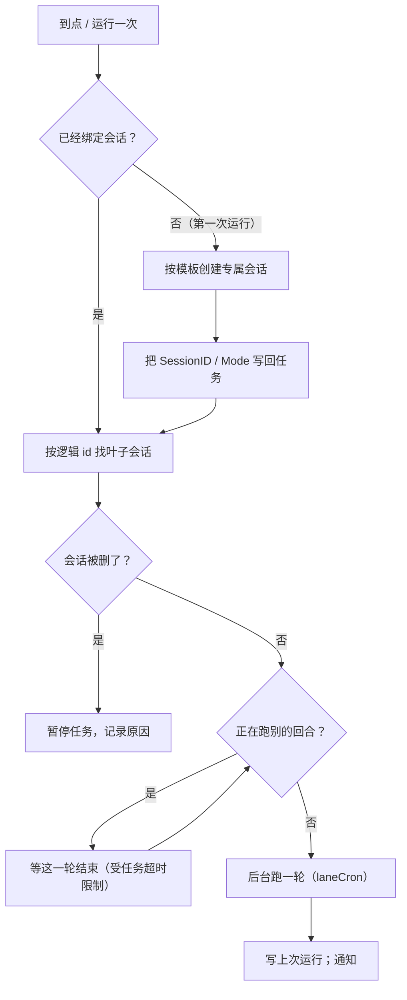

# Desktop 定时任务（cron）设计

> 设计文档，已按此实施（2026-10-18）。目标：让 desktop 复用同一套 cron 调度器，补上任务管理界面，并让任务在会话压缩后继续跟着这段对话。
>
> 体验稿：[2026-10-18-desktop-cron-prototype.html](2026-10-18-desktop-cron-prototype.html)（静态 HTML，不是应用的一部分）。

---

## 目录

1. [目标与非目标](#1-目标与非目标)
2. [现状：决定这份设计的事实](#2-现状决定这份设计的事实)
3. [体验总览](#3-体验总览)
4. [身份：跨压缩的那条线](#4-身份跨压缩的那条线)
5. [任务数据模型](#5-任务数据模型)
6. [调度归属：两个进程怎么分](#6-调度归属两个进程怎么分)
7. [一次触发怎么跑](#7-一次触发怎么跑)
8. [通知、静默与权限](#8-通知静默与权限)
9. [时区](#9-时区)
10. [桌面接口、事件与前端](#10-桌面接口事件与前端)
11. [会话中的 Cron 工具](#11-会话中的-cron-工具)
12. [并发与存储](#12-并发与存储)
13. [边界情况](#13-边界情况)
14. [测试计划](#14-测试计划)
15. [实施清单](#15-实施清单)
16. [已定 / 未决 / 未来](#16-已定--未决--未来)

---

## 1. 目标与非目标

**目标**

- desktop 进程能调度并执行 `TargetType = "desktop"` 的 cron 任务。调度器、存储和任务格式尽量复用现有 `cron` 包，不另起一套。
- 两个入口：
  - **完整页**：侧栏搜索图标旁边的小时钟，打开「定时任务」整页；列表、创建、编辑、暂停、删除都在这里。
  - **弹层**：输入框状态栏右侧的小时钟，随手看一眼下次运行和上次结果；新建跳到完整页。
- 一条任务可以选两种回复方式：
  - **在这个会话里继续**：继承对话上下文，结果写进这段对话。
  - **新建一个专属会话**：第一次运行的时候创建一个新会话（标题是任务名），之后一直在这个会话里继续，和第一种完全一样；不会每次运行都新开一个。
- 会话里仍然可以用 `Cron` 工具创建、修改、暂停、删除任务；默认目标是当前对话。
- 会话压缩后，绑定到对话的任务自动跟着到新会话，不需要重建。
- 任务时区生效，默认本机时区。

**非目标**

- **不做退出期间补跑。** 应用退出时错过就错过，和系统 cron 的直觉一致。
- **不做跨进程执行。** desktop 的任务只在 desktop 进程里跑；channel 进程不替它跑，也不创建桌面会话。
- **不改 channel 的投递与判断。** `notify_gate`、`jev`、按 thread 投递都保持现状。
- **不做运行历史页。** 列表只显示上次运行和下次运行；完整过程就在会话里。
- **不做任务的独立模型设置。** 任务使用会话/模板的 provider；以后需要再加。

---

## 2. 现状：决定这份设计的事实

| 事实 | 位置 | 为什么关键 |
| --- | --- | --- |
| 调度器和存储是通用的，channel 只是目前唯一构造者 | `cron/scheduler.go`、`cron/store.go`、`channel/manager/cron.go` | desktop 只需要构造第二个 Scheduler，不需要另一套 cron 实现 |
| 任务的目标字段是 channel 专用的 | `cron/job.go`：`TargetType`、`TargetThreadID` | 需要新增桌面目标；老任务读回来必须保持 channel 行为 |
| 会话已经有一个跨压缩不变的身份 | `session.Session.LogicalID`、`LogicalConversationID()` | 不用另造 id；压缩时 `FinalizeCompact` 会把它写到子会话 |
| channel 靠迁移 `ThreadID` 跟压缩 | `agent/compact.go` 的 `FinalizeCompact` | desktop 不需要搬任何东西，按逻辑会话 id 解析最新一页即可 |
| 每条对话有自己的 run / agent / 历史 | `desktop/agent_turn.go`、`desktop/agent.go` | 调度器可以在后台跑一条会话而不切走屏幕 |
| 一个会话同一时间只跑一轮 | `beginTurn` 的 `r.running` | 定时任务和用户消息撞车时必须排队或跳过 |
| `beginTurn` 自己造 `context.Background()` | `desktop/agent_turn.go` | 定时任务要能被任务超时/退出取消，需要接收父 context |
| 回合事件按会话分发，通知看 `watching` | `desktop/agent_turn.go` 的 `handleEventIn`、`desktop/notify.go` | 后台会话也能收到完成通知；用户在看这个会话时不打扰 |
| 没有回合可显示的运行用 `withoutAsk` | `desktop/permission.go`、`desktop/commands.go` | 定时任务无人值守，命中 `ask` 的命令应拒绝而不是挂住 |
| 任务文件被所有入口共享，存储只有进程内锁 | `cron/store.go` | 两个进程同时写会丢改动，需要文件锁 |
| `timezone` 存了但调度器没用 | `cron/scheduler.go` 用 `cron.WithLocation(time.Local)` | 字段现在是个谎言；本次要么接上，要么删掉 |
| `Cron` 工具硬编码 channel 目标 | `agent/tools/cron.go` | 需要泛化成「当前会话的绑定器」 |
| 设置页把 `cron` 标成 `applyUnused` | `desktop/settings.go` | 功能落地后这条说法不成立，同一轮要改 |
| 新建会话的入口在 `NewSession` | `desktop/agent_session.go` | 专属会话第一次创建时要复用项目、工作区、provider 的解析，而不是自己拼路径 |
| 通知点击依赖前端已有这个会话 | `desktop/notify.go` 的 `openSession`、`App.tsx` 的 `ui:open_session` | 专属会话第一次创建后，侧栏必须先知道它存在 |

---

## 3. 体验总览

### 3.1 入口

```
侧栏顶部：Tachi                      [搜索] [时钟]   ← 完整页
输入框状态栏：模型 / 审批 / … / Agents / MCP / [时钟] ← 弹层
```

- 两个入口指向同一个任务集合，只是空间不同：弹层用来「看一眼」，完整页用来「管理」。
- 弹层底部保留「打开完整页面 →」，方便从随手看一眼走进管理。
- 侧栏按钮在完整页打开时保持选中态。

### 3.2 弹层

内容按「下次运行」排序，启用在前、暂停在后：

- 任务名、目标标签（此对话 / 专属会话 / 首次运行时创建）、计划（每天 09:00）。
- 下次运行的绝对时间和相对时间（明天 09:00 · 还有 15 小时）。
- 上次运行的结果（成功 / 失败原因 / 还没跑过）和通知策略。
- 行内操作：运行一次、编辑、暂停/恢复。
- 头部：任务数、启用数、「＋ 新建」跳到完整页。
- 底部一句话：「任务在 Tachi 里运行。退出应用后不会执行，也不会补跑。」

空状态给一个例子，并直接给「新建任务」。

### 3.3 完整页

- 左列表、右编辑（已定）。
- 左边：任务列表 + 「＋ 新建任务」；暂停的任务保留一行。
- 右边：编辑表单。字段顺序：
  1. 名称
  2. 什么时候运行：每天 / 每周 / 每 N 小时 / 自定义；时间；星期选择；高级里放 cron 表达式和时区。另有一个独立的「只跑一次（跑完自动删除）」勾选框——它说的是任务类型，不是时间形状，所以一次性的「每天 09:00」在编辑页仍然显示成每天。
  3. 下次运行预览，随时跟着改。
  4. 做什么（提示词）。
  5. 在哪儿回复：两个卡片——「在这个会话里继续」和「新建一个专属会话」。选后者时展开项目和目录选择，并说明「第一次运行时创建，之后一直用这个会话」。
  6. 通知：每次都通知 / 有值得看的内容时。
  7. 保存 / 取消。
- 顶部：启用开关、删除。
- **Esc 返回对话**；删除确认框打开时，Esc 先关掉确认框，再按一次才离开。
- 保存时校验：名称、计划、提示词、cron 表达式、时区、目标会话/目录；错误就标在字段上，不落库。

### 3.4 会话里的样子

定时任务发起的回合在对话里显示成：

```
┌ 定时任务 · 每天 09:00
│ 整理今天的站会要点，列出需要我决策的事项。
└
```

- 气泡的文字是「任务名 + 提示词摘要」，不是每次都会变的时间；重新加载会话也能看到。
- 模型实际收到的是完整提示词（加通知策略和无人值守说明），和显示文字分开存。
- **执行过程和普通回合一样可见**：正在看这条会话时，思考、工具卡片、正文都会实时出现；不在看时，侧栏的会话行显示运行中，之后打开会话能看到完整记录（工具调用和思考也在记录里）。
- 侧栏里有活动任务的会话行带一个数量徽章（时钟 + 任务数），状态栏时钟的角标是当前会话的任务数。
- 定时回合不切走当前屏幕；专属会话在第一次运行时创建，之后出现在侧栏，但不自动打开。
- 完成时如果用户不在这条会话里，发系统通知「定时任务 · <任务名> 完成」；点通知进对应会话。

### 3.5 「运行一次」

指的是**立刻触发一次这个任务**，不改计划、不影响下次运行：

- 在后台跑，和到点触发走同一条执行路径。
- 会更新「上次运行」；失败也写进上次运行。
- 一次性任务被手动运行一次后照常自动删除。
- 用来试任务，也用来补一次手动触发的检查。

---

## 4. 身份：跨压缩的那条线

**结论：任务的 `TargetSessionID` 存 `LogicalConversationID()`，不存当前 session id。**

- 没有压缩过的会话，`LogicalConversationID()` 就是它自己的 id。
- 第一次压缩：子会话的 `LogicalID` 被写成父会话的逻辑 id；父会话保持空。之后再压缩，孙会话继承同一个值。
- 所以一条任务的绑定从头到尾不变。

**解析「现在该写进哪一页」**：

1. 扫描会话列表。
2. 找 `LogicalConversationID() == TargetSessionID` 且 `CompactedChildID == ""` 的那一条——压缩链的叶子。
3. 找不到叶子（任务创建后对话被删了）：任务暂停，记下原因。

**分支（fork）**不属于同一条对话：fork 不带 `LogicalID`，所以任务不会跟到分支上。

**为什么要用逻辑 id，而不是搬 thread**：channel 的 `ThreadID` 是「哪个渠道线程」的索引，压缩时必须从旧会话搬到新会话，否则 `FindByThreadID` 会指回旧历史。desktop 没有这个索引，直接用对话身份更干净，也天然跨重启。

---

## 5. 任务数据模型

在 `cron.Job` 上追加一组可选字段，老任务读回来行为不变：

```go
const (
    TargetTypeChannel = "channel"
    TargetTypeDesktop = "desktop"
)

const (
    DesktopModeSession = "session" // 已经绑定到一个会话
    DesktopModeNew     = "new"     // 还没绑定：第一次运行时创建专属会话
)

// DesktopTarget 是桌面入口的目标。
//
// 一条任务最终都落在一个逻辑会话上。Mode 只描述“现在有没有这个会话”：
// 新建任务选了专属会话时，模式是 new、SessionID 为空；第一次运行把它创建出来，
// 再把 SessionID 和 Mode=session 写回任务文件。之后它和“在这个会话里继续”没有区别。
type DesktopTarget struct {
    Mode string `json:"mode"`

    // 逻辑会话 id（session.Session.LogicalConversationID）。
    SessionID string `json:"session_id,omitempty"`

    // 以下只在 Mode == new 且 SessionID 为空时使用：创建专属会话的模板。
    ProjectID      string   `json:"project_id,omitempty"`
    WorkingDir     string   `json:"working_dir,omitempty"`
    AdditionalDirs []string `json:"additional_dirs,omitempty"`
    ProviderName   string   `json:"provider_name,omitempty"`
    // SkipApproval 只用来给新建的专属会话定初始审批模式；创建之后以会话记录为准。
    SkipApproval   bool     `json:"skip_approval,omitempty"`
}

type Job struct {
    // …现有字段不动…
    TargetType     string         `json:"target_type"`
    TargetThreadID string         `json:"target_thread_id"`
    Desktop        *DesktopTarget `json:"desktop,omitempty"`
}
```

- `CreatedBy` 现有字段开始真正使用：桌面任务写创建时的逻辑会话 id。它只用于「这条对话创建过哪些专属会话任务」的列表归类，不是执行目标。
- `Type`（oneshot / recurring）语义不变。界面默认 recurring；「只跑一次」是一个独立的勾选框，和计划形状分开。
- 一次性任务跑到一半失败时，现有调度器仍然会删掉它。本次不改；失败原因当时会写进 LastRun，任务随即消失。若要保留失败的 oneshot，属于另一个决定。

---

## 6. 调度归属：两个进程怎么分

- `SchedulerConfig` 增加：

```go
// Owns 决定这个进程要不要调度某条任务。nil = 全部（保持老行为）。
Owns func(*Job) bool
```

- channel 构造时：`Owns = TargetType == "channel"`。
- desktop 构造时：`Owns = TargetType == "desktop"`。
- `Start` 只给 owned 的任务建定时项；`Create/Update/Resume` 也只调度 owned 的。另一个进程照样能在同一个文件里看到它们，但绝不触发。
- 桌面弹层和完整页只列 desktop 任务；channel 的 `Cron` 工具只列本线程的任务。两边不互相编辑。
- 两个进程都不在时，任务不跑；desktop 退出时也不跑。这是「应用内调度」的固有边界，界面明确写出来。

---

## 7. 一次触发怎么跑



**已绑定会话的任务**（两种模式第一次运行之后都一样）

1. 解析叶子会话。
2. `prepareSession` 造/取这条会话的 agent。
3. 尝试 `beginTurn`；忙就等当前回合的 `turnDone`，醒了再解析一次叶子（这期间对话可能又压缩了）。
4. 历史取这条 run 的内存历史；没有就用磁盘（`runHistory` 已经处理）。
5. 跑 `RunConversationStream`，事件走 `laneCron`。
6. `endTurn`；中途自动压缩由现有 `followCompaction` 收尾。
7. 超时或被取消：本轮取消，记「会话正忙，本次跳过」或「已取消」。

**专属会话的第一次运行**

1. 用任务里的模板建会话：
   - 项目存在就用项目的根，否则用 `WorkingDir`；都没有就用默认工作区。
   - provider 取模板；空则用默认。
   - 标题直接写成任务名，避免 LLM 用提示词生成一个每天都不一样的标题。
   - `AdditionalDirs` 照写。
2. 发 `agent:sessions_changed`，让侧栏先有这个会话。
3. 把 `SessionID` 和 `Mode=session` 写回任务文件，模板字段可以清掉；这次写回只改目标字段，不碰用户可能同时改的计划/提示词。
4. 空历史，跑第一轮。

**写回失败怎么办**

- 会话创建成功但绑定没写进去：删掉刚建的会话，本次不跑，原因写进上次运行；下一次重试。宁可这次不跑，也不留一个任务不知道、侧栏里却存在的孤儿会话。
- 会话创建失败：任务保持未绑定，下一次运行重试；原因写进上次运行。

**提示词**

- 模型收到的正文 = 任务提示词
  - `notify = when_relevant` 时再拼一段「没有值得报告的内容就只回 `[SILENT]`」的政策。
  - 再拼一段无人值守说明：「这一轮由定时任务发起，用户可能不在；不要向用户提问，需要决定的事情写进回复。」
- **不拼时间戳**。同一个任务的正文每次必须逐字相同，否则每次都会打穿这条会话的提示缓存。
- 显示文字走 `WithDisplayUserMessage`：`⏰ <任务名>\n<提示词摘要>`。它只影响记录里的 `display_content`，不改变模型看到的正文。

**@ 引用**

- 提示词里如果写了 `@path`，在触发时按目标会话（专属会话就是它自己）的工作区展开，和用户手打一条消息的行为一致。
- 展开发生在执行时，不在保存时；文件改了，下次跑就是新内容。

**工具**

- 挂 `Cron` 工具（目标是这条对话），这样任务里还能创建后续任务。
- 挂 `SendFile`（普通回合也有）。
- **不挂委派**：提醒层的规则是「cron / 环境回合不该被告知委派」，保持。

**可见性**

- 定时回合走和普通回合同一套事件（`handleEventIn` + `laneCron`），所以正在看这条会话的人会实时看到思考、工具卡片和正文，不会只看到一个最终答案。
- 不在看时，侧栏的会话行照样显示运行中；切过去时 `LoadSession` 从磁盘读到已经写下的部分，后续事件继续接上。
- 任务列表里也给正在跑的那一行一个「运行中」状态，方便在弹层/完整页里确认它真的动了。
- 专属会话第一次创建时先发 `sessions_changed` 再开跑，所以侧栏会先出现这一行，然后它开始转。

**用户在定时任务运行时发消息**

- 一个会话同一时间只跑一轮，所以用户的消息不会和任务并排跑；输入框会把它放进待发送队列（现有行为）。
- 定时回合**不接受 steer**（不把 steer channel 交给 agent）。理由：定时任务是一条自包含的指令，用户对助手说的话不应该悄悄改变它这次要做什么。
- 队列里的消息在任务自然结束后自动发出（`agent:idle` 的 `complete` 分支）；任务出错或被停止时，消息留在队列里让用户确认。
- 用户想立刻接管，就点队列上的「立即发送 · 打断」：停掉定时回合，再发自己的消息。
- 前端从 `agent:cron_turn` 知道这一轮是定时任务，待发送条显示「等定时任务结束后发送」，而不是普通回合那句「会在本轮工具调用结束后自动插入」。
- 任务在另一条会话里跑时不存在这个问题：用户在这条会话里正常发送。

---

## 8. 通知、静默与权限

**通知**

- 回合正常完成：`定时任务 · <任务名> 完成`。
- 回合失败：`定时任务 · <任务名> 没有跑成功`（后台任务没有屏幕上的失败气泡，通知是唯一能打扰到用户的信号）。
- 用户正看着这条会话：不打扰（沿用 `watching`）。
- 设备提示音走同一条 `watching` 判断，静默时一起静默。

**when_relevant**

- 桌面没有 channel 的 Jev 判断门禁，也不需要：回复本来就写在会话里，能抑制的只有通知和提示音。
- 因此判断用现有 `cron.Job.ShouldSuppressResult`：最终回复是空的或包含 `[SILENT]` 时，不通知、不响铃；回复照旧留在会话里。
- 提示词里的政策用 `cron` 包里共享的那段 marker 政策；channel 的 `gateNotificationPolicy` 不动。

**无人值守的权限**

- 定时回合遵守**目标会话自己的审批模式**（`session.Session.SkipApproval`），不是一刀切：
  - 会话是「无需审批」：ask 规则静默，命令直接执行；agent 的会话级开关在构建/切换时已经应用，定时回合不再额外拒绝。
  - 会话是「需要审批」（默认）：没有人能点卡，命中 ask 的命令被拒绝并说明原因。
- 判断在回合开始时读一次目标会话的记录；之后在会话底部改审批模式，从下一次定时回合起生效（本次已经开始的回合按它开始时的模式）。
- 专属会话第一次创建时，用任务里记录的审批模式（创建任务时所选的值，默认跟随当前会话）初始化；之后以这个会话自己的记录为准。
- `deny` 规则照常先生效。
- 提示词里的「不要向用户提问」仍然保留：`AskUserQuestion` 不归权限层管，只能靠明确要求避免它挂住。
- 这和 channel 的「直接放行 `ask`」不同：桌面只有在会话明确设成「无需审批」时才放行。

---

## 9. 时区

- `job.Timezone` 为空 = 本机时区。
- 创建/更新时校验 IANA 名称，不合法当场拒绝。
- 调度器按「不同时区一个引擎」实现：`robfig/cron` 的 location 是每个引擎一份，所以 `Scheduler` 里维护 `map[string]*cron.Cron`，条目记录它属于哪个引擎；默认引擎是本机。
- 下次运行时间统一用 `NextRun(schedule, timezone)` 计算，工具输出、弹层、完整页共用。
- 界面默认「本机（Asia/Shanghai）」，高级里可以改成 IANA 名称或常见时区；不开放自由输入时区名的简化版可以后续再做。

---

## 10. 桌面接口、事件与前端

### 10.1 绑定

```go
// 只列 desktop 任务；目标会话的标题、下次运行、上次运行、是否正在运行都在里面。
ListCronJobs() []CronJobVO

// "ok:<id>" 表示成功（新建和更新都回 id，前端据此选中刚保存的那条），其他字符串是给用户看的错误。
SaveCronJob(in CronJobInput) string
DeleteCronJob(id string) string
SetCronJobPaused(id string, paused bool) string

// 立刻触发一次（见 3.5）。
RunCronJobNow(id string) string

// 表单的实时预览：合法则给接下来几次时间，不合法给原因。
PreviewCron(schedule, timezone string) CronPreviewVO

// 会话选择器：压缩链只出一个选项，返回逻辑 id + 当前标题 + 项目/目录。
ListCronTargets() []CronTargetVO
```

`CronJobInput` 不暴露 `Job` 本身：名称、计划、提示词、类型、通知、时区、模式（`session` / `new`）、目标会话 / 项目 / 目录 / provider。`new` 只表示「还没有专属会话，第一次运行时创建」；已经绑定之后保存不再需要模板字段。

`ListCronTargets` 而不是直接复用 `ListSessions`：侧栏列表里折叠的压缩链在绑定器里要合并成一条，返回逻辑 id 才不会让用户选到「压缩前」那一页。

### 10.2 事件

| 事件 | 时机 | 前端用途 |
| --- | --- | --- |
| `agent:cron_turn` | 定时回合开始 | 往对应会话的 transcript 里插用户气泡（会话已加载时）；标记这一轮是定时任务，让待发送条改文案；不改变当前屏幕 |
| `agent:cron_changed` | 任务创建/修改/删除/跑完/第一次绑定会话 | 弹层或完整页开着时重新拉列表 |
| `agent:sessions_changed` | 专属会话第一次创建后 | 侧栏重新拉会话列表，让通知点击能找到它 |

三个事件都在 `main.go` 的 `init()` 里 `application.RegisterEvent`，否则 Wails 会静默丢弃。

### 10.3 前端

- 新文件 `cron.tsx`：`CronPanel`（弹层）和 `CronPage`（完整页）。
- `App.tsx`：
  - 侧栏顶部搜索按钮旁增加时钟按钮；`view` 增加 `'cron'`。
  - 状态栏增加时钟触发器和弹层状态。
  - 弹层打开时拉 `ListCronJobs`；完整页打开时连同 `ListCronTargets`、`ListProjects` 一起拉。
  - 专属会话第一次创建后，`agent:sessions_changed` 只刷新列表，不切换会话。
- `agentEvents.ts`：接 `agent:cron_turn`，在会话已加载时追加气泡和 running 占位。
- 侧栏会话行的徽章：`SessionInfo` 增加 `CronCount`（由任务的逻辑会话 id 与每个会话的 `LogicalConversationID` 匹配、计数得出），状态栏时钟的角标也读这个数；工具在一次回合里增删任务时靠 `agent:cron_changed` 重新拉列表。

---

## 11. 会话中的 Cron 工具

把 `CronTool` 从「channel 线程」泛化成「当前对话」：

```go
type CronTarget struct {
    Type string // channel / desktop

    // ID 是当前对话的标识（channel thread / desktop 逻辑会话 id）。
    ID func() string

    // Matches 决定 list 显示哪些任务。
    Matches func(*cron.Job) bool

    // Prepare 在创建时填目标字段。mode 是 "session" 或 "new"。
    Prepare func(job *cron.Job, mode string) error

    // SupportsNewSession 决定 target="new" 是否合法。
    SupportsNewSession bool
}
```

- 新增参数 `target`：`session`（默认）/ `new`。channel 传 `new` 直接拒绝并说明。
- `list` 用 `Matches` 过滤：channel 看本线程；desktop 看「目标是我」或「从这条对话创建的专属会话任务」。
- **按 id 的动作也过同一个 `Matches`**（get/update/delete/pause/resume）：别的对话或另一个入口的任务一律读作「not found」。只过滤 `list` 会让模型拿一个见过的 id 去改看不见的任务。
- 详情/摘要里的目标文案从绑定器给，不再硬编码 `channel thread`。
- 桌面回合的额外工具：`NewCronTool(scheduler, desktopTarget)`。
- 调度器没启动（`cron.enabled=false` 或 bootstrap 失败）时不挂这个工具，和现在 channel 的做法一致。

---

## 12. 并发与存储

- **跨进程写锁**：`cron.Store` 的 `Create/Update/Delete` 在「读 → 改 → 写」外层加 `pkg/flock`（锁文件放在 `crons.json` 旁边）。`List/Get` 不加：文件是原子写，读到的要么是旧版要么是新版。
- **两个进程各跑各的**：见第 6 节。文件共享不再意味着执行共享。
- **两个任务同一分钟打同一个会话**：第一个跑，第二个在 `beginTurn` 外等，等到后接着跑；都受各自的任务超时限制。
- **任务文件被另一个进程改了**：`fire` 已经会在写 LastRun 前重新读一次，保持现状。
- **全局上限 50 条**：现有约束，跨进程共享。桌面创建时报错文案要说清是全局上限。

---

## 13. 边界情况

| 情况 | 行为 |
| --- | --- |
| 目标会话被删 | 任务暂停，`LastRunError` 写「目标会话已不存在」；列表红字提示，提供「改绑会话」/「改成专属会话」 |
| 目标会话被压缩 | 按逻辑 id 找到叶子，下一次直接写进新会话；列表仍显示这条任务 |
| 目标会话正在跑用户消息 | 等这一轮结束；超过任务超时时间就跳过并记录 |
| 用户在定时回合运行时发消息 | 进待发送队列，不插入定时回合；任务自然结束后自动发出；可「立即发送 · 打断」 |
| 用户正在看任务跑 | 和普通回合一样实时看到思考、工具卡片和正文；侧栏行和任务列表都标运行中 |
| 用户在别处，任务在后台跑 | 不切屏幕；侧栏行显示运行中，完成时通知；打开会话能看到完整过程 |
| 定时回合被用户「立即发送」打断 | 本轮按已停止结束，不算失败；队列里的消息发出 |
| 专属会话还没创建（第一次运行前） | 列表标「首次运行时创建」；保存时只存模板，不建会话 |
| 专属会话创建了但绑定写失败 | 删掉刚建的会话，本次不跑，原因写进上次运行；下次重试 |
| 应用退出 / 崩溃 | 不执行，不补跑 |
| 会话自动清理 | 跳过 `CronBound` 的会话；这个标记由桌面从任务文件推导、写到叶子，压缩时搬到子会话 |
| 桌面 bootstrap 失败 | 没有调度器；入口仍可打开，只读显示磁盘上的任务和「当前无法运行」 |
| `cron.enabled=false` | 没有调度器；任务不跑；界面写明「已在设置中关闭」 |
| provider 被删 / 项目目录不存在 | 专属会话第一次创建时失败，原因写进上次运行；不自动换 provider |
| cron 表达式坏了 | 启动时调度器跳过并记日志；列表里把这条标成「计划不可用」 |
| 一次性任务 | 跑完自动删除；失败也删除（现状） |
| 任务提示词里 @ 一个不存在的文件 | 和普通消息一致：展开阶段给模型一条说明，运行照常 |
| 两个入口同时改了同一条任务 | 文件锁保证不丢更新；后保存的覆盖先保存的字段 |

---

## 14. 测试计划

**`cron` 包**

- `Owns`：另一个进程的任务不建定时项，也不在 `Create/Update/Resume` 时被调度。
- 时区：同一个表达式在不同 location 下的下次运行时间；非法时区被拒绝。
- 文件锁：两个 `Store` 指向同一个临时文件，交错写不丢更新（用 goroutine + 屏障，而不是依赖时序）。
- 现有 channel 行为回归：没有 `Owns` 时等同「全部」。

**desktop**

- 叶子解析：一条压缩链（父 `CompactedChildID` 指向子、子 `LogicalID` 等于父 id）解析到子；再压缩一次解析到孙。
- 目标被删：handler 返回错误并暂停任务。
- 忙时等待：用可控的假 turn 占住 run，触发任务，断言它等、然后跑。
- 专属会话第一次运行：标题 = 任务名；项目/工作区/provider 按模板落盘；发 `sessions_changed`；把 `SessionID` 写回任务；第二次运行不再新建。
- 绑定写回失败：刚建的会话被删掉，任务仍未绑定。
- 用户在定时回合运行时发消息：消息不进入 agent 的 steer channel；回合结束后队列自动发出（前端 + 后端一起断言）。
- 提示词：正文逐字稳定、不含时间；显示文字与正文分开。
- 无人值守：目标会话是「需要审批」时，命中 ask 的命令被拒绝，不注册 pendingAsk；目标会话是「无需审批」时，ask 规则不弹卡、命令被执行。
- 专属会话第一次创建：`SkipApproval` 按模板写进会话记录。
- when_relevant：`[SILENT]` 时通知被抑制，回复仍在记录里。

**桌面冒烟（`itest/desktop/`）**

| 场景 | 断言 |
| --- | --- |
| `cron-panel` | 状态栏时钟打开弹层，列出种子任务；暂停/恢复后行状态变化；「新建」进入完整页 |
| `cron-sidebar` | 侧栏搜索旁时钟打开完整页；返回对话 |
| `cron-page` | 完整页左列表右表单；非法 cron 保存被拒；保存后列表出现 |
| `cron-run-session` | 种子一条 `@every 2s` 的此会话任务；对话里出现带时钟标记的用户气泡和回复 |
| `cron-run-dedicated` | 触发专属会话任务两次；第一次创建一个标题为任务名的新会话，第二次仍写进同一个会话；当前屏幕不切走 |

冒烟里的时间用 `@every`（解析器支持描述符），不要等整分钟。运行一次也可以作为不依赖时钟的触发手段。

---

## 15. 实施清单

**根模块**

- `cron/job.go`：`DesktopTarget`、目标类型常量、`NextRun` 辅助。
- `cron/scheduler.go`：`Owns`、按 location 分引擎、`Create/Update` 校验时区。
- `cron/store.go`：写路径加 `pkg/flock`。
- `agent/tools/cron.go`：`CronTarget`、`target` 参数、目标文案、按任务时区算下次运行。
- `channel/manager/cron.go`：传入 `Owns`；marker 政策移到 `cron` 包共用。
- `config/config.go`：`CronConfig` 注释去掉「only active in channel mode」。

**desktop**

- 新增 `desktop/cron.go`：启动/停止调度器、触发 handler、会话解析、专属会话首次创建与绑定、通知文案、绑定方法。
- `desktop/agent.go` / `desktop/agent_turn.go`：调度器字段、`beginTurn` 接收父 context、`laneCron`、定时回合不接 steer、`agent:cron_turn`。
- `desktop/main.go`：启动/停止调度器；注册三个事件。
- `desktop/agent_session.go`：`SessionInfo.CronCount`（后端计算，侧栏徽章和状态栏角标共用）。
- `desktop/notify.go`：定时任务的完成/失败文案。
- `desktop/settings.go`：`cron` 行从 `applyUnused` 改为 `applyRestart`，说明改成「channel 与 desktop 的后台调度」。
- 绑定重新生成：`cd desktop && GOWORK=off wails3 generate bindings -clean=true -ts -i`。

**前端**

- `desktop/frontend/src/cron.tsx`：弹层 + 完整页。
- `App.tsx`：两个入口、`view='cron'`、事件接线。
- `agentEvents.ts`：`agent:cron_turn`；待发送条在定时回合时换文案。
- `components.tsx`：时钟图标。
- `public/overlays.css` / `public/layout.css`：弹层、页面、侧栏按钮。
- 冒烟 driver 与 `scenarios.go`。

**文档（实施完成时同轮更新，不是现在）**

- `docs/agents/desktop.md`：冒烟路由表加 cron 场景；后端一节写调度器归属、逻辑会话绑定、两个入口。
- `docs/agents/channel.md`：只加一句「channel 的调度器只负责 channel 任务」，指向 `Owns`。
- `.tachi.md` 是否需要加一行，取决于最后 cron 的边界是否够复杂；目前看不需要，桌面手册能承载。

---

## 16. 已定 / 未决 / 未来

**已定**

- 两个入口：状态栏弹层 + 完整页；完整页另在侧栏搜索图标旁。
- 完整页用「左列表 + 右编辑」。
- 专属会话的工作区在表单里单独选（项目或目录），不跟创建时所在会话走；第一次运行时创建，之后一直用它。
- 目标会话正忙：等这一轮结束再跑，超时才跳过并记录。
- 退出期间错过的任务不补跑。
- 时区接上，默认本机。
- 「运行一次」= 立刻触发一次，不改计划。
- 定时任务沿用目标会话的审批模式：会话设成「无需审批」时定时回合也不问，否则命中审批规则的命令被拒绝。
- 定时回合不接受 steer：用户的消息进队列，任务结束后发出；「立即发送 · 打断」可以接管。
- 对话里的定时消息显示「⏰ 任务名 + 提示词摘要」，落进 `display_content`，重新加载也能看到。
- 完成和失败都发系统通知（用户正看着这条会话时不打扰）；`when_relevant` 只抑制通知。
- 任务行保留「运行一次」；侧栏会话行的数量徽章（`CronCount`）和状态栏时钟角标这次做了。

**未来**

- 启动时补跑一次（已明确不做，但可以以后作为选项）。
- 应用退出后由独立的 headless 进程执行桌面任务。
- 任务级的模型/provider 选择。
- 任务运行历史页。
