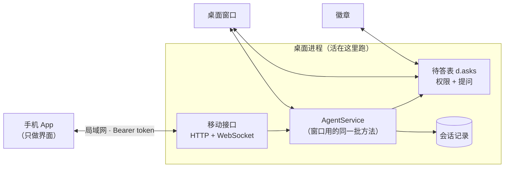

# Tachi 移动端设计（Android 优先，V1）

> 版本: 0.4 | 日期: 2026-10-19 | 状态: **设计已定值；手机端界面、假服务端与桌面服务端（§4 的阶段 1–3）已就绪；桌面前端的回声与配对卡片尚未接入**
> 关联: [desktop.md](./agents/desktop.md)（桌面后端、另一块前端、待答表）、
>       [badge.md](./agents/badge.md)（设备链路：同一张待答表的第二个读者）、
>       [channel.md](./agents/channel.md)（为什么**不**做成 channel）、
>       `desktop/asks.go`、`desktop/permission.go`、`desktop/askuser.go`、
>       `desktop/agent_turn.go`、`desktop/agent_session.go`、`session/session.go`
> 原型: [2026-10-18-mobile-prototype.html](./2026-10-18-mobile-prototype.html)（单文件假数据；手机 / 平板 / 白天 / 黑夜都能切）

---

## 进度（收工时的状态）

**已就绪**——`mobile/` 能单独跑起来，怎么装环境、怎么构建、怎么验都在 [agents/mobile.md](./agents/mobile.md)：

- 配对（扫二维码 / 手输）、会话列表、聊天、设置；平板两栏、白天黑夜两套配色。
- 权限卡、提问卡、工具卡、附件（文本阅读器 + 图片）、Mermaid（随包离线渲染）、会话信息（上下文分项 / 工作区 / 模型切换 / 跳过审批 / 用量）。
- 事件流客户端：投影归并、自动重连、心跳、回到前台重读；手机端单测与 Maestro 端到端都通过。
- **假服务端** `mobile/mockapi/`：说真协议、喂假数据。协议在 [agents/mobile-protocol.md](./agents/mobile-protocol.md)，手机端不依赖桌面进程就能把整条流程跑完。

**已就绪（桌面服务端）**——`desktop/mobile*.go`，细节在 [agents/mobile.md](./agents/mobile.md) 的「服务端」一节：

- `mobile` 配置块与 `~/.tachi/mobile.json` 令牌文件、HTTP + WebSocket 服务、`loadSessionForRemote`、按会话寻址的 `SwitchProvider` / `GetSkipApproval` / `SetSkipApproval`、`agent:user_message`（`startTurn` / `Steer` 带 `origin`）。
- 端点是协议那份文档里的全部；Go 侧 `httptest` 钉住「不切走桌面 / 翻页游标 / 拒绝码 / 投影 / 背压 / 附件只认交付记录」。

**没动**（下一步从这开始）：

- 桌面前端那一半：`agent:user_message` 的监听（把手机发的消息画进窗口的会话全文），以及设置页那张配对卡片（二维码 + 令牌 + 重新生成）。
- 手机和**真实桌面**还没有一起跑过 —— 现在验证的是「手机 + mock 服务」和 Go 侧的 `httptest`；把两者接起来是第一次联调。

---

## 目录

1. [背景与目标](#1-背景与目标)
2. [形态](#2-形态)
3. [原料盘点](#3-原料盘点)
4. [服务端](#4-服务端)
5. [协议](#5-协议)
6. [审批与提问](#6-审批与提问)
7. [手机端](#7-手机端)
8. [不变量](#8-不变量)
9. [错误与文案](#9-错误与文案)
10. [安全](#10-安全)
11. [测试计划](#11-测试计划)
12. [分阶段](#12-分阶段)
13. [V1 明确不做 / 已定值](#13-v1-明确不做--已定值)

---

## 1. 背景与目标

桌面上的对话，人离开电脑就断了。手机上能看见它们、接着说话、回答 agent 停在问题上的那一下，就足够了。

**手机是同一批会话的第三块屏，不是第二个 agent 宿主。** 活、工具、工作目录、审批都在桌面那台机器上；手机不执行任何 agent loop，也不拥有任何会话。

V1 的目标，按优先级：

1. 看：桌面的会话列表，以及每段对话的完整记录。
2. 说：往一段已有的对话里发消息；它正在跑时能插话或打断。
3. 答：桌面上等你批准的命令、agent 提的问题，在手机上以卡片出现并回答。
4. 看过程：当前打开那段对话的实时输出（文字、工具调用），不是只有一个「正在跑」。
5. 调：切这段对话的模型、看它的工作区、切换「跳过审批」。
6. 看用量：cost、实时 tps、上下文占用。
7. 收结果：`SendFile` 交付的图片、Markdown、文本能在手机上看；回复里的 Mermaid 图直接渲染。

V1 的非目标（每一条都是一个决定，见 §13）：不做推送、不做后台、不在手机上开新会话、不管会话的增删改、不做多台机器、不做加密。

---

## 2. 形态



一句话：**手机连的是那个开着的桌面进程。** 桌面关掉（⌘Q），手机就只剩「连不上」；把窗口收起来（⌘W / ⌘H）不影响，进程还在跑。

这也决定了它为什么不是 channel：channel 的每个通道有**自己的**线程和会话（`ThreadID` → 会话），而手机的会话就是桌面的会话。套进 channel 会立刻出现两套会话和两套记忆。

---

## 3. 原料盘点

这件事能做小，是因为桌面已经把每一半都做完了，手机只是另一条运输线。

| 手机需要的 | 现成的 | 用法上的注意 |
| --- | --- | --- |
| 会话列表 | `AgentService.ListSessions` | 这是**记录的**列表；「在跑」来自 `RunningSessions`，「在等」来自 `snapshotAsks`，三者要合到一个 VO 里 |
| 一段对话的历史 | `pageSessionMessages` + `buildSessionMessages`，向上翻页 `LoadSessionMore` | **绝不能走 `LoadSession`**：它会改 `d.activeID`，把桌面窗口切走（§4.4）。`LoadSessionMore` 不改，可以放心用 |
| 发消息 / 插话 / 打断 | `startTurn`、`Steer`、`StopAndSend` | 三条路各自的拒绝原因要原样透传，不能都变成一句话 |
| 批准一条命令 | `answerPermission` | 与窗口、徽章同一个函数；不是第二条回答路径 |
| 回答一个问题 | `answerAskUser` | 同上；回答按会话走，不按 tool id |
| 一轮的过程 | `handleEventIn` 已经为**每个**会话发出的 `agent:event` | 投影之后才上线，绝不原样转发（§5.3） |
| 会话状态 | `setSessionState` / `emitState` | 它是所有状态变化的唯一出口，也是移动端的挂点 |
| 「已经有人答了」 | `notifyAskAnswered` | 已经是广播；手机是它的新听众 |
| 切模型 | `ListProviders` + `SwitchProvider` | `SwitchProvider` 只认**当前显示的会话**；手机要按会话寻址（§4.4） |
| 看工作区 | `GetSessionRoots` / `GetSessionWorkingDir` | 只读；改目录是桌面的事 |
| 跳过审批 | `GetSkipApproval` / `SetSkipApproval` | 同样只认当前会话；这是会话级决定，不写全局 |
| 用量 | `GetSessionUsage` + `agent:tps` / `agent:usage` / `agent:cost` | cost 是会话累计；tps 只在生成时是活的，工具边界后变暗 |
| 上下文 | `contextUsage` / `GetContextInfo` | 总量、窗口、分项要一次快照读出来 |
| 附件 | `SendFile` 的工具调用记录 + 会话目录 | 只提供这段对话真的交付过的文件（§4.8） |
| Mermaid | 回复里的 ` ```mermaid ` 围栏 | 渲染成图；解析失败退回源码 |

两个现成的坑，写在最前面：

- **`LoadSession` 会切走桌面窗口。** 它同时做三件事：准备会话、恢复 LLM 历史、把 `activeID` 指过去。手机只想要第一、第二件。
- **`prepareSession` 不恢复 `r.history`。** 只调它然后 `startTurn`，这一轮会**丢掉之前的上下文**——因为 `runHistory` 读的是内存里那份，而恢复它只发生在 `LoadSession` 里。所以移动端需要一个自己的加载路径（§4.4）。

---

## 4. 服务端

> 这一层的**线上协议**以 [agents/mobile-protocol.md](./agents/mobile-protocol.md) 为准（端点、事件、字段、错误码都在那里）。本节是当时的设计说明，细节有出入看那份。

### 4.1 放在哪

`desktop/mobile*.go`，package `main`，跟 `desktop/` 的其他后端代码在同一个 module 里。理由只有一条：它要够到 `desktopApp` 的内部（`d.asks`、`d.runs`、事件出口），而这些不该被导出成一套新的公共 API。

它不是一个新的入口模式（不碰 `main.go` 的 command），也不进 `channel/manager`。它随桌面进程启动，随桌面进程退出。

### 4.2 开与关、令牌

配置块（`config.yaml`）：

```yaml
mobile:
  enabled: false
  listen: "0.0.0.0:8787"
  max_attachment_mb: 50
```

- 三个键都进 `desktop/settings.go` 的 `settingsTable`（`settings_test.go` 会要求每个新字段都有一行）。前两个是 `applyRestart`：开一个监听器是进程级的事，改完重启生效最诚实。`max_attachment_mb` 是 `applyLazy`——下载那一刻现读 live config，改完下一次下载就是新值。
- Note 必须说两件事：**这是局域网明文**，以及**拿到令牌就能让这台电脑上的 agent 执行命令**。
- 令牌单独一个文件：`~/.tachi/mobile.json`（`0600`），`{"token": "...", "created_at": "..."}`。它是凭据，不是偏好，所以不进 `config.yaml`，也不由设置页的普通叶子编辑。
- 设置页多一个卡片（与 MCP 编辑器同一个形状的 schema 声明）：二维码 + 可复制的 URL 与令牌 + 「重新生成」。二维码内容是
  `{"v":1,"url":"http://<lan-ip>:8787","token":"<token>"}`。
- `RegenerateMobileToken()` 是一个绑定：写新令牌、**断开所有活着的连接**（否则旧令牌的会话还能继续用）。

绑定的地址默认 `0.0.0.0:8787`：手机要能从局域网连进来，就必须监听在非 loopback 上。监听失败（端口占用、地址不合法）只在设置页报错，不影响桌面启动。

### 4.3 HTTP 接口

全部在 `/v1` 下，除 `ping` 外都要求 `Authorization: Bearer <token>`。

| 方法 | 路径 | 做什么 |
| --- | --- | --- |
| GET | `/v1/ping` | `{ok, name, version}`，配对页用来验证地址与令牌 |
| GET | `/v1/sessions` | 会话列表（已折叠压缩链、已带 running/waiting 标记） |
| GET | `/v1/providers` | 可切换的模型（provider 名字 + 模型名） |
| GET | `/v1/sessions/{id}/page?before=&limit=` | 一页历史（向上翻页）；`before` 是记录序号（见下） |
| POST | `/v1/sessions/{id}/messages` | `{text, mode}`，`mode ∈ send / steer / interrupt` |
| POST | `/v1/sessions/{id}/stop` | 停掉这个会话正在跑的一轮 |
| POST | `/v1/sessions/{id}/provider` | `{name}`，只改这段对话 |
| POST | `/v1/sessions/{id}/skip-approval` | `{skip}`，只改这段对话 |
| GET | `/v1/sessions/{id}/files/{attachmentId}` | 下载一个 `SendFile` 交付过的附件 |
| POST | `/v1/sessions/{id}/permissions/{toolId}` | `{decision}`，`allow_once / deny` |
| POST | `/v1/sessions/{id}/questions` | `{answers}`，或 `{decline: true}` |

返回形状：

```json
// GET /v1/sessions
{"sessions": [{
  "id": "…", "title": "…", "projectName": "…",
  "updatedAt": "2026-10-18T17:00:00+08:00",
  "running": false, "waiting": "", "readOnly": false, "heldByTask": false
}]}
```

- `waiting` 的非空值只有两句，与侧栏、菜单栏、通知同一批常量：`等待你的授权` / `等待你的回答`。
- `readOnly` 来自 `SessionInfo.Kind != ""`；`heldByTask` 来自保留记录。两者都只**显示**，真正的拒绝在 agent 入口。
- 列表按「钉住优先，然后 `updatedAt` 倒序」。**一段对话一行**：压缩链折到叶子（子会话），父会话不出现——折叠由后端做，手机不重新推导链。
- 打开一段对话时的 `snapshot` 还要带上：`model`、`skipApproval`、`workspace {primary, additional[]}`、`usage {cost, credit, cacheHitRate}`、`context {estimate, window, parts[]}`，以及这段对话已经交付的附件列表。

**翻页游标是记录序号，不是时间戳。** `before` 传上一次拿到的最旧一条的 `index`（`SessionMessage.Index`，即该条消息在会话记录文件里的绝对位置），服务端返回序号**严格小于**它的那 `limit` 条。理由：消息自己没有 id，而时间戳会撞——同一时刻的两条正好落在页边界上时，现有的按时间戳过滤会把它们整段跳过（`pageSessionMessages` 就是按 `m.Timestamp.Before(t)` 过滤的）。服务端给按序号的分支，桌面那条老路先不动。向上翻页复用现成的 `LoadSessionMore`：它不改 `d.activeID`，§4.4 禁用 `LoadSession` 的那条与它无关。

### 4.4 按会话寻址（本节是这套设计里最容易做错的地方）

新增一个 `loadSessionForRemote(id) (*sessionRun, error)`，等价于 `LoadSession` 的前两件事，**不做第三件**：

1. `prepareSession(ctx, id)` —— 建这个会话自己的 agent 与 session manager；
2. `agent.LoadSessionHistory()` → 写进 `r.history`；
3. 页一段消息返回。

它**不写 `d.activeID`，也不发状态事件**。这样手机打开一段对话时，桌面窗口里正看着的那一段不会跳走，状态栏也不会被一句「已加载会话」覆盖。

`startTurn` 本身已经对没加载过的会话做过 `prepareSession`，但它不会恢复 `r.history`；所以「手机第一次往一段桌面没打开过的对话里发消息」必须**先**走这个加载路径，否则上一轮之前的上下文会从模型眼里消失（而界面上一切正常，这是最坏的那种失败）。

**另外三个桌面方法也只认「当前显示的会话」**：`SwitchProvider`、`GetSkipApproval`、`SetSkipApproval` 读的是 `currentID` / `activeRun`。手机直接调，会改到桌面正在看的那一段；或者手机改了一段、桌面改另一段，两边各说一个模型。移动端要的是同一套逻辑加一个显式的会话 id——这三条各写一个按会话的版本，复用它们内部的检查（先写记录、再翻 live agent），不要复制实现。

`GetSessionUsage`、`GetContextInfo`、`GetSessionRoots` 本来就是按 id 取的，直接调；但**不要**从 `GetState` / `CurrentSession` 这类「当前」出口拿数据。

### 4.5 另一块屏发了消息，这边要看见

桌面窗口里的用户气泡是**前端自己**在提交时画的；它不来自事件。所以手机发出去的消息，如果不告诉窗口，窗口就会只显示助手的回答、没有用户那一句。徽章的语音已经解决过同一个问题（`badge:voice` → 前端 `submit`），但那条路会让前端**再发一次**，在这里是错的。

做法是一条对称于 `agent:ask_answered` 的广播：

```
agent:user_message { sessionId, text, displayText, steer, origin }
```

- 在 `startTurn` / `Steer` 真正受理之后发出，`origin ∈ desktop / mobile / badge / cron`。
- 桌面前端：`origin == "desktop"` 时忽略（自己刚画过），其余都追加成用户气泡（`steer` 为真时是「插入」样式）。
- 手机前端：`origin == "mobile"` 时忽略（它本地已经加了），其余都追加。
- `startTurn` / `Steer` 因此多带一个 origin 参数；它**只**用于这条回声，不改变任何行为。

### 4.6 待答表：第三个读者

权限询问与 agent 的提问本来就在同一张表里（`d.asks`），窗口和徽章都是读者，回答都走 `answerPermission` / `answerAskUser`。手机是第三个读者，**不是第三条回答路径**。

四件随之而来的事：

- **卡片上显示什么是 agent 给的**：权限卡片用 `PermissionEvent` 的 `preview`、`toolName`、`kind`（`bash` / `files` / `mcp_search`）；提问卡片用 `tools.Question` 原文。手机不自己拼文案，也不再解析一遍 preview。
- **`pendingAsk` 需要多带一个 `toolName`**，好让手机拿到与桌面同一套 `permEventKind` 的外壳。这一个字段加在产生等待的那一处，不是第二个来源。
- **谁先答谁算数，另一边立刻撤卡**：`notifyAskAnswered` 已经广播（`agent:ask_answered`），手机把它接上就行；手机自己回答成功后也发一次同样的广播。一张过期的、还能点的卡片是这条路唯一的可见故障。
- **手机不在线时，桌面那张卡继续等人**。不会有人替它答，也不会超时自动拒绝。

V1 的权限卡片只有 **允许一次 / 拒绝**。「本会话全部允许」留在桌面：它是一次性的批量授权，手机上误触的代价太大。

### 4.7 事件出口与背压

挂点都是现有的「唯一一条路」，不新开旁路：

| 挂点 | 发什么 |
| --- | --- |
| `handleEventIn` | 一轮的过程（文字、思考、工具、结束、压缩） |
| `registerAsk` | 新增了一条等待（权限或提问） |
| `notifyAskAnswered` | 一条等待已被回答 |
| `setSessionState` | 一个会话的状态变了 |
| `emitIdle` | 一轮真的结束了（决定手机要不要补发排队的消息） |
| `tpsAdd` / `tpsReset` | 实时速度（`tps` / `lastTps`） |
| `emitUsage` / `emitCost` | 会话金额、credit、缓存命中 |
| `startTurn` / `Steer`（§4.5） | 另一块屏发来的用户消息 |

上下文的分项不在流里推：它在打开会话的快照里带一份，然后由「轮次边界重读」更新——分项随一轮的工作变化，推它只会让消息流变胖。

两条硬约束：

- **手机绝不能让 agent 卡住。** 每条连接一个 256 条事件的缓冲队列；满了就发一条 `lagged` 并断开，由客户端重连 + 重读，**绝不阻塞**发事件的那个 goroutine。同时最多接受 16 条连接（第 17 条在握手时拒绝）——同样是「手机不能拖住桌面」。
- **只有订阅了某个会话的连接才收它的事件**；例外是 `ask_answered`（很小，且可能属于任何会话）。

### 4.8 附件：只交付 SendFile 那一次

手机能看的附件，只有 agent 在这段对话里用 `SendFile` 交出去的那些。

- 快照里的附件条目来自**记录下来的工具调用**（会话 + 调用 id），带文件名、类型、大小和可下载的 id。下载端点是 `GET /v1/sessions/{id}/files/{attachmentId}`。
- **`attachmentId` 就是那次 `SendFile` 调用的 id。** 一次调用只送一个文件（工具只收一个 `path`），而这个 id 已经写进会话记录，所以对话重开、进程重启，链接都不变。
- **端点不接受路径。** 只按 id 回记录里反查：查不到那条 `SendFile` 调用就是 404，别的会话的文件也拿不到。记录里的 `path` 可能是相对的，按**那次调用所属会话**的工作目录解析回绝对路径（同一套根目录，§4.4）。这样「令牌 = 任意文件读取」这个洞从一开始就不存在：路径穿越、读 `~/.ssh`、读别的会话的文件，都没有入口。
- **单个文件上限 50 MB**（`mobile.max_attachment_mb`，默认 50）。超了不给出下载，只列文件名、类型、大小，并说明这个太大。
- 类型只影响手机怎么展示：图片内嵌、Markdown / 文本进阅读器、其他类型说明「在电脑上打开」。桌面能预览 HTML / PDF，手机 V1 不承诺。
- 手机 V1 不做「上传附件」：`SendFile` 是 agent → 用户的方向，反方向没有对应的工具。

---

## 5. 协议

### 5.1 为什么是 HTTP + WebSocket

命令要能独立重试、能用 `curl` 调（排障时这一点很值钱），所以命令走 HTTP；过程要推，走一条 WebSocket。React Native 的 WebSocket **不能设握手头**，所以令牌放在查询串里（`?token=…`）。这没有新增暴露：这条链路本来就是明文局域网，嗅探者拿到令牌只是时间问题（§10）。

### 5.2 连接与订阅

```
手机 → {"type":"open","sessionId":"…"}
服务端 → {"type":"snapshot", …}   ← 先给一份完整快照
服务端 → {"type":"text", …}       ← 然后是增量
```

- 一次只订阅一个会话；第二次 `open` 替换订阅。
- `snapshot` 包含：会话 VO、`messages`、`hasMore`、`state`、`asks`、`running`，以及 `model`、`skipApproval`、`workspace`、`usage`、`context`、`attachments`。
- 快照与增量之间的重叠由「轮次边界重读」收敛（§7.4）：**记录是权威的，实时流只负责延长尾巴。**
- 心跳：手机每 20 秒发 `{"type":"ping"}`，服务端回 `pong`；两分钟没有心跳就关连接。手机切前台时重连。

### 5.3 事件的投影

绝不原样转发 `agent.AgentEvent`：它在每轮结束时带着 `Messages`（整段历史），在工具结果里带着完整输出。手机要的是一份**投影**：

| 线上类型 | 内容 |
| --- | --- |
| `text` / `thinking` | 增量文本 |
| `tool_start` / `tool_args` | `toolId`、工具名、给人看的一行摘要（`ToolArgsSummary`） |
| `tool_result` | `toolId`、是否出错、**截断**后的结果（2 KiB，带 `truncated`） |
| `turn` | 耗时、迭代数、退出原因 |
| `error` | 错误文本、是否是被用户停下的 |
| `idle` | 这一轮真的结束了（`complete / interrupted / error`） |
| `compact_start` / `compact_done` | 压缩开始/结束（含失败原因） |
| `state` | 这个会话的状态（`status`、`label`、`detail`、`waiting`） |
| `tps` | 实时速度（`tps`、`lastTps`；工具边界后变暗） |
| `usage` / `cost` | 会话金额、credit、缓存命中（只更新顶部细条） |
| `ask` | 新增等待（权限或提问） |
| `ask_answered` | 等待已解决 |
| `user_message` | 另一块屏发来的用户消息（§4.5） |
| `lagged` | 你跟不上了，重读快照 |

参数与结果都截断的理由很实际：手机屏幕本来就会把它们折叠起来，而一条 `ReadFile` 的结果可以有几十 KB。**完整输出是桌面的事。**

---

## 6. 审批与提问

两张卡片都长在对话里，因为等待本来就属于那段对话。

**权限卡片**（`kind` 决定外壳）：

```
┌──────────────────────────────────┐
│ 等待你的授权 · Bash               │
│ $ rm -rf build/                  │  ← preview，agent 原文
│ 匹配规则 permissions.bash.ask …   │  ← preview 的另一半
│ [ 允许一次 ]        [ 拒绝 ]      │
└──────────────────────────────────┘
```

- 标题随 `kind` 换（命令 / 文件 / 搜索费用），与桌面那张卡同一套外壳。
- 回答调 `answerPermission(sessionId, toolId, decision)`；过期的 tool id 得到明确的 409，而不是静默成功。

**提问卡片**：

- 每个问题按 agent 给的 `options` 渲染；`multi_select` 就是多选；没有 `options` 就是输入框。
- 答案的构造沿用桌面的约定：**键是问题原文**，值是选中项（以及自由文本）用 `", "` 连接——`answers[q.question] = parts.join(", ")`。不要发明第二种形状：模型看到的是同一段话。
- 「跳过」= 空答案，模型会被告知问题没有被回答，而不是收到一个编出来的选择。

两类卡片在 `ask_answered` 到达时撤掉，无论答案来自哪块屏。

---

## 7. 手机端

### 7.1 选型与目录

`mobile/`，Expo（React Native + TypeScript），Android 先行，iOS 后接。理由是它和 `web/frontend` 同一门语言、同一套类型习惯，而聊天界面不需要原生控件级别的定制。

不放进任何 Go 的 embed：CI 只跑 `tsc --noEmit` 和 lint；APK 由 Expo / EAS 在本地产出。

### 7.2 三块主界面 + 设置

1. **配对**：扫二维码（`expo-camera`），或手输 URL + 令牌；存进 `expo-secure-store`；「测试连接」打 `/v1/ping`。
2. **会话列表**：进入时拉一次、下拉刷新一次、从聊天返回时拉一次。**不做实时刷新**（V1 的决定）。
   每行：标题、项目名、最后活动时间、标记（在跑 / 在等你授权 / 在等你回答 / 只读 / 被节点任务占用）。
3. **聊天**：历史 + 输入框 + 卡片。只读会话隐藏输入框并显示横幅（措辞沿用桌面）。
4. **设置**：连接状态与地址、二维码、外观（跟随系统 / 白天 / 黑夜）、解除配对。

另外三层是从聊天里按需打开的（会话信息、模型列表、附件阅读器），不算导航。平板宽度够时，列表和聊天并排，层盖在右侧那栏上。

### 7.3 打开一段对话

```
open(sessionId)
  → WS open
  → 收到 snapshot（历史 + 状态 + 待答）
  → 渲染历史；正在跑就在末尾放一个「本轮进行中」的活气泡
  → 增量事件续在活气泡里
```

历史向前翻页走 HTTP；不做本地缓存（V1 的非目标）。

### 7.4 轮次边界重读

**记录是权威的，实时流只负责延长尾巴。** 以下三个时刻都把当前会话的快照重读一遍，替换掉活气泡：

- `turn` 或 `error` 到达（一轮结束）；
- 重连成功；
- 收到 `lagged`。

这样不需要事件重放、不需要给增量编号、不会出现半句话拼接错位——中间漏掉的东西由记录补上。

### 7.5 发送

- **空闲** → `mode: send`，本地先画气泡；服务端拒绝（恰好有人抢先起了一轮）就把气泡标成失败并保留文字。
- **正在跑，插话** → `mode: steer`：在下一个工具调用结束后插入（与桌面输入框的「工具调用结束后插入」是同一件事）。定时任务轮不接受插话，这时提示并给「立即发送（打断）」。
- **正在跑，打断** → `mode: interrupt`（`StopAndSend`）：停掉当前一轮，带着新消息重新开始。
- 正在跑时输入框上方显示两个动作：`排在这轮之后`（本地排队，等 `idle` 再发；只在 App 在前台时成立）和 `立即发送 · 打断`。

### 7.6 顶部细条：cost / tps / 上下文 / 模型

打开的每段对话，在标题下面有一条常驻的细条：

```
$0.12 · 52 tok/s · ◔ 26%        [Sonnet 4.5]  ⋯
```

- **cost** 是这段对话的累计金额（来自 `usage`），不是一个进程的总账。
- **tps** 只在文字正在流出来时是活的（数字在动、点常亮）；工具边界和轮次结束后变成上一轮的读数，变暗。这和桌面的 tps 语义一致，不另造一个。
- **上下文** 是窗口占用比例；≥75% 变琥珀、≥90% 变红。点它或点 `⋯` 打开会话信息。
- **模型** 是当前会话的模型，点它打开模型列表。
- 平板宽度够时，细条右边还会带工作区路径；手机上它在会话信息里。

### 7.7 会话信息与模型

`⋯` 打开一层，内容全部只读（除了两个开关）：

- **上下文**：估算 / 窗口，加一条分项条（系统提示词、工具定义、对话、工具结果）和各项 token 数。
- **工作区**：主目录与附加目录，只显示，不能改。
- **模型**：点开列表，选中即切。**只影响这段对话**，不写全局默认。
- **审批**：「跳过审批」开关，只影响这段对话；打开时细条上出现一枚琥珀色标记，提醒之后的命令不再弹问。
- **用量**：这段对话、上一轮、当前速度。

只读 / 被远端任务占用的会话，模型和审批都禁用，并说明原因。

### 7.8 附件与 Mermaid

**附件**：

- 一条 `SendFile` 工具调用渲染成**文件卡**，不是原始工具行。图片直接把缩略图铺在气泡里；Markdown / 文本是一张带文件名的卡片；其他类型只显示类型与大小。
- 点开是一个全屏阅读器：图片铺满宽度；Markdown 按文档渲染（标题、列表、表格、代码）；文本用等宽字体；打不开的类型明说「在电脑上打开」。
- 文件通过带令牌的下载端点取，不缓存到手机本地（V1）。

**Mermaid**：

- 回复里的 ` ```mermaid ` 围栏渲染成图，不是代码块；解析失败时退回成代码块并说明。
- **实现路径：WebView 里跑一份随 App 离线打包的 mermaid，strict 模式。** 不自己写解析器——图语法远不止原型里认的那一小块（原型那个只懂 flowchart 的一个子集）。
- **绝不把模型写的 HTML/SVG 直接插进页面**：送进 WebView 的只有围栏里的原文，页面上那棵 SVG 由渲染器生成。这条和桌面的 markdown / HTML 沙箱是同一条规矩。
- 主题 token 用消息传进 WebView（切白天 / 黑夜时重发、重画），不在两边各写一套颜色。

### 7.9 连接状态

顶部一条常驻的细横条：

| 状态 | 文案 |
| --- | --- |
| 已连接 | 不显示 |
| 正在重连 | 正在连接电脑… |
| 连不上 | 连不上电脑（没开机、或不在同一个网络） |
| 令牌失效 | 令牌已失效，请在电脑上重新配对 |

### 7.10 配色与其余渲染

- **两套配色，和桌面完全同一份 token**（`desktop/frontend/public/base.css`）：深色是 Ayu Mirage 那套石墨色，浅色是暖纸 + 墨蓝。不要引入第三套色板，也不要在前端里散落硬编码颜色。
- 默认跟随系统；设置页可以手动切「白天 / 黑夜」，只影响这台手机。
- 用户气泡是**一层浅浅的底色 + 深色墨水**，不是饱和的蓝色填充——桌面的 `--user-grad-*` / `--user-ink` 那两个 token 就是为此存在的。
- 回复按 Markdown 渲染（代码块等宽、可横向滚动）；工具调用是一行可展开的小卡片，展开显示摘要与被截断的结果。

### 7.11 Android 的明文许可

Expo 构建配置里打开 `android.usesCleartextTraffic`（iOS 以后加 `NSAllowsLocalNetworking`）。这是 §10 那条决定的机械后果，不是疏忽。

---

## 8. 不变量

按会被踩到的顺序：

1. **手机不改变桌面正在显示的会话。** 打开、翻历史、发消息都不碰 `activeID`；`LoadSession` 在这条路上是禁用的。
2. **手机是待答表的第三个读者，不是第三条回答路径。** 两类回答都走现成的 `answerPermission` / `answerAskUser`；回答后必须广播，让另外两块屏撤卡。
3. **手机的连接绝不背压 agent。** 满了就丢、就断、就让客户端重读；发事件的 goroutine 不等任何人。
4. **记录是权威的，实时流只延长尾巴。** 轮次结束、重连、`lagged` 都重读快照，不做增量重放。
5. **线上只走投影，不走内部事件。** 没有 `Messages`，没有完整工具输出。
6. **令牌是凭据，不是配置。** 单独文件、`0600`、可一键作废；作废时断开所有活连接。
7. **一块屏改了共享状态，要告诉另一块。** 消息（`agent:user_message`）和回答（`agent:ask_answered`）是同一类事。
8. **模型和审批开关按会话寻址，不按「当前窗口」。** `SwitchProvider` / `GetSkipApproval` / `SetSkipApproval` 只认 `currentID`，手机必须走按会话的版本；一次改动只落在被点名的那段对话上。
9. **附件只来自 `SendFile` 的交付记录，下载端点不接受路径。** id 查不到就是 404；令牌不能变成任意文件读取。
10. **配色就是桌面的两套 token，不引进第三套。** 深浅两套都从 `base.css` 抄值，新增颜色先进那里的 token。

---

## 9. 错误与文案

| 情况 | HTTP | 手机显示 |
| --- | --- | --- |
| 没带令牌 / 令牌错 | 401 `unauthorized` | 令牌已失效，请在电脑上重新配对 |
| 会话不存在（被删了） | 404 `no_session` | 这段对话已经不在了 |
| 这一轮正在跑（`send`） | 409 `turn_running` | 它正在跑；插话或打断？ |
| 没在跑（`steer`） | 409 `not_running` | 这一轮已经结束了，直接发送？ |
| 定时任务轮不接受插话 | 409 `steer_unsupported` | 这轮不接受插话，等它结束或打断 |
| 待答项已被处理 | 409 `no_such_pending_request` | 已经在别处回答过了 |
| 只读会话（子系统所有） | 409 `read_only` | 这段对话由别的任务占用 |
| 节点任务正在执行 | 409 `held_by_task` | 有一项远端任务正在使用它 |

后端拒绝的**原因**要原样透传，不要笼统成「操作失败」——手机屏幕小，用户唯一能行动的就是那句话。

---

## 10. 安全

V1 的取舍是明确的：**局域网明文 HTTP + Bearer token，不做 TLS。**

- 同一张 Wi-Fi 下的人可以嗅到令牌；拿到令牌的人可以让这台电脑上的 agent 执行命令。这是被接受的代价，前提是**只在自己家的网络里用**。
- 因此设置页的 Note 必须写清楚，而且默认关闭；不要在咖啡厅 / 公司网络里开。
- 令牌可一键重新生成，生成后旧连接立刻断开。
- 附件下载是这条链路里唯一一个「按名字取文件」的端点，所以它只认交付记录里的 id，不接受路径；不要把会话目录做成静态文件服务。
- 不监听公网、不做端口转发；如果以后要走公网，TLS 与设备身份（参照 `node/` 的证书与 pin）是单独的一步，不是这一版的放大。

---

## 11. 测试计划

### 11.1 服务端（Go，`httptest`）

| 用例 | 钉住 |
| --- | --- |
| 远程读不切走桌面 | 调移动接口打开会话后 `d.activeID` 不变 |
| 远程写入恢复历史 | 往一段没在桌面打开过的会话发消息，模型收到的请求里带着之前的消息 |
| 鉴权 | 缺令牌 / 错令牌 → 401；比较是常量时间 |
| 列表折叠与标记 | 压缩链只出叶子；running / waiting / readOnly / heldByTask 各自正确 |
| 翻页游标 | 按记录序号翻页不漏不重：同一时刻的两条消息分在两页也一条不少 |
| 三种发送 | `send` / `steer` / `interrupt` 各走对的路，拒绝原因原样返回 |
| 回答 | 错的 tool id → 409；重复回答 → 409；回答后 `ask_answered` 广播 |
| WebSocket | 只转发订阅的会话；线上没有 `Messages`；超过缓冲发 `lagged` 并断开 |
| 用户消息回声 | 手机发消息后，`agent:user_message` 带 `origin=mobile`；桌面发消息时带 `desktop` |
| 按会话切模型 | 只改点名的那段对话；桌面窗口正在看的那一段模型不变 |
| 按会话跳过审批 | 只写点名的那段的记录并翻它的 live agent；桌面当前会话不变 |
| 附件端点 | 只认这段对话交付记录里的 id（相对路径按当次会话的工作目录解析）；未知 id → 404；没有路径参数；别的会话的文件拿不到；超过上限的文件不给下载 |
| 用量与速度 | `tps` / `usage` / `cost` 只发给订阅的会话；上下文分项不推、由重读更新 |

### 11.2 手机端

- `tsc --noEmit` + lint 进 CI。
- 纯函数单测：答案构造（键是问题原文、多选 `", "` 连接）、事件归并（增量续在活气泡上）。
- 人工清单：配对、列表、打开在跑的会话、插话、打断、两种卡片、关掉桌面后的错误、锁屏回来重连、切模型、跳过审批、附件（图片 / Markdown）、Mermaid 失败退回、白天 / 黑夜切换。

### 11.3 端到端

在桌面的冒烟体系之外先做一条独立脚本：`mockllm` + 桌面进程 + `curl` 打完整轮（列会话 → 发消息 → 读事件 → 回答一次权限）。它证明的是「这两半说的是同一套话」，不是 UI。

---

## 12. 分阶段

1. **服务端骨架**：配置块 + 令牌文件 + `/v1/ping` + 会话列表 + 远程读路径。先让 `curl` 能用。
2. **服务端命令**：三种发送 + 停止 + 两类回答 + 用户消息回声。
3. **服务端事件**：WebSocket、投影、背压、五个挂点。
4. **手机端只读**：配对 + 列表 + 历史。
5. **手机端能说**：发送、插话、打断、活气泡、轮次边界重读。
6. **手机端能答**：权限卡、提问卡、`ask_answered` 撤卡。
7. **手机端能调**：顶部细条（cost / tps / 上下文）、会话信息（工作区 / 用量）、模型切换、审批开关。
8. **结果与外观**：附件卡与阅读器、Mermaid 渲染、白天 / 黑夜两套配色。
9. **收尾**：只读/占用的显示、错误文案、CI、人工清单。

每一步都能独立跑起来；第 1、2 步做完，手机端还没写就已经可以用脚本验证整条链路。

---

## 13. V1 明确不做 / 已定值

**不做**（每一条都是决定）：

- 推送与后台：锁屏后不通知；回到 App 才看到结果。长任务卡在审批上会一直等。
- 在手机上开新会话、删会话、改名、压缩、分叉、回退。
- 附件只收不传：不做手机拍照 / 上传；只预览 `SendFile` 交付过来的图片、Markdown、文本。HTML / PDF 不在手机 V1 的预览范围里。
- 多台电脑：一次连一台；换电脑就重新配对。
- 本地缓存：没有网就连列表都看不到；附件也不落盘。
- 斜杠命令：`/model`、`/compact` 这些是桌面的事（切模型有专门的入口，不走斜杠命令）。
- 在手机上改工作区、项目、目录。
- Mermaid 的编辑与导出：图只读。
- TLS、公网访问、多用户。

**已落定**（0.2 定下，实现照抄，不要再各写一遍）：

- 翻页游标是记录序号，不是时间戳（§4.3）；向上翻页复用 `LoadSessionMore`。
- 单个附件上限默认 50 MB（`mobile.max_attachment_mb`，§4.8）；不允许「保存到手机」，也不做上传。
- WebSocket 每条连接 256 条事件、最多 16 条连接（§4.7）。
- Mermaid 走 WebView + 离线 mermaid，strict 模式（§7.8）。
- 列表 V1 平铺，项目名做行内标签；默认端口 `8787`，监听 `0.0.0.0`。
- 「排在这轮之后」的本地队列在 App 被系统杀掉后会丢——接受，界面要说明。
- 手机显示 agent 的「思考」增量，默认折叠。
