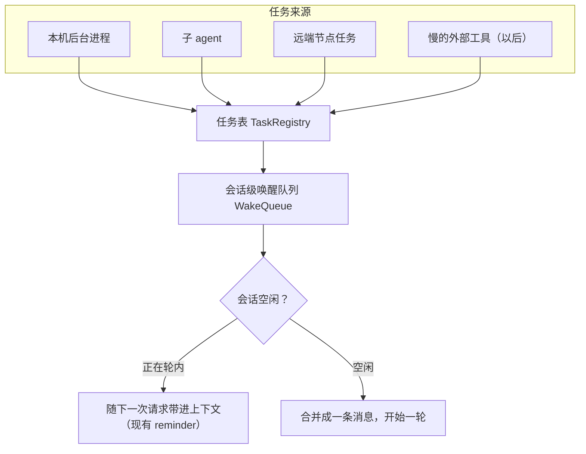
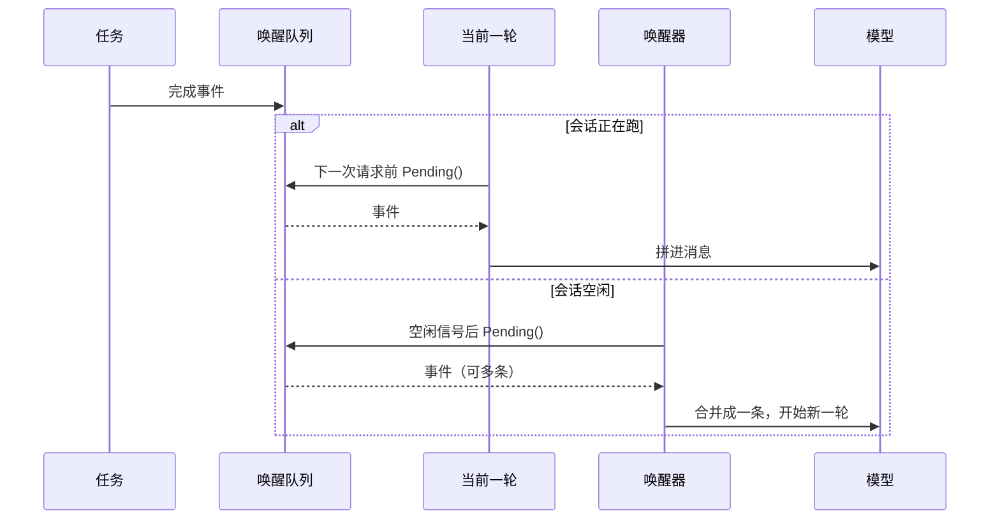

# 异步任务与唤醒 — 设计文档

> 版本: 1.5 | 日期: 2026-11-09 | 状态: 五个阶段已落地（队列与唤醒、SubAgent 异步、后台进程事件、远端委派轮询、MCP 调用超时），外加唤醒轮的提问上限与在跑任务提醒；desktop / tui / channel 三个入口都已对齐，只有 `-p` 不唤醒。剩余项见「剩下的未决问题」

## 一、要解决的问题

agent 是一个「被问才动」的循环：只有用户发消息（或 cron 到点）才能开始一轮。因此当一个活要跑很久时，模型没有别的选择，只能用工具调用反复问「好了吗」。每一次问都是一次完整的模型请求，又慢又费钱。

现在仓库里有三套各自独立的等待方式，参数互不相同：

| 工具 | 等待方式 | 每步最长 | 忙等 | 完成提醒 |
|---|---|---|---|---|
| Bash 后台 | `agent/tools/bash.go` 的 `defaultForegroundWindow` 15 秒窗口后转后台，之后 `wait_name` 每 `defaultWaitStep` 15 秒问一次 | 15s | 是 | `BackgroundTaskReminder` |
| SubAgent | `agent/tools/subagent.go` 的 `ExecuteContext` 同步阻塞到子 agent 结束 | 无限 | 整轮被占死 | 无（结果就是返回值） |
| DelegateTask | `node/remoteclient.go` 的 `Submit` 后自己 `Wait`，`defaultWaitBudget` 30 秒 | 30s | 一步吃满 | `RemoteTasksReminder` |
| RemoteTask(`wait`) | `DefaultRemoteWait` 60 秒，超时再来一次 | 60s | 是 | `RemoteTasksReminder` |
| MCP 工具 | `Manager.CallTool` 用调用方的 ctx，本地无超时兜底 | 无限 | 整轮被占死 | 无 |

同一件事有四种答案，且离得越远反而越有耐心（15 / 30 / 60 / 无限），没有可解释的理由。

已建成的那一半是**提醒**：任务完成时进不了模型上下文，但下一次模型请求之前，`ReminderCollector` 会把已经完成、还没报告过的事件取走并拼进消息。缺的那一半是**唤醒**：会话空闲时，没有任何东西能开始一轮。

### 顺带发现（本次一并考虑，不必然同期做）

- `BashTool.Parallel()` 返回 false，`agent/tool_executor.go` 把非并行工具各自成组，所以同一轮里只要有一个 Bash，它前后的并行工具（Read / Grep）也会被串起来。一个 90 秒的构建会拖住旁边本来能同时读文件的调用。
- `SubagentTool.Parallel()` 返回 true，所以一轮里可以并行派多个子 agent —— 但仍然要等最慢的那个。

## 二、目标与非目标

**目标**

- 派发即返回：模型可以「派出去、结束这一轮」，不需要原地等。
- 完成事件只有一个出口：忙的时候随下一轮带进上下文，闲的时候合并成一次唤醒。
- 一套机制覆盖本机进程、子 agent、远端任务；以后慢的外部工具也能接进来。
- 用户停止只停止当前这一轮，不取消任务。

**非目标**

- 不做跨进程的事件总线。任务与通知仍然只在本机、本进程内。
- 不改任务本身的执行语义（进程组、worktree、并发上限都保持现状）。
- 不新增工具数量，也不新增工具参数。模型看到的工具清单变化会让每个会话的 prompt 前缀失效（见 `docs/agents/prompt-cache.md`），所以能力挂在已有工具的字段上；能不加字段就不加。

## 三、核心概念



### 任务（Task）

一次会花很久的活。字段：会话内唯一的 id、来源、命令或提示的摘要、状态（运行中 / 完成 / 失败 / 等用户回答）、结果。

**任务表属于谁**：进程级。`tools.ProcessManager` 现在是每个 agent 一份（`Config.ProcessManager`），而 desktop 的 agent 是按会话懒创建的、可能被回收重建 —— 任务不能跟着 agent 一起消失。更准确地说，它归**入口的会话管理层**（desktop 的 `desktopApp`、channel 的 `Manager`，它们本身就是进程内的单例）；agent 只是执行者，和 cron 的 `Scheduler` 是同一种归属。

### 唤醒队列（WakeQueue）

每个逻辑会话一个。`LogicalConversationID` 跨压缩不变（cron 的 `Job.Desktop.SessionID` 也是这么用的），所以队列挂在它上面，压缩换了叶子会话也不丢事件。

队列只做四件事：

- `Post(TaskEvent)`：任务到达终态时投递。
- `Pending()`：取走所有还没投递的事件，标记为已投递。
- `Restore([]TaskEvent)`：放回取走的事件（入口没能开始一轮时用），保证事件不丢也不重复。
- 一个「有事件进来」的信号通道，让空闲时的唤醒 goroutine 不必轮询。

### 唯一出口

**事件只能被投递一次。** 取走式，谁先取谁负责渲染。因此两条路不会重复报告同一件事：



**合并规则**（这是这套机制的核心）：

- 一次 `Pending()` 取到的所有事件合并成**一条消息**，每个任务一段：名字、结果状态、输出尾部、大结果的落盘路径。
- 唤醒前有一个很短的合并窗（建议 800ms）：一批任务几乎同时结束时，等到齐再一次唤醒，而不是十次。
- 合并窗结束再取一次，把窗口期内到达的事件一起带走。
- 一次唤醒的消息里不放「请继续」之类的话，只放事实。要不要继续、怎么继续，由模型决定。

## 四、谁能让会话开始一轮

agent 自身没有「开始一轮」的能力，只有入口有。这和 cron 的形状完全相同 —— 每个入口已经有一个「等会话空闲 → 开始一轮 → 结束」的实现，唤醒复用同一套：

| 入口 | 能否唤醒 | 复用哪套 |
|---|---|---|
| desktop | 能 | `desktop/cron.go` 的 `runCronTurn`（等空闲、`beginTurnWith`、`endTurn`） |
| channel | 能 | `channel/manager/cron.go` 的 `OnCronTrigger` |
| tui | 能 | 单会话，直接跑 |
| acp | 能，但客户端不在时不唤醒 | 同 tui；事件留在队列，下次进来时带出 |
| `-p` | **不能** | 没有会话、跑完即退。只能原地等，这是设计上的例外 |

因此 core 只提供队列与渲染，「开始一轮」由入口实现一个很窄的钩子：

```
TryWake(ctx, logicalConversationID, block string) (started bool)
```

返回 false 表示没开始（会话忙、agent 不可用、入口不支持）：入口先把取走的事件 `Restore` 回队列再返回 false，**事件不消耗**，留给下一次消费者。这条规则让所有竞态都退化成「下次再说」，不需要锁。

**入口能力必须注入到工具里，不能只写在文档里。** 如果一个不能唤醒的入口（`-p`）仍然拿到「派发即返回」的子 agent，进程退出时活还在跑，结果就丢了。所以「这个会话能不能唤醒」要是工具读得到的标志（和 `BashTool.acpMode` 同一种注入）：不能唤醒时 SubAgent 退回同步。顺带一提，`background=true` 在 `-p` 下今天就有这个洞（进程被留下），异步化不能把它扩大到子 agent。

## 五、边界与护栏

1. **有终点的任务结束时默认唤醒，不需要声明。** 模型要等结果时什么都不用说，结束这一轮即可。永不结束的东西（dev server、watch）自然唤不醒——它不结束；而用户真的不想要的那个结果，该加的是「别通知我」的开关，不是「通知我」的开关：构建、测试、子 agent 的结果本来就是模型该知道的。这条也让工具面一个参数都不加。
2. **会话忙时不唤醒**，事件留在队列里，由当前轮的下一次请求取走。同一时刻一个会话只跑一轮。
3. **多个完成合并成一次唤醒**，见上一节的合并规则。
4. **用户按停止只停当前轮，任务继续跑。** 终止任务是一个单独的动作（「全停」），界面上同时显示「还有 N 个任务在跑」。停止后**暂停该会话的自动唤醒**，直到用户下次开口 —— 否则「别跑了」永远停不下来。**TUI 现在的 Ctrl+C 会杀光后台进程，要改成和 desktop 一致；这是本次要动的既有语义。**
5. **唤醒不限次数。** 有意不设上限：任务链（测试 → 修 → 再跑）是正常工作，掐断它比多花几轮更糟。每轮唤醒记一行日志，失控是可以事后看出来的，不需要先用一个数字去赌。
6. **唤醒轮本身产生的任务可以继续唤醒**（测试 → 修 → 再跑是合法的链），不设「链太长」的判定。
7. **任务的生死不跟着会话的开合走，跟着「谁有权放弃它」走。** 切到别的会话、agent 被回收都不杀（这是核心诉求：切走不等于不要了，任务表放进程级就是为了这个）；用户删掉会话时杀；进程退出时杀（没有守护进程收尸，留着就是孤儿）。「会话结束就杀」会把切换标签页变成取消构建，「进程退出才杀」会在删掉的会话里留下无人接收的输出和占用的端口，两个都不对。
8. **唤醒轮可以被用户打断。** 它和普通轮一样接受 steer：用户看到它在收尾时直接说「先别修了，把日志给我」。cron 那种「不可 steer、用户消息排队」不适用于唤醒——唤醒轮的目的就是接着干活，打断它是合理的。
9. **唤醒默认不推送通知**（`docs/agents/push.md`）；只在任务失败时推。成功被半夜叫醒是干扰，失败才是需要知道的。过滤点必须在「回合结束」那个统一的通知触发处，按「这一轮是不是自动唤醒 + 任务是否失败」判断——不要指望前端自己分辨。
10. **唤醒轮不触发记忆召回。** 那块内容是任务结果，不是用户在问什么；拿它当查询词去召回记忆只会引出无关的东西。
11. **在跑的任务要看得见。** 异步之后子 agent 没有 `list_bg` 那样的列表，模型忘了 id 就无从知道还有什么在跑。需要一条「当前在跑的任务」提醒：只在集合变化时注入（带时长会让文本每轮都变，破坏 prompt 缓存），不变化的回合保持沉默。
12. **唤醒轮允许权限卡和提问，但都带超时。** 唤醒由事件触发，用户可能在也可能不在。弹窗照弹（在场就是最好的体验），但等待有上限（建议 2 分钟）：超时后权限按拒绝处理、提问按「用户当前不可用」返回，模型把需要决定的事写进回复然后结束。超时要落在权限询问那条路上（`docs/agents/permission.md`），不要每个前端各写一份。这和 cron 的「无人值守、命中 ask 直接拒绝」不冲突——cron 是定时的，唤醒是用户自己派出去的活的延续，值得给一次机会。

## 六、与现有机制的关系

- `BackgroundTaskReminder` 与 `RemoteTasksReminder` 从「各自去 drain 自己的表」改为「从队列取走未投递的事件」。它们仍然是忙时的唯一消费者，渲染格式共享同一份。
- `RunState.freshReminders` 的去重键是 reminder 的 piece 名。唤醒轮是新的 turn，不涉及该去重；同一轮里不会出现两次完成事件，因为队列是取走式。
- `AIAgent.TurnInFlight()` 已经是「一轮是否正在进行」的唯一定义（rewind 与 itest 的 `WaitIdle` 都用它）。入口判断空闲应该用它，不要再发明一个。
- 唤醒消息在会话历史里仍然是 user 消息（LLM API 的要求），但**用户看到的应该是摘要而不是整块事件**。现成的做法就是 cron 的 `cronModelPrompt` / `cronDisplayText`（`desktop/cron.go`）：模型拿到模型文本，会话里存 `DisplayContent` 给气泡显示。不需要新的消息类型，也不会影响 `ConvertSessionToLLMMessages` 的重建规则（它按位置区分「包在下一条用户消息前的提醒」和「轮中注入的提醒」，新类型是在给自己挖坑）。
- cron 与唤醒是并列的两种「自己开始一轮」，不要合并成一个调度器：一个由时间触发，一个由事件触发，但共用入口的「等空闲 → 跑」这一段。
- 注入方向：队列由入口创建，像 `Config.ProcessManager` 一样交给 agent；`ProcessManager` 在 `recordExit` 处回调投递事件，`DrainCompleted` 那张「已完成待取走」的表挪进队列，不再由它自己维护。`BackgroundTaskReminder` / `RemoteTasksReminder` 只从队列读，不再碰进程表。

## 七、工具面的变化

**Bash** 不改参数：后台进程结束（无论主动 `background=true` 还是 15 秒窗口自动转后台）时投递事件。

- `wait_name` 保留，但降级为两种用途：这一轮里再等一小会儿，以及看进度和输出。描述里明确写「要结果请结束这一轮，不要反复问」。它的 15 秒步长限制因此不再是「唯一能等的方式」，保留只是为了不阻塞太久。
- 前台窗口仍然有用：`ls`、`git status` 这种命令必须同步返回，否则每条命令都要多一个来回。15 秒窗口就是「赌它很快」的启发式。
- 不新增 `await` 或 `notify` 参数。见第五节第 1 条：永不结束的进程唤不醒，需要安静的情况还没出现；真出现了再加「别通知我」的开关。

**SubAgent** 改为派发即返回：工具调用立刻返回任务 id，子 agent 在后台跑，完成时投递事件。默认唤醒（模型派它就是为了结果）。顺序活由模型用 `wait=true` 声明：这一次调用阻塞到结束，绑在当前轮的生命周期上；不写才走后台。`wait` 只在能唤醒的入口出现在 schema 里。

- 子 agent 本来就有自己独立的会话，可以直接看进度，不需要额外的观测接口。
- 现有的「结果过大落盘」「部分结果 + 错误」逻辑保留，只是投递点从工具返回值改成队列事件。
- 代价：工具调用的返回值不再携带结论，模型必须等到唤醒。这是这条路的本质，不是缺陷。
- **顺手修一个已有 bug**：`LastSubagentID` 是工具上的单个字段，`tool.go` 在工具执行完之后才去读它——一轮里并行两个 SubAgent 时，两个结果可能拿到同一个（后完成的那个）id。异步化要求 id 在派发时就生成并随这次的返回值一起带出，那个共享字段可以删掉。

**RemoteTask** 已经是最接近目标形态的一个（有 id、有提醒、有取消）。`Sender.PollDelegations` 每 20 秒轮询未结算的记录，状态变成终态或「等回答」时投递事件；`wait` 降级为诊断（要等就结束这一轮）。轮询由能唤醒的入口开启（`DelegatorCache.SetTaskSink`），事件只投给本进程工作过的会话——记录被所有入口共享，不能从另一个进程唤醒正在别处跑的会话。

**MCP 工具**只加超时兜底（`Manager.CallTool`，每 server 的 `tool_timeout`，默认 5 分钟），不做异步：协议里没有所有 server 都遵守的取消，异步化之前要能保证取消是有效的。超时的错误说「可能还在那边跑」，调用方自己取消（用户按停止）走另一条错误。

## 八、分阶段落地

1. **管道**：`TaskEvent` + `WakeQueue` + 唯一出口；把现有的三个完成来源改成投递事件；desktop 先接上唤醒（复用 `runCronTurn` 的骨架）。这一步不改任何工具行为，可以单独验证「忙时随轮注入、闲时唤醒、合并、不重复」。
2. **SubAgent 异步化**：最痛（整轮堵死）也最干净（有独立会话）。同时删掉一批为「同步等」而存在的补偿逻辑。
3. **Bash 完成时投递事件**，`wait_name` 降级为诊断（无新参数）。
4. **RemoteTask** 接上唤醒。
5. **MCP** 超时兜底。

## 九、剩下的未决问题

1. **`ProcessManager` 的 `KillAll` 边界要重划。** 它现在绑在 agent 上（`AIAgent.Close` 调用），任务表改进程级之后，哪些路径调 `KillAll`、哪些只解绑不杀，要按第五节第 7 条逐一确认。
2. **「全停」放在哪。** TUI 需要一个快捷键（和已有的 Ctrl+C 区分开），desktop 需要一个动作和一处显示「还有 N 个任务在跑」的地方。属于交互细节，但要和停止的语义一起做，否则用户找不到它。

## 十、已定的取舍（记录理由，避免以后反复）

| 决定 | 理由 |
|---|---|
| 不加 `await` / `notify` 参数，有终点的任务默认唤醒 | 永不结束的进程唤不醒，本来就不需要开关；构建、测试、子 agent 的结果都该被知道 |
| 唤醒默认不推送，失败才推 | 成功被半夜叫醒是干扰，失败才是需要知道的 |
| 唤醒轮接受 steer | 它的目的就是接着干活，用户打断是合理的；cron 的「不可 steer」针对的是「用户不能改变任务的指令」 |
| 不保留「上一次唤醒说了什么」 | 上一次唤醒就是上下文里的一条消息，和任何工具结果一样；额外保存一份就是在重复事实 |
| 不把 cron 和唤醒合成一个调度器 | 一个由时间触发、一个由事件触发，但共用入口「等空闲 → 跑」那一段 |
| 唤醒不设次数上限 | 任务链是正常工作，掐断比多花几轮更糟；每轮写一行日志，失控可以事后看出来，不先用一个数字去赌 |
| 用户按停止后按住唤醒，直到用户再开口 | 不限次数之后，停止是唯一的刹车；`Pause` 只按住空闲唤醒，轮内提醒照常取事件 |
| 唤醒消息用 `DisplayContent` 放摘要，不新增消息类型 | 已有 cron 的先例；`ConvertSessionToLLMMessages` 按位置区分两种提醒，加新类型是在给历史重建挖坑 |
| 唤醒轮关闭记忆召回 | 内容是任务结果，不是用户在问什么 |
| 不能唤醒的入口里，异步工具退回同步 | 否则 `-p` 跑完即退，子 agent 的活白做 |
| 停止不杀任务，终止走单独的「全停」 | 任务属于会话不属于轮次；「我去跑个构建、同时改一下说法」不该把构建杀掉。TUI 现有的 Ctrl+C 语义要改 |
| 唤醒轮的权限卡和提问都带超时（建议 2 分钟） | 用户在场时体验最好，不在时也不能把会话挂死；超时后按拒绝处理并把问题写进回复 |
