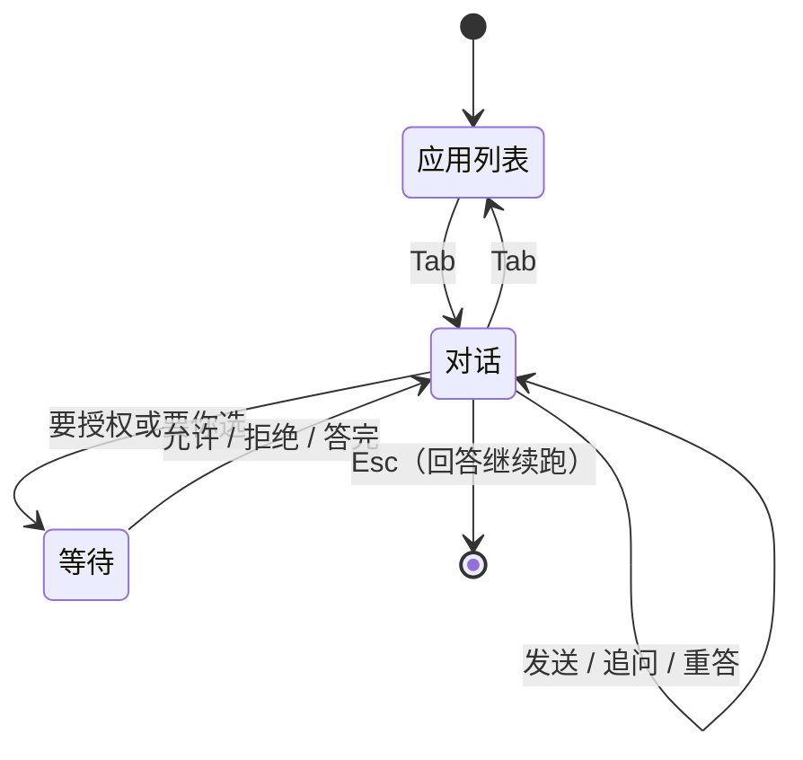

# 桌面启动器：快捷 AI 对话（设计 v0.2）

- 日期：2026-11-12
- 状态：设计，未实现
- 参考：Raycast Quick AI / AI Chat（2026-11 的官方手册）。参考的是**取舍**，不是功能清单——
  下文每处「照做」和「不照做」都写了理由。
- 关联：`TODO.md` 里那条「实时那一轮不会按记录对齐」会在本功能里被放大，先修或同时修。
- v0.2：定了 v0.1 留下的四个问题（回退键、复制按钮、标题、从应用行带上下文），
  结果已写进对应章节，不再单列。

---

## 1. 一句话

**启动器负责「问」，主窗口负责「看和改」。**

按 Tab，在启动器里就能对一个真的 Tachi 提问：它读你的工作目录、跑命令、改文件、问你，
用的是同一个 agent、同一份权限规则。当这件事长大，`⌘J` 把它整段搬进主窗口，那里有 diff、
文件树、计划——启动器里永远不做这些。

三条判断决定了下面所有的细节：

1. **这不是另一个助手。** 第二套权限、第二个模型、另一种工具集，都会让「为什么这里能做、
   那里不能」变成永久的解释负担。面板只是同一段对话的另一扇窗。
2. **面板小，所以它只承诺四件事**：问、看回答、回答它的追问、把对话交出去。
   凡是需要大面积阅读的东西（diff、文件树、计划全貌），一律给入口不给压缩版。
3. **快捷对话默认是可丢弃的。** 它不承诺被保存、被整理、被同步。想要它留下来，`⌘J`。

---

## 2. 从 Raycast 学到什么，哪里不跟

Raycast 把这件事拆成两个面：Quick AI（启动器里，Tab 进入）和 AI Chat（独立窗口、历史、
记忆、项目、常驻置顶），两者之间 `⌘J` 一整段搬过去。这个骨架是对的，我们照搬。
但它是一个生产力助手，我们是一个会动手的编码 agent，所以四处不跟：

| 点 | Raycast | 我们 | 为什么 |
|---|---|---|---|
| Tab 的语义 | 有字就**直接发送** | **带过去当草稿，不发送** | 我们的搜索框是应用匹配器，半截词（`chr`、`chr`+拼音）是常态。发出去就是一段会话加一次模型调用，还要占一次额度。多按一个回车，换掉一整类误发——而且真要问的人本来就会按回车。 |
| 对话历史 | Quick AI 与 AI Chat 合并，历史侧栏可搜 | **面板只回退最近几段（`⌘[`/`⌘]`），不设历史列表；要留存就 `⌘J`** | 它的 AI Chat 只有聊天，历史侧栏是天然的家。我们的侧栏是干活的地方，快捷对话混进去就是噪音；再做一个「快捷历史」面板，等于在启动器里造第二个产品。 |
| 权限 | Ask / **Auto** / Always Allow 三档，Auto 默认放行只读、当前目录内的改动、日常命令 | **只有一份规则（config.yaml + 目录树里的 permissions.yaml），不新增 Auto 层** | 我们已经有「按目录树贡献规则」和 ask 语义。再加一层“按范围自动放行”，就是第二套判断，而两套判断迟早会对同一条命令给出两个答案。代价是面板里会多弹几次卡——这个代价我们付。 |
| 回答的主操作 | 回车把回答**粘贴回刚才那个应用** | **只做复制** | 它的回答通常是一段话、一个命令；我们的回答经常是多段解释加文件路径，粘进聊天窗口不是任何人想要的。 |

跟它一样的：`⌘J` 搬运、`⌘N` 新对话、`⌘R` 重答、静默超时后自动开新对话、
「它想问你一件事」在两个面都常开、后台完成时通知。

---

## 3. 形态


### 3.1 一段对话的两扇窗

- 快捷对话是一段**真实会话**：同一个 agent、同一份系统提示、同一套工具、同一份权限规则、
  同样的自动召回。它不读主窗口那段对话的历史——两件事不该互相污染。
- 创建快捷对话**不许改变主窗口当前显示的那一段**。主窗口的“当前”是用户在那边工作的地方，
  启动器没有资格替它做主。
- 两边可以同时显示同一段（用户刚 `⌘J` 过、或侧栏里点开了它）。消息本来就按会话归档，
  谁在看谁就跟着更新；同一段会话不会有两个同时在跑的回合（后端本来就拦）。
- `⌘J` 是单向的：搬过去之后它就是普通会话，出现在侧栏，面板不再认它。

### 3.2 什么时候接上、什么时候新开

- 按 Tab 进入对话时，**如果上一次的快捷对话还静默未满 10 分钟，就接上它**；超过就开一段新的。
  可配 5 / 10 / 30 / 60 分钟、永不、总是新开。
- 例外永远优先于超时：**上一次还在跑，或者停在一张等你回答的卡上，就一定接上它。**
  把一段正在等你授权的对话因为“过了十分钟”而丢在后台，是最坏的一种。
- `⌘N` 立刻开新的，不等超时。
- 默认 10 分钟，因为它是“一口气”的长度：写完一段代码回来接着问，接得上；
  第二天早上再按 Tab，是新的问题。

### 3.3 会话的生命周期

| 时刻 | 发生什么 |
|---|---|
| Tab（无上文） | 建一段会话，打上「快捷」标记，工作目录 `~/workspace` |
| 关掉面板 | 对话继续跑。菜单栏和运行列表照常显示它 |
| 再按 Tab（10 分钟内） | 接上，正文和光标都在原处 |
| `⌘J` | 清掉标记 → 主窗口打开并定位到它 → 面板关闭 |
| 闲置 7 天 | 删掉。它从没承诺要留下来 |
| 被提升过 | 普通会话，按普通规则保留、参与整理 |

---

## 4. 交互

### 4.1 键位

| 键 | 应用列表 | 对话里 |
|---|---|---|
| `Tab` | 进对话，输入框里的字变成本次提问的草稿，光标在末尾 | 回应用列表（两边草稿各自保留到本次呼出结束） |
| `⏎` | 打开选中的应用 | 发送 |
| `⇧⏎` | — | 换行；输入框最多长到三行，再高就滚动 |
| `⏎`（一轮在跑时） | — | 排队，这一轮结束后发出 |
| `⌘⏎`（一轮在跑时） | — | 立刻插话（打断当前这步，把话递进去） |
| `⌘.` | — | 停止这一轮 |
| `⌘N` | — | 新对话 |
| `⌘R` | — | 重答最后一段 |
| `⌘[` / `⌘]` | — | 上一段 / 下一段快捷对话。**到头了不提示**：按了没反应，就是没有 |
| `⌘J` | — | 搬到主窗口 |
| `Esc` | 关闭面板 | **有卡在等你**：拒绝 / 跳过；否则关闭面板（对话继续跑） |

`Esc` 的两个意思靠底部提示行说清楚：那一行永远只写此刻真能按的键。

### 4.2 状态



### 4.3 边界情况

- **没有配置模型**：正文位置说清楚「没有可用的 provider」和去哪儿配，不给一个转圈。
- **`~/workspace` 不存在**：不悄悄退回家目录。说清楚路径不对、配置在哪；这一轮不开始。
- **模型报错 / 网络断**：原因原文 + 「可以重试」。`⌘R` 就是重试。
- **误发**：`⌘N` 开新的，误发的那段留在上一次里，不会污染后面的对话。
- **面板关着、它停在授权卡上**：菜单栏的「等待你的授权」照常亮；回来按 Tab 就接上那张卡。
- **主窗口开着同一段**：两边都看得到同一张卡，答了一边另一边跟着撤（现有的广播已经这么做）。

---

## 5. 界面

### 5.1 尺寸

- 应用列表保持现在的 660 × 120…460。
- 对话是 **760 宽**，以原中心横向变宽、顶边不动（`launcherTopInset` 不变）。
- 高度**按内容长**：起步约 300，内容多了向下长，上限 `min(600, 工作区高度 − 140)`。
  同一段对话里只长不缩——边读边跳比留白烦人。换一段对话或重新呼出时才回到起点。
- 短回答就是一个小面板。这一点很重要：它是启动器，不是随时摊开的工作台。

### 5.2 骨架

```
┌──────────────────────────────────────────────────────┐
│ ✦  问点什么，会用 ~/workspace 里的文件                │
├──────────────────────────────────────────────────────┤
│                                [你：这段报错什么意思] │
│  是因为 …（正文，现有 markdown 渲染，代码块横向滚动）│
│  ┌ 等你授权 · Bash ────────────────────────────────┐ │
│  │ $ go test ./...                                  │ │
│  │ 命中规则：ask · go test                          │ │
│  │   [⌘⏎ 允许一次]  [⌥⏎ 以后都允许]  [esc 拒绝]     │ │
│  └──────────────────────────────────────────────────┘ │
│  ● Bash · go test ./... · 1.2s                   ▸    │
│  ▸ 3 个文件改动  +42 −7        在主窗口看 diff        │
├──────────────────────────────────────────────────────┤
│ ⏎ 发送  ⇧⏎ 换行  ⇥ 返回应用      模型名 · ~/workspace│
└──────────────────────────────────────────────────────┘
```

### 5.3 内容怎么画

| 内容 | 画法 |
|---|---|
| 你 | 右对齐、暗底气泡、最宽 78%。**超过 10 行折叠**，给「展开」——粘一段堆栈进来是常态 |
| 回答 | 通栏、无气泡，和主窗口同一个 markdown 渲染器；代码块带复制按钮 |
| 工具 | 折成一行（名字 · 对象 · 耗时）；同一轮连续的调用合成一组「4 个调用 · 2.1s」，组里展开最多 8 行 |
| 失败的调用 | 那一行变红，永远露在外面（不进折叠组） |
| 子代理 / 后台任务 / 远端 | 一行状态，不可展开 |
| 报错 | 一行红字 + 原因原文，不加按钮（除了「重试」） |

**思考过程**：面板里不铺开。回答出现之前只占一行「正在想…」/「正在读 3 个文件…」，
`⌘J` 过去再看全文。这是 760 宽里唯一诚实的做法。

**回答下方一行小动作**：复制、在主窗口继续。复制是一个**按钮**，不是只靠 `⌘C`——
选一段回答再复制，在滚动的窄面板里很容易带上旁边的工具行；按钮复制的是模型自己的正文。
（「粘贴回刚才那个应用」不做，理由见第 2 节。）

### 5.4 四张卡

1. **授权卡**：标题（等你授权 · Bash）、等宽命令块（超过 8 行滚动）、命中规则那一句、
   三个键。**「以后都允许」是次一级的**，因为它会改文件——按 `⌥⏎` 才出现确认句
   「写进 `~/workspace/.tachi/permissions.yaml`？」。
2. **提问卡**：模型要你定一件事。数字键选、多选照常、自由输入框、答完才能提交。
3. **花费卡**（MCP 搜索预算）：一句话 + 金额 + 允许 / 拒绝，和授权卡同构。
4. **改动条**：`✎ 3 个文件 +42 −7`，最多列 5 个文件名，右边「在主窗口看 diff」。
   **面板里永远不铺开 diff。**

### 5.5 底部提示行

左边始终是「此刻能按的键」，右边始终是「凭什么相信这个回答」：模型名 · 工作目录。
两样都便宜，都值得常驻。跑着的时候左边多一个 `⌘. 停止`。

### 5.6 焦点

面板是 non-activating 的，这是它好用的前提。所有卡片都要**在键盘上答得完**，不能让用户去
点一个可能已经不在前台的窗口。

---

## 6. 权限与工具

- **工具集和主窗口完全一样**：读写文件、Bash、搜索、网页、记忆、子代理、后台任务、远端委派。
  不在启动器里删任何一样——「这里不能做的事」是用户最难记住的一类规则。
- **规则也只有一份**：`config.yaml` 里的 `permissions.*`，加上会话目录树里的
  `.tachi/permissions.yaml`。面板只是把 `ask` 的结果画成一张卡。
- **「以后都允许」写进目录树里的那份**（`~/workspace/.tachi/permissions.yaml`），不写主
  配置：范围一眼可见，删的时候知道去哪儿删，也让“这台机器上所有项目都放行”保持为一个
  需要手动做的决定。卡片上必须写清写了哪个文件、加的是哪条规则。
- **不新增 Auto 档。** Raycast 有它是因为它的工具都在云端账户上，没有“项目”这个概念；
  我们的每一条规则都有一个可以解释的位置。多弹几次卡是可接受的代价。

---

## 7. 会话与数据

- 会话记录上加一个 **Quick** 标记（和“跳过整理”同一类：一条记录上的属性，不是窗口状态）。
  它是**可见性**的来源，不是权限的来源。
- **默认不出现在**主窗口侧栏、手机会话列表。侧栏底部给一个「显示快捷对话」的开关，默认关；
  它是临时查看的动作，不是设置项。
- **正在跑的快捷对话必须到处看得见**：菜单栏、运行列表。一个在后台干活、却在所有界面都
  看不见的回合，比侧栏多一行危险得多。
- **保留 7 天**，不参与记忆整理（读记忆照常，写回整理不参与）。
- **标题沿用现有规则**：从第一句自动生成，不另起一套「快捷对话 · 时间」——它在「最近」和
  未来的侧栏开关里都要能被认出来，而「问的是哪句」就是最好的名字。
- **工作目录默认 `~/workspace`，可配**。它也是权限规则的来源树，所以面板底部一直显示它。
- **不推送手机**：快捷对话的完成不打扰手机。停在授权卡上时，现有的等待标记（菜单栏、徽章）
  已经覆盖了“有人在等你”。
- **通知只给一种情况**：面板关着、这一轮在别处结束了——菜单栏与角标足够，不弹系统通知。

---

## 8. 不做什么

1. 不做 diff、文件树、计划全貌、会话全文——只给「在主窗口看」。
2. 不做切换会话、看历史列表、管理设置和模型——它只服务这一次提问。
3. 不做 `@文件` / `#会话` 引用。要指文件就写路径；真需要选择器的时候再谈。
4. 不做把回答粘贴回上一个应用。
5. 不做第二套权限模式、第二个模型来源、另一套工具集。
6. 不做面板里的多会话标签。
7. 不做「在面板里编辑之前发过的话」——那是主窗口的能力。
8. 不做从应用列表的一行带上下文（停在 Xcode 上按 Tab → 「这个应用…」）。Tab 只带输入框里
   的字；一个“我停在哪儿”的隐式上下文，会让人分不清这次问的到底包不包括它。

---

## 9. 分期

每一期都能单独交付、单独验证；后一期不成立时，前一期仍然有用。

| 期 | 做什么 | 怎么算成了 |
|---|---|---|
| P0 | 会话基础：Quick 标记、创建/接上、**不抢主窗口当前会话**、实时事件按会话投递 | 面板能建一段会话并看到回答流式出现；主窗口显示的那段没被换掉 |
| P1 | 对话骨架：Tab、输入、正文、状态行、`⌘N`、`⌘R`、`⌘J` | 问一句、追问一句、搬进主窗口，三步都通 |
| P2 | 过程与卡片：工具组、授权卡、提问卡、花费卡、改动条 | 一条会触发授权和一次提问的任务，全程不出面板 |
| P3 | 生命周期：10 分钟超时、`⌘[`/`⌘]`、侧栏开关、7 天保留、运行中可见 | 关掉面板再回来能接上；昨天的不接 |
| P4 | 打磨：长消息折叠、失败与空状态的文案、键盘走查 | 全程不碰鼠标 |

冒烟至少要钉住四条：**Tab 不发送**、**关掉再 Tab 接上**、**`⌘J` 之后出现在侧栏**、
**授权卡能在面板里用键盘答完**。

---

## 10. 已知风险

- **实时事件漏一次，那一轮就永远缺一块**（`TODO.md`）。面板开着、主窗口不看，这种机会更多。
  P0 之前先修，或至少把“一轮结束按记录对齐”一起做掉。
- **面板和主窗口抢焦点**：卡片出现时如果面板已经隐藏，用户会以为它卡住了。现有的菜单栏
  等待标记必须对快捷会话同样生效。
- **权限弹卡频率**：不设 Auto 层，第一次用会连着弹几张。如果实际用起来无法忍受，正确的修法
  是让规则更好写（比如按命令前缀的模板），不是加一个隐形的放行档。
- **10 分钟这个数**：它是猜的。上线后看两个数字——接上的比例、误接的比例，再调。

